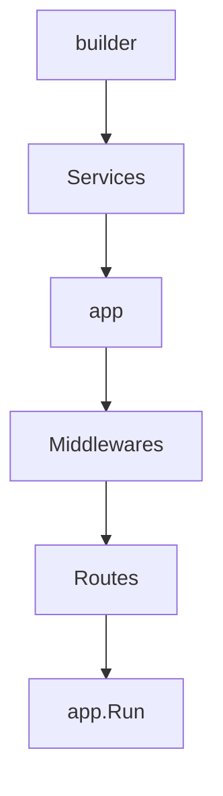

# Cours - Une API web avec ASP.NET Core

> [!abstract] Objectifs
> - Créer une API REST avec ASP.NET Core en style « API minimale »
> - Déclarer des routes qui lisent l'adresse et le corps JSON et renvoient le bon code de statut
> - Enregistrer un service et le recevoir par injection de dépendances
> - Lire la configuration (`appsettings.json`, variables d'environnement)
> - Savoir à quoi sert Entity Framework Core et comment l'API passe dans Docker

**Prérequis :** [[Cours - Lire et écrire du code .NET]] · [[API REST]] · [[Code de statut HTTP]]

## 1. ASP.NET Core, c'est un framework web
Il reçoit les requêtes HTTP, appelle ta fonction selon la méthode et l'adresse, transforme ce qu'elle renvoie en JSON. C'est l'équivalent de FastAPI dans l'API Python de MesDépenses. Voir [[Framework web]].

## 2. Schéma


## 3. Le squelette : Program.cs
```bash
dotnet new webapi -o MesDepenses.Api
```
Tout se passe dans `Program.cs`, toujours dans cet ordre :
```csharp
var builder = WebApplication.CreateBuilder(args);
// 1. j'enregistre les services (ce que mes routes pourront recevoir)
builder.Services.AddSingleton<IStockage, StockageMemoire>();

var app = builder.Build();
// 2. les middlewares (journal, HTTPS, CORS…)
// 3. les routes
app.MapGet("/depenses", (IStockage s) => s.Lister());

app.Run();
```

## 4. Les routes
`app.MapGet`, `MapPost`, `MapPut`, `MapDelete` : une méthode HTTP + une adresse → une fonction. Les paramètres de la fonction sont remplis tout seuls : depuis l'adresse (`{id:int}`), la requête (`?categorie=…`), le corps JSON (un objet), ou les services. `Results.Ok`, `Results.NotFound`, `Results.Created` choisissent le code de statut. Voir [[Endpoint]] (encadré « Comment ça s'écrit »).

> [!tip] La documentation est déjà là
> Le modèle `webapi` active une description [[OpenAPI]] de ton API. Avec un client comme Bruno ou le fichier `.http` créé dans le projet, tu peux essayer chaque route.

## 5. Les services et l'injection de dépendances
Les routes ne créent pas elles-mêmes ce dont elles ont besoin (stockage, client HTTP, horloge) : elles le **demandent** en paramètre, et le framework le fournit. On choisit l'implémentation à un seul endroit, dans `Program.cs`. Voir [[Service et injection de dépendances]].

## 6. La configuration
`appsettings.json` contient les réglages ; une **variable d'environnement** du même nom les écrase (`Api__Url` pour `Api:Url`). C'est ce qui permet la même image Docker en test et en production. `ASPNETCORE_ENVIRONMENT` dit dans quel environnement on est. Voir [[Variable d'environnement]].

## 7. Les middlewares
Chaque requête traverse une chaîne de [[Middleware|middlewares]] avant d'arriver à ta route : `app.UseHttpsRedirection()`, `app.UseCors()`, `app.UseAuthentication()`. L'**ordre** des `Use…` compte.

## 8. La base de données : Entity Framework Core
L'[[ORM]] de .NET. Une classe `DbContext` décrit les tables ; on écrit des requêtes en LINQ, EF Core les traduit en SQL ; les **migrations** font évoluer le schéma. Paquet à ajouter : `Microsoft.EntityFrameworkCore.Sqlite` (ou `Npgsql.EntityFrameworkCore.PostgreSQL`). À garder pour quand l'API marche avec un stockage en mémoire.

## 9. Dans Docker
Image en deux étapes : on **construit** avec l'image du SDK, on **exécute** avec l'image plus légère du runtime ASP.NET.
```dockerfile
FROM mcr.microsoft.com/dotnet/sdk:8.0 AS build
WORKDIR /src
COPY . .
RUN dotnet publish MesDepenses.Api -c Release -o /out

FROM mcr.microsoft.com/dotnet/aspnet:8.0
WORKDIR /app
COPY --from=build /out .
ENV ASPNETCORE_HTTP_PORTS=8080
ENTRYPOINT ["dotnet", "MesDepenses.Api.dll"]
```
Voir [[Dockerfile]] et [[dotnet publish]]. Si le réseau bloque le registre `mcr.microsoft.com` ou nuget.org, il faut passer par un miroir interne.

## Pièges
> [!warning] Erreurs fréquentes
> - Enregistrer un service **après** `builder.Build()` : trop tard, l'application est figée
> - Oublier d'enregistrer un service : `Unable to resolve service for type 'IStockage'` au premier appel
> - Renvoyer `null` au lieu de `Results.NotFound()` : le client reçoit un 200 vide (ou un 204) au lieu d'un 404
> - Écrire un mot de passe dans `appsettings.json` commité : passer par une variable d'environnement ou les « user secrets » (`dotnet user-secrets`)
> - Chercher l'API sur le port 5000 : le port est affiché au démarrage et réglé dans `Properties/launchSettings.json`

## Concepts du cours
[[Framework web]] · [[Endpoint]] · [[Service et injection de dépendances]] · [[Variable d'environnement]] · [[Middleware]] · [[ORM]] · [[OpenAPI]]
