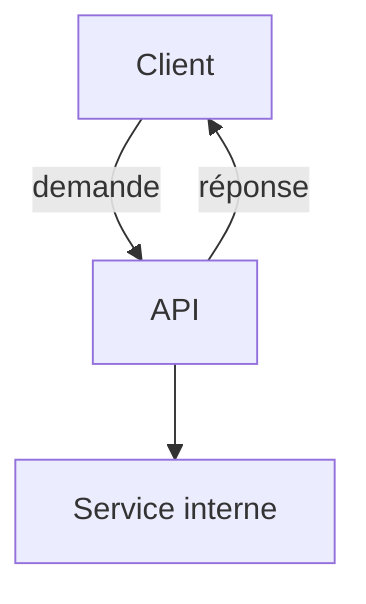
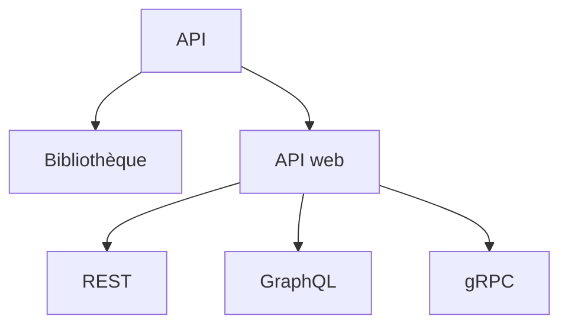

# API

> [!info] En une phrase
> Une API est un contrat qui permet à un programme d'utiliser les services d'un autre, sans connaître son code : on envoie une demande dans un format convenu, on reçoit une réponse.

```dataviewjs
await dv.view("10 — Templates/Scripts/learning", { view: "concept" })
```

## 1 · Comprendre
### Définition
**API** (*Application Programming Interface*) : l'ensemble des opérations qu'un logiciel met à disposition des autres, avec leurs entrées et leurs sorties.
- Une bibliothèque a aussi une API : les fonctions qu'elle exporte (`zipfile.ZipFile`, `fetch`).
Le **contrat** est souvent décrit dans un document [[OpenAPI]], et parfois livré sous forme de [[SDK]].

### Pourquoi ça existe
Les programmes doivent collaborer (une interface et son serveur, deux services, ton script et une API externe) sans dépendre de leurs détails internes.

### Le problème résolu
Chacun peut évoluer de son côté tant que le contrat est respecté ; on peut utiliser un service sans l'avoir écrit.

## 2 · Explorer
### Comment ça fonctionne


### Exemple concret
```bash
curl -s https://api.github.com/repos/cvat-ai/cvat | head -20
```
```python
import requests
rep = requests.get("https://cvat.exemple.com/api/tasks", headers={"Authorization": "Token …"})
print(rep.status_code, rep.json()["count"])
```
Même API, trois clients possibles : curl, Python, une interface web en React.

### Cas d'utilisation
- Un frontend qui parle à son backend
- Brancher un service tiers (paiement, carte, e-mail)

> [!warning] À ne pas confondre
> **API** (le contrat) et **serveur** (le programme qui l'implémente). Et une API web n'est pas forcément REST : il existe aussi GraphQL, gRPC, les webhooks.

### API ou API REST ?
**API** est le mot général : n'importe quelle façon convenue de demander un service à un programme. **API REST** est **une sorte** d'API web, qui suit des règles précises. Toute API REST est une API, mais toutes les API ne sont pas REST.



| | API (en général) | API REST |
| --- | --- | --- |
| C'est quoi | Un contrat entre programmes | Un style précis d'API web |
| Passe par | Appel de fonction, réseau, fichier… | [[HTTP]] uniquement |
| Organisation | Libre | Des **ressources** (`/notes/42`) + des [[Méthode HTTP\|méthodes HTTP]] |
| Exemple | `zipfile.ZipFile(...)` en Python | `GET /api/tasks/12` sur une API web |

Une API web **non REST** : `POST /api` avec `{"action": "supprimerNote", "id": 42}`. Ça marche, c'est une API, mais ce n'est pas REST (le verbe est dans le corps, pas dans la méthode HTTP).

Et [[CORS]] n'est **ni l'un ni l'autre** : c'est une règle du navigateur qui décide si une page a le droit de lire la réponse d'une API située sur une autre origine.

## 3 · Pratiquer

### Exercice visuel

Sur Excalidraw, **sans regarder la fiche**. Puis je compare avec la fiche, je corrige en rouge ce qui était faux, et j'explique mon dessin à voix haute ou à Claude dans le chat.

> [!example] 🧠 Dessine de mémoire
> Dessine une API comme un guichet : qui demande, ce qui est affiché sur le guichet (le contrat), ce qui reste caché derrière.

> [!example] 🔄 Change de contexte
> Redessine le guichet pour trois API différentes : une API web REST, une API publique comme celle de GitHub, une bibliothèque Python. Qu'est-ce qui change, qu'est-ce qui reste ?

### Mon schéma

> [!tip] Mon dessin Excalidraw
> _Je crée le dessin « Schéma - API » et je l'intègre ici avec `![[Schéma - API.excalidraw]]`, puis je coche `schema`._

### Appliquer dans le fil rouge
- Pas encore d'étape du fil rouge pour cette notion : elle sera pratiquée dans le fil rouge de son niveau (voir [[Niveaux]]).

## 4 · Relier
- **Au travail** : [[API au travail]]
- **Prérequis** : [[Client-serveur]] · [[HTTP]]
- **Complémentaires** : [[API REST]] · [[OpenAPI]] · [[SDK]] · [[CORS]]
- **Utilisé par** : [[Endpoint]]

## 5 · Réviser
> [!question] Me faire interroger
> Je demande à Claude de m'interroger sur cette notion pour vérifier que je l'ai comprise.

### Validation (compris, puis maîtrisé)
Trois cases à cocher dans les propriétés de la fiche :
- `schema` : mon dessin du concept est dans « Mon schéma » ;
- `exercice_visuel` : j'ai fait et corrigé les exercices visuels de la section 3 ;
- `fil_rouge` : je l'ai appliqué dans le fil rouge (coché tout seul quand une étape qui l'utilise est réussie).

Les trois cochées : la notion compte comme **comprise**. **Maîtrisé** : c'est moi qui le mets dans `status`, quand je le sens.

```dataviewjs
await dv.view("10 — Templates/Scripts/learning", { view: "maitrise" })
```
