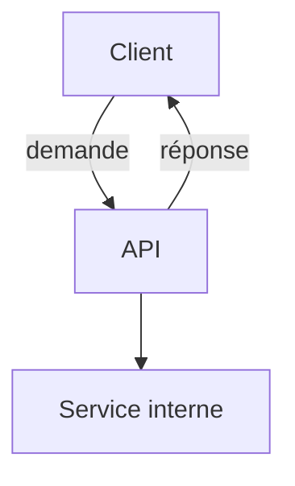

# API

> [!info] En une phrase
> Une API est un contrat qui permet à un programme d'utiliser les services d'un autre, sans connaître son code : on envoie une demande dans un format convenu, on reçoit une réponse.

```dataviewjs
await dv.view("10 — Templates/Scripts/learning", { view: "concept" })
```

## 1 · Comprendre
### Définition
**API** (*Application Programming Interface*) : l'ensemble des opérations qu'un logiciel met à disposition des autres, avec leurs entrées et leurs sorties.
- Une **API web** est appelée par le réseau, en [[HTTP]], et répond souvent en [[JSON]]. CVAT expose une API web : son interface l'utilise, ton script Python ou ta fonction Nuclio aussi.
- Une bibliothèque a aussi une API : les fonctions qu'elle exporte (`zipfile.ZipFile`, `fetch`).
Le **contrat** est souvent décrit dans un document [[OpenAPI]], et parfois livré sous forme de [[SDK]].

### Pourquoi ça existe
Les programmes doivent collaborer (une interface et son serveur, deux services, ton script et CVAT) sans dépendre de leurs détails internes.

### Le problème résolu
Chacun peut évoluer de son côté tant que le contrat est respecté ; on peut utiliser un service sans l'avoir écrit.

## 2 · Explorer
### Comment ça fonctionne


### Exemple concret
```bash
curl -s https://api.github.com/repos/cvat-ai/cvat | head -20
```
```python
import requests
rep = requests.get("https://cvat.exemple.com/api/tasks", headers={"Authorization": "Token …"})
print(rep.status_code, rep.json()["count"])
```
Même API, trois clients possibles : curl, Python, le frontend React de CVAT.

### Cas d'utilisation
- Récupérer les annotations d'une tâche CVAT
- Un frontend qui parle à son backend
- Brancher un service tiers (paiement, carte, e-mail)

> [!warning] À ne pas confondre
> **API** (le contrat) et **serveur** (le programme qui l'implémente). Et une API web n'est pas forcément REST : il existe aussi GraphQL, gRPC, les webhooks.

## 3 · Pratiquer
- Choisis une API publique (GitHub, jsonplaceholder) et appelle trois de ses endpoints avec curl

## 4 · Expliquer
> [!quote] Mon résumé, avec mes mots
> _À écrire sans regarder la fiche. Si je bloque, je ne l'ai pas encore compris._

## 5 · Relier
- **Prérequis** : [[Client-serveur]] · [[HTTP]]
- **Complémentaires** : [[API REST]] · [[OpenAPI]] · [[SDK]]
- **Utilisé par** : [[Endpoint]]

## 6 · Réviser
> [!question] Me faire interroger
> Je demande à Claude de m'interroger sur cette notion pour vérifier que je l'ai comprise.

### Validation de la maîtrise
La notion est maîtrisée quand j'ai réussi **tous les exercices** qui l'utilisent (statut `reussi` dans l'exercice).

```dataviewjs
await dv.view("10 — Templates/Scripts/learning", { view: "maitrise" })
```
