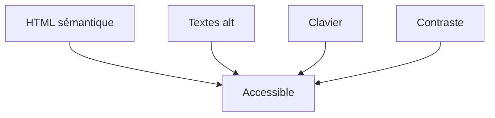

# Accessibilité web

> [!info] En une phrase
> Rendre une page utilisable par tous, y compris au clavier, avec un lecteur d'écran, avec une vue faible ou daltonien.

```dataviewjs
await dv.view("10 — Templates/Scripts/learning", { view: "concept" })
```

## 1 · Comprendre
### Définition
L'**accessibilité** (a11y) suit des règles (WCAG) : structure sémantique, textes alternatifs, contrastes suffisants, navigation au clavier, labels de formulaires. Une page bien structurée en [[HTML]] est déjà largement accessible.

### Pourquoi ça existe
Environ une personne sur cinq a un handicap, temporaire ou permanent ; c'est aussi une obligation légale pour de nombreux services.

### Le problème résolu
Des interfaces inutilisables au clavier ou avec un lecteur d'écran (boutons en `div`, images sans `alt`, gris clair sur blanc).

## 2 · Explorer
### Comment ça fonctionne


### Exemple concret
```html
<!-- Non -->
<div onclick="exporter()">Exporter</div>

<!-- Oui -->
<button type="button" onclick="exporter()">Exporter</button>

<button aria-label="Fermer"><svg aria-hidden="true">…</svg></button>
```
Vérifications rapides : naviguer avec **Tab** seulement ; outil **Lighthouse** (F12) ; un seul `h1` et des titres dans l'ordre.

### Cas d'utilisation
- Toute interface, en particulier les formulaires et les boutons à icône
- Les composants des frameworks (React, Vue, Angular) doivent rester accessibles

> [!warning] À ne pas confondre
> Ajouter des attributs `aria-*` partout et écrire du HTML correct : **la bonne balise d'abord**, ARIA seulement quand aucune balise native ne convient.

## 3 · Pratiquer

### Exercice visuel

Sur Excalidraw, **sans regarder la fiche**. Puis je compare avec la fiche, je corrige en rouge ce qui était faux, et j'explique mon dessin à voix haute ou à Claude dans le chat.

> [!example] 🛣️ Suis le trajet
> Dessine le formulaire d'ajout de dépense parcouru uniquement au clavier, puis lu par un lecteur d'écran. Marque chaque endroit où l'utilisateur peut se perdre.

> [!example] ⚖️ Avant / après
> Avant / après : un bouton fait avec une `div` et un vrai `button`. Dessine ce que le clavier et le lecteur d'écran perçoivent dans chaque cas.

### Mon schéma

> [!tip] Mon dessin Excalidraw
> _Je crée le dessin « Schéma - Accessibilité web » et je l'intègre ici avec `![[Schéma - Accessibilité web.excalidraw]]`, puis je coche `schema`._

### Appliquer dans le fil rouge
- Pas encore d'étape du fil rouge pour cette notion : elle sera pratiquée dans le fil rouge de son niveau (voir [[Niveaux]]).

## 4 · Relier
- **Prérequis** : [[HTML]]
- **Complémentaires** : [[Formulaire HTML]] · [[CSS]]

## 5 · Réviser
> [!question] Me faire interroger
> Je demande à Claude de m'interroger sur cette notion pour vérifier que je l'ai comprise.

### Validation de la maîtrise
Trois cases à cocher dans les propriétés de la fiche :
- `schema` : mon dessin du concept est dans « Mon schéma » ;
- `exercice_visuel` : j'ai fait et corrigé les exercices visuels de la section 3 ;
- `fil_rouge` : je l'ai appliqué dans le fil rouge (coché tout seul quand une étape qui l'utilise est réussie).

Les trois cochées : la notion compte comme **comprise**. **Maîtrisé** : c'est moi qui le mets dans `status`, quand je le sens.

```dataviewjs
await dv.view("10 — Templates/Scripts/learning", { view: "maitrise" })
```
