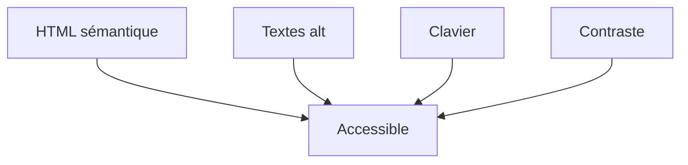

# Accessibilité web

> [!info] En une phrase
> Rendre une page utilisable par tous, y compris au clavier, avec un lecteur d'écran, avec une vue faible ou daltonien.

```dataviewjs
await dv.view("10 — Templates/Scripts/learning", { view: "concept" })
```

## 1 · Comprendre
### Définition
L'**accessibilité** (a11y) suit des règles (WCAG) : structure sémantique, textes alternatifs, contrastes suffisants, navigation au clavier, labels de formulaires. Une page bien structurée en [[HTML]] est déjà largement accessible.

### Pourquoi ça existe
Environ une personne sur cinq a un handicap, temporaire ou permanent ; c'est aussi une obligation légale pour de nombreux services.

### Le problème résolu
Des interfaces inutilisables au clavier ou avec un lecteur d'écran (boutons en `div`, images sans `alt`, gris clair sur blanc).

## 2 · Explorer
### Comment ça fonctionne


### Exemple concret
```html
<!-- Non -->
<div onclick="exporter()">Exporter</div>

<!-- Oui -->
<button type="button" onclick="exporter()">Exporter</button>

<button aria-label="Fermer"><svg aria-hidden="true">…</svg></button>
```
Vérifications rapides : naviguer avec **Tab** seulement ; outil **Lighthouse** (F12) ; un seul `h1` et des titres dans l'ordre.

### Cas d'utilisation
- Toute interface, en particulier les formulaires et les boutons à icône
- Les composants des frameworks (React, Vue, Angular) doivent rester accessibles

> [!warning] À ne pas confondre
> Ajouter des attributs `aria-*` partout et écrire du HTML correct : **la bonne balise d'abord**, ARIA seulement quand aucune balise native ne convient.

## 3 · Pratiquer
- Passe une page de ton choix dans Lighthouse (onglet Accessibilité) et corrige trois problèmes.

## 4 · Expliquer
> [!quote] Mon résumé, avec mes mots
> _À écrire sans regarder la fiche. Si je bloque, je ne l'ai pas encore compris._

## 5 · Relier
- **Prérequis** : [[HTML]]
- **Complémentaires** : [[Formulaire HTML]] · [[CSS]]

## 6 · Réviser
> [!question] Me faire interroger
> Je demande à Claude de m'interroger sur cette notion pour vérifier que je l'ai comprise.

### Validation de la maîtrise
- [ ] Je l'explique sans notes, en 3 phrases, à quelqu'un qui ne connaît pas
- [ ] J'ai réussi un exercice qui l'utilise
- [ ] Je l'ai utilisé dans un projet
- [ ] Je sais dire quand ne pas l'utiliser (ou ce qu'il ne faut pas confondre)
