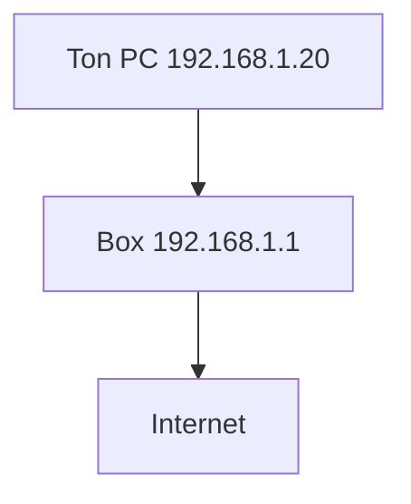

# Adresse IP

> [!info] En une phrase
> Le numéro qui identifie une machine sur un réseau, comme une adresse postale.

```dataviewjs
await dv.view("10 — Templates/Scripts/learning", { view: "concept" })
```

## 1 · Comprendre
### Définition
Une **adresse IPv4** s'écrit en 4 nombres de 0 à 255 : `192.168.1.20`. Le **masque** (`/24`) dit quelle partie désigne le réseau et quelle partie la machine : `192.168.1.0/24` = toutes les adresses `192.168.1.x`. **IPv6** (`2001:db8::1`) existe car il n'y a plus assez d'adresses IPv4.

| Adresse | Sens |
| --- | --- |
| `127.0.0.1` / `localhost` | cette machine elle-même |
| `0.0.0.0` | (pour un serveur) écouter sur toutes les interfaces |
| `10.x`, `172.16-31.x`, `192.168.x` | adresses **privées** (réseau local, conteneurs) |
| autres | adresses **publiques**, joignables sur Internet |

### Pourquoi ça existe
Pour que les paquets de données sachent à quelle machine aller.

### Le problème résolu
Sans adresse unique sur un réseau, impossible d'envoyer une donnée à une machine précise.

## 2 · Explorer
### Comment ça fonctionne

- Ta machine a souvent **plusieurs** adresses : une par interface (Wi-Fi, Ethernet, WSL, Docker).
- Chez toi, la box donne les adresses automatiquement (**DHCP**) ; les serveurs ont souvent une adresse fixe.
- Docker crée ses propres réseaux privés (`172.17.0.0/16`) : chaque conteneur y a son IP.

### Exemple concret
```bash
ip addr          # Linux / WSL : tes adresses
hostname -I      # version courte
```
```powershell
ipconfig         # Windows
```

### Cas d'utilisation
- Savoir si un service est joignable seulement en local ou depuis le réseau
- Comprendre pourquoi un serveur dans un conteneur doit écouter sur `0.0.0.0`

> [!warning] À ne pas confondre
> `localhost` dans un conteneur = **le conteneur lui-même**, pas ta machine. Et WSL a sa propre adresse, différente de celle de Windows.

## 3 · Pratiquer
- Liste tes adresses IP sous Windows et sous WSL ; repère les adresses privées et l'interface de chacune.

## 4 · Expliquer
> [!quote] Mon résumé, avec mes mots
> _À écrire sans regarder la fiche. Si je bloque, je ne l'ai pas encore compris._

## 5 · Relier
- **Prérequis** : [[Internet]]
- **Complémentaires** : [[DNS]] · [[Routage et NAT]] · [[Port]]
- **Commandes** : [[ip]] · [[ipconfig]] · [[ping]]

## 6 · Réviser
> [!question] Me faire interroger
> Je demande à Claude de m'interroger sur cette notion pour vérifier que je l'ai comprise.

### Validation de la maîtrise
- [ ] Je l'explique sans notes, en 3 phrases, à quelqu'un qui ne connaît pas
- [ ] J'ai réussi un exercice qui l'utilise
- [ ] Je l'ai utilisé dans un projet
- [ ] Je sais dire quand ne pas l'utiliser (ou ce qu'il ne faut pas confondre)
