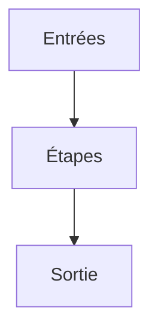

# Algorithme

> [!info] En une phrase
> Un algorithme est une suite finie d'étapes précises qui, à partir de données d'entrée, produit un résultat ; c'est la solution d'un problème, indépendamment du langage dans lequel on l'écrit.

```dataviewjs
await dv.view("10 — Templates/Scripts/learning", { view: "concept" })
```

## 1 · Comprendre
### Définition
Une recette de cuisine, un itinéraire, la méthode pour poser une division : ce sont des algorithmes. Ils ont :
- des **entrées** (les ingrédients, le nombre à diviser) ;
- des **étapes** précises, sans ambiguïté, dans un ordre défini ;
- une **sortie** (le plat, le quotient) ;
- une **fin** : on s'arrête toujours.
Avec seulement quatre briques, on écrit n'importe quel algorithme :
1. **séquence** (faire A, puis B) ;
2. **condition** (si… sinon…) ;
3. **répétition** (tant que…, pour chaque…) ;
4. **variables** (se souvenir d'une valeur).
Le **langage** (Python, JavaScript, Bash) n'est qu'une façon d'écrire l'algorithme pour la machine. Celui qui sait trouver l'algorithme apprend un nouveau langage en quelques jours ; celui qui n'a appris que la syntaxe est perdu dès que le problème change.

### Pourquoi ça existe
Un ordinateur ne sait rien deviner : il faut lui dire exactement quoi faire, étape par étape.

### Le problème résolu
Transformer un problème flou (« trier les fichiers ») en une méthode qui marche à tous les coups, pour toutes les entrées possibles.

## 2 · Explorer
### Comment ça fonctionne


### Exemple concret
Problème : trouver le plus gros fichier d'un dossier.
```
entrée : une liste de fichiers avec leur taille
plus_gros ← aucun
pour chaque fichier f de la liste :
    si plus_gros est aucun ou f.taille > plus_gros.taille :
        plus_gros ← f
sortie : plus_gros
```
Le même algorithme en Python :
```python
def plus_gros(fichiers):
    meilleur = None
    for f in fichiers:
        if meilleur is None or f.taille > meilleur.taille:
            meilleur = f
    return meilleur
```
Et en JavaScript, en Bash… l'idée reste la même.

### Cas d'utilisation
- Tout programme que tu écris
- Résoudre un exercice ou un bug
- Les entretiens techniques

> [!warning] À ne pas confondre
> Un **algorithme** (la méthode) n'est pas un **programme** (la méthode écrite dans un langage précis). Et « ça marche sur mon exemple » ne veut pas dire que l'algorithme est juste : il doit marcher pour **toutes** les entrées, y compris vides ou bizarres.

## 3 · Pratiquer
- Écris en français, étape par étape, l'algorithme pour ranger un paquet de cartes dans l'ordre, puis fais-le exécuter à la lettre par quelqu'un

## 4 · Expliquer
> [!quote] Mon résumé, avec mes mots
> _À écrire sans regarder la fiche. Si je bloque, je ne l'ai pas encore compris._

## 5 · Relier
- **Prérequis** : [[Condition (if)]] · [[Boucle (for, while)]]
- **Complémentaires** : [[Décomposer un problème]] · [[Pseudo-code et trace d'exécution]]
- **Utilisé par** : [[Complexité (notation grand O)]]

## 6 · Réviser
> [!question] Me faire interroger
> Je demande à Claude de m'interroger sur cette notion pour vérifier que je l'ai comprise.

### Validation de la maîtrise
La notion est maîtrisée quand j'ai réussi **tous les exercices** qui l'utilisent (statut `reussi` dans l'exercice).

```dataviewjs
await dv.view("10 — Templates/Scripts/learning", { view: "maitrise" })
```
