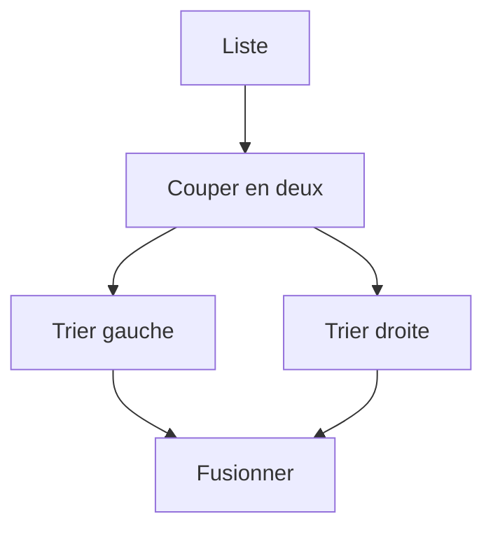

# Algorithmes de tri

> [!info] En une phrase
> Trier, c'est ranger des éléments selon un ordre ; les tris simples (sélection, insertion) sont en O(n²), les tris efficaces (fusion, rapide, et celui de Python) en O(n log n).

```dataviewjs
await dv.view("10 — Templates/Scripts/learning", { view: "concept" })
```

## 1 · Comprendre
### Définition
| Tri | Idée | Complexité |
| --- | --- | --- |
| **Sélection** | chercher le plus petit, le mettre en premier, recommencer sur le reste | O(n²) |
| **Insertion** | prendre chaque élément et l'insérer à sa place dans la partie déjà triée (comme des cartes en main) | O(n²), rapide si presque trié |
| **Fusion** (*merge sort*) | couper en deux, trier chaque moitié (récursivement), fusionner deux listes triées | O(n log n) |
| **Rapide** (*quicksort*) | choisir un pivot, mettre les petits à gauche et les grands à droite, recommencer de chaque côté | O(n log n) en moyenne |
Dans la vraie vie, on utilise le tri du langage (`sorted`, `list.sort`, `Array.prototype.sort`, `ORDER BY`), très optimisé (Timsort en Python). Écrire un tri soi-même sert à **comprendre** les idées : comparer, diviser pour régner, récursivité.
Ce qu'il faut savoir faire au quotidien : trier selon une **clé** et dans les deux sens.

### Pourquoi ça existe
Les données triées sont plus faciles à chercher, à afficher, à comparer et à dédoublonner.

### Le problème résolu
Apprendre les grandes stratégies de résolution (essayer, insérer, diviser pour régner) à travers un problème simple.

## 2 · Explorer
### Comment ça fonctionne


### Exemple concret
```python
def tri_insertion(l):
    l = l[:]                          # ne pas modifier l'original
    for i in range(1, len(l)):
        x, j = l[i], i - 1
        while j >= 0 and l[j] > x:
            l[j + 1] = l[j]
            j -= 1
        l[j + 1] = x
    return l

def tri_fusion(l):
    if len(l) <= 1:
        return l
    m = len(l) // 2
    a, b = tri_fusion(l[:m]), tri_fusion(l[m:])
    res, i, j = [], 0, 0
    while i < len(a) and j < len(b):
        if a[i] <= b[j]: res.append(a[i]); i += 1
        else:            res.append(b[j]); j += 1
    return res + a[i:] + b[j:]

# au quotidien
fichiers.sort(key=lambda f: f.stat().st_size, reverse=True)       # du plus gros au plus petit
taches = sorted(taches, key=lambda t: (t["statut"], t["nom"]))     # par statut puis par nom
```

### Cas d'utilisation
- Afficher des listes ordonnées
- Préparer une recherche dichotomique
- Comprendre « diviser pour régner »

> [!warning] À ne pas confondre
> En JavaScript, `[10, 9, 1].sort()` trie comme du **texte** (`[1, 10, 9]`) : passe une fonction `(a, b) => a - b`. Et `list.sort()` modifie la liste et renvoie `None`, alors que `sorted()` renvoie une nouvelle liste.

## 3 · Pratiquer
- Écris le tri par insertion, trace-le à la main sur `[5, 2, 4, 1]`, puis compare son temps avec `sorted` sur 10 000 nombres

## 4 · Expliquer
> [!quote] Mon résumé, avec mes mots
> _À écrire sans regarder la fiche. Si je bloque, je ne l'ai pas encore compris._

## 5 · Relier
- **Prérequis** : [[Complexité (notation grand O)]] · [[Motifs de boucle]]
- **Complémentaires** : [[Récursivité]]

## 6 · Réviser
> [!question] Me faire interroger
> Je demande à Claude de m'interroger sur cette notion pour vérifier que je l'ai comprise.

### Validation de la maîtrise
La notion est maîtrisée quand j'ai réussi **tous les exercices** qui l'utilisent (statut `reussi` dans l'exercice).

```dataviewjs
await dv.view("10 — Templates/Scripts/learning", { view: "maitrise" })
```
