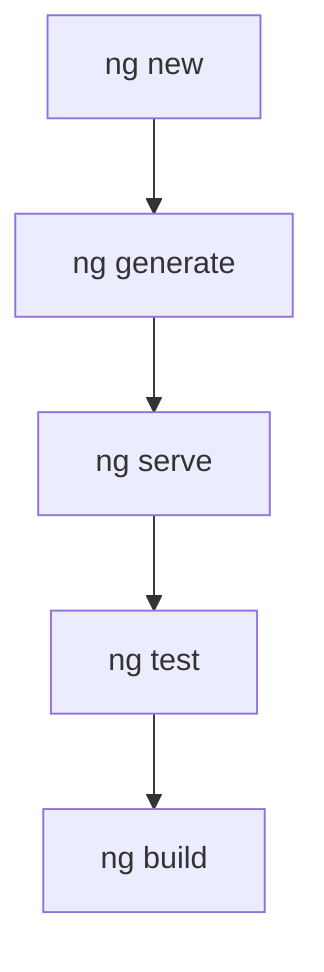

# Angular CLI

> [!info] En une phrase
> L'Angular CLI (commande ng) crée un projet, génère composants et services, lance le serveur de développement, les tests et le build de production.

```dataviewjs
await dv.view("10 — Templates/Scripts/learning", { view: "concept" })
```

## 1 · Comprendre
### Définition
| Commande | Rôle |
| --- | --- |
| `ng new nom` | crée un projet |
| `ng serve` | serveur de développement (port 4200) |
| `ng generate component x` (`ng g c x`) | génère un composant |
| `ng g service x` / `ng g guard x` / `ng g pipe x` | génère un service, une garde, un pipe |
| `ng build` | build de production dans `dist/` |
| `ng test` | tests unitaires |
| `ng lint` | vérification du style (si configuré) |
| `ng add @angular/material` | ajoute et configure une bibliothèque |
| `ng update` | met à jour Angular et migre le code |
La configuration est dans **`angular.json`**. Les environnements (URL de l'API…) dans `src/environments/` ou via des variables au build.

### Pourquoi ça existe
Un projet Angular a beaucoup de fichiers et de conventions ; les écrire à la main serait long et source d'erreurs.

### Le problème résolu
Des projets homogènes, des mises à jour de version assistées, et un build optimisé sans configuration.

## 2 · Explorer
### Comment ça fonctionne


### Exemple concret
```bash
ng new taches --routing --style=css
cd taches
ng g c pages/liste-taches
ng g s services/taches
ng serve --open
ng build                   # dist/taches/browser/
```
Sans installation globale : `npx -p @angular/cli ng new taches`, puis `npx ng …` dans le projet.

### Cas d'utilisation
- Tous les jours dans un projet Angular
- Le build dans une pipeline CI
- Les montées de version

> [!warning] À ne pas confondre
> Une version **globale** du CLI différente de celle du projet : dans un projet, `npx ng` utilise la version du projet.

## 3 · Pratiquer

### Exercice visuel

Sur Excalidraw, **sans regarder la fiche**. Puis je compare avec la fiche, je corrige en rouge ce qui était faux, et j'explique mon dessin avec mes mots (section 4).

> [!example] 🛣️ Suis le trajet
> Dessine ce qui sort de `ng new`, `ng generate component`, `ng serve` et `ng build`. Pour chaque commande, ce qu'elle crée ou lance.

> [!example] ⚖️ Avant / après
> Avant / après : créer un composant à la main, puis avec `ng generate`. Dessine les fichiers créés et ce qui est modifié en plus.

### Mon schéma

> [!tip] Mon dessin Excalidraw
> _Je crée le dessin « Schéma - Angular CLI » et je l'intègre ici avec `![[Schéma - Angular CLI.excalidraw]]`._

### Appliquer dans le fil rouge
- [[MesDépenses 10 - Angular, afficher la liste]]

## 4 · Expliquer
> [!quote] Mon résumé, avec mes mots
> _J'explique mon schéma avec mes mots, sans regarder la fiche. Si je bloque, je ne l'ai pas encore compris._

## 5 · Relier
- **Prérequis** : [[Angular]] · [[npm]]
- **Complémentaires** : [[Outil de build front (Vite)]]

## 6 · Réviser
> [!question] Me faire interroger
> Je demande à Claude de m'interroger sur cette notion pour vérifier que je l'ai comprise.

### Validation de la maîtrise
La notion est maîtrisée quand je sais :
1. **l'expliquer** de façon fluide, à partir de mon schéma (section 4) ;
2. **l'adapter** à un autre contexte (consigne « Change de contexte », ou Claude m'interroge sur un autre cas) ;
3. **l'appliquer** pour de vrai dans le fil rouge (section 3).

Réussir un exercice ne suffit pas. C'est moi qui passe le statut en `maitrise`.

```dataviewjs
await dv.view("10 — Templates/Scripts/learning", { view: "maitrise" })
```
