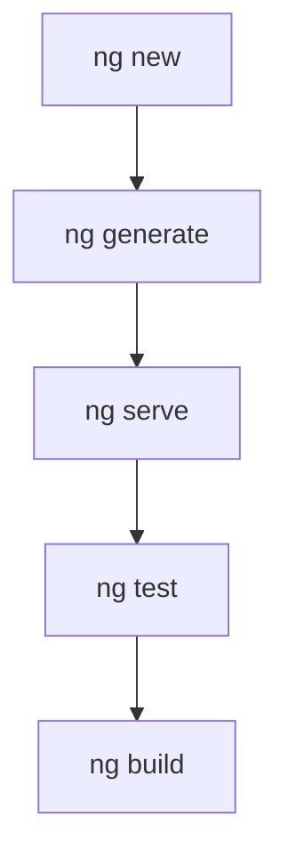

# Angular CLI

> [!info] En une phrase
> L'Angular CLI (commande ng) crée un projet, génère composants et services, lance le serveur de développement, les tests et le build de production.

```dataviewjs
await dv.view("10 — Templates/Scripts/learning", { view: "concept" })
```

## 1 · Comprendre
### Définition
| Commande | Rôle |
| --- | --- |
| `ng new nom` | crée un projet |
| `ng serve` | serveur de développement (port 4200) |
| `ng generate component x` (`ng g c x`) | génère un composant |
| `ng g service x` / `ng g guard x` / `ng g pipe x` | génère un service, une garde, un pipe |
| `ng build` | build de production dans `dist/` |
| `ng test` | tests unitaires |
| `ng lint` | vérification du style (si configuré) |
| `ng add @angular/material` | ajoute et configure une bibliothèque |
| `ng update` | met à jour Angular et migre le code |
La configuration est dans **`angular.json`**. Les environnements (URL de l'API…) dans `src/environments/` ou via des variables au build.

### Pourquoi ça existe
Un projet Angular a beaucoup de fichiers et de conventions ; les écrire à la main serait long et source d'erreurs.

### Le problème résolu
Des projets homogènes, des mises à jour de version assistées, et un build optimisé sans configuration.

## 2 · Explorer
### Comment ça fonctionne


### Exemple concret
```bash
ng new taches --routing --style=css
cd taches
ng g c pages/liste-taches
ng g s services/taches
ng serve --open
ng build                   # dist/taches/browser/
```
Sans installation globale : `npx -p @angular/cli ng new taches`, puis `npx ng …` dans le projet.

### Cas d'utilisation
- Tous les jours dans un projet Angular
- Le build dans une pipeline CI
- Les montées de version

> [!warning] À ne pas confondre
> Une version **globale** du CLI différente de celle du projet : dans un projet, `npx ng` utilise la version du projet.

## 3 · Pratiquer
- Génère un projet, deux composants, un service et une garde, puis construis-le et regarde `dist/`

## 4 · Expliquer
> [!quote] Mon résumé, avec mes mots
> _À écrire sans regarder la fiche. Si je bloque, je ne l'ai pas encore compris._

## 5 · Relier
- **Prérequis** : [[Angular]] · [[npm]]
- **Complémentaires** : [[Outil de build front (Vite)]]

## 6 · Réviser
> [!question] Me faire interroger
> Je demande à Claude de m'interroger sur cette notion pour vérifier que je l'ai comprise.

### Validation de la maîtrise
La notion est maîtrisée quand j'ai réussi **tous les exercices** qui l'utilisent (statut `reussi` dans l'exercice).

```dataviewjs
await dv.view("10 — Templates/Scripts/learning", { view: "maitrise" })
```
