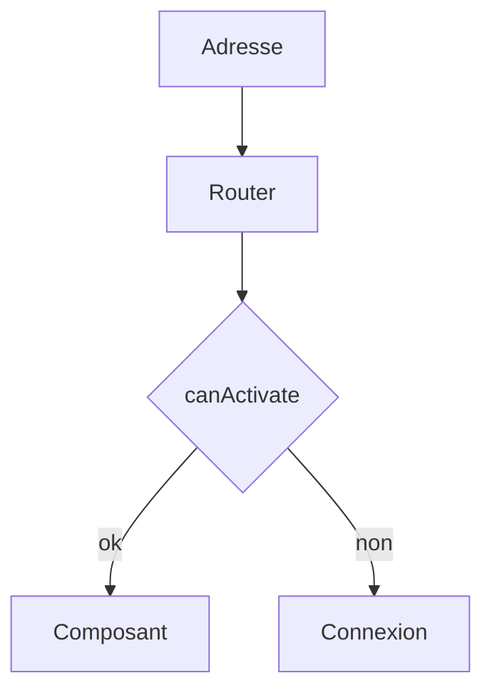

# Angular Router

> [!info] En une phrase
> Le routeur d'Angular associe des adresses à des composants, avec paramètres, chargement à la demande et gardes qui contrôlent l'accès aux pages.

```dataviewjs
await dv.view("10 — Templates/Scripts/learning", { view: "concept" })
```

## 1 · Comprendre
### Définition
```ts
// app.routes.ts
export const routes: Routes = [
  { path: "", component: AccueilComponent },
  { path: "taches", component: ListeTachesComponent },
  { path: "taches/:id", component: DetailTacheComponent },
  { path: "admin", loadComponent: () => import("./admin/admin.component").then((m) => m.AdminComponent),
    canActivate: [authGuard] },
  { path: "**", component: IntrouvableComponent },
];
export const authGuard: CanActivateFn = () =>
  inject(AuthService).connecte() ? true : inject(Router).parseUrl("/connexion");
```
- `<router-outlet />` : là où s'affiche la page ; `<a routerLink="/taches">` pour naviguer.
- Lire un paramètre : `inject(ActivatedRoute).snapshot.paramMap.get("id")`, ou avec `withComponentInputBinding()` une simple entrée `id = input<string>()`.
- `loadComponent` : la page est téléchargée seulement à la première visite.

### Pourquoi ça existe
Une application Angular a de nombreux écrans, dont certains réservés.

### Le problème résolu
Navigation instantanée, adresses partageables, chargement à la demande et redirection des utilisateurs non connectés.

## 2 · Explorer
### Comment ça fonctionne


### Exemple concret
```html
<nav><a routerLink="/" routerLinkActive="actif">Accueil</a> <a routerLink="/taches">Tâches</a></nav>
<router-outlet />
```
Même règle que toute [[Application monopage et routage|SPA]] : le serveur renvoie `index.html` pour toutes les adresses.

### Cas d'utilisation
- Toute application Angular
- Espaces d'administration

> [!warning] À ne pas confondre
> Une garde protège l'**interface**, pas les **données** : l'API doit vérifier l'autorisation elle-même.

## 3 · Pratiquer
- Ajoute une route avec paramètre, une route chargée à la demande et une garde à une application Angular

## 4 · Expliquer
> [!quote] Mon résumé, avec mes mots
> _À écrire sans regarder la fiche. Si je bloque, je ne l'ai pas encore compris._

## 5 · Relier
- **Prérequis** : [[Application monopage et routage]] · [[Composant Angular]]
- **Complémentaires** : [[Vue Router]]

## 6 · Réviser
> [!question] Me faire interroger
> Je demande à Claude de m'interroger sur cette notion pour vérifier que je l'ai comprise.

### Validation de la maîtrise
La notion est maîtrisée quand j'ai réussi **tous les exercices** qui l'utilisent (statut `reussi` dans l'exercice).

```dataviewjs
await dv.view("10 — Templates/Scripts/learning", { view: "maitrise" })
```
