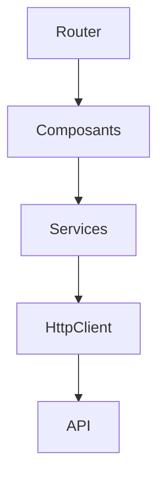

# Angular

> [!info] En une phrase
> Angular est un framework complet de Google pour construire de grandes applications web en TypeScript : composants, routeur, formulaires, appels HTTP, tests et outil en ligne de commande sont fournis.

```dataviewjs
await dv.view("10 — Templates/Scripts/learning", { view: "concept" })
```

## 1 · Comprendre
### Définition
Là où [[React]] n'est qu'une bibliothèque d'affichage, **Angular fournit tout** et impose une structure :
- des [[Composant d'interface|composants]] (classe TypeScript + template HTML + style) ;
- des [[Service et injection de dépendances|services]] injectés pour la logique et les appels d'API ;
- [[Observable et RxJS|RxJS]] pour l'asynchrone ;
- un routeur, des formulaires, un client HTTP, des tests ;
- l'[[Angular CLI]] (`ng`) pour créer, générer, lancer et construire.
Toujours en **TypeScript**. Une nouvelle version majeure tous les six mois ; les versions récentes (17+) utilisent les **composants autonomes** (*standalone*), les **signals** et la nouvelle syntaxe `@if` / `@for`.

### Pourquoi ça existe
Les grandes équipes veulent un cadre unique et complet, où chaque projet est organisé pareil.

### Le problème résolu
Moins de choix à faire, une structure commune, des outils intégrés : adapté aux grosses applications d'entreprise.

## 2 · Explorer
### Comment ça fonctionne


### Exemple concret
```bash
npm install -g @angular/cli
ng new taches --style=css --ssr=false
cd taches && ng serve          # http://localhost:4200
```
```ts
@Component({
  selector: "app-compteur",
  standalone: true,
  template: `<button (click)="n.set(n() + 1)">Cliqué {{ n() }} fois</button>`,
})
export class CompteurComponent { n = signal(0); }
```

### Cas d'utilisation
- Applications d'entreprise (banques, administrations, industrie)
- Grands back-offices
- Projets où l'équipe change souvent

> [!warning] À ne pas confondre
> **AngularJS** (version 1, 2010, abandonnée) et **Angular** (2016 et après, réécrit en TypeScript) : deux frameworks différents. Méfie-toi des tutoriels avec `$scope` ou `ng-controller`.

## 3 · Pratiquer

### Exercice visuel

Sur Excalidraw, **sans regarder la fiche**. Puis je compare avec la fiche, je corrige en rouge ce qui était faux, et j'explique mon dessin à voix haute ou à Claude dans le chat.

> [!example] 🧠 Dessine de mémoire
> Dessine les pièces d'une appli Angular : composants, services, routeur, injection. Relie-les pour le front de ton application.

> [!example] ⚖️ Avant / après
> Avant / après : le front de ton application en Vue, puis en Angular. Dessine ce qu'Angular impose en plus (TypeScript, services, modules).

### Mon schéma

> [!tip] Mon dessin Excalidraw
> _Je crée le dessin « Schéma - Angular » et je l'intègre ici avec `![[Schéma - Angular.excalidraw]]`, puis je coche `schema`._

### Appliquer dans le fil rouge
- [[MesDépenses 10 - Angular, afficher la liste]]

## 4 · Relier
- **Prérequis** : [[TypeScript]] · [[HTML]] · [[Module et import]]
- **Complémentaires** : [[React]] · [[Vue.js]]
- **Utilisé par** : [[Composant d'interface]]

## 5 · Réviser
> [!question] Me faire interroger
> Je demande à Claude de m'interroger sur cette notion pour vérifier que je l'ai comprise.

### Validation (compris, puis maîtrisé)
Trois cases à cocher dans les propriétés de la fiche :
- `schema` : mon dessin du concept est dans « Mon schéma » ;
- `exercice_visuel` : j'ai fait et corrigé les exercices visuels de la section 3 ;
- `fil_rouge` : je l'ai appliqué dans le fil rouge (coché tout seul quand une étape qui l'utilise est réussie).

Les trois cochées : la notion compte comme **comprise**. **Maîtrisé** : c'est moi qui le mets dans `status`, quand je le sens.

```dataviewjs
await dv.view("10 — Templates/Scripts/learning", { view: "maitrise" })
```
