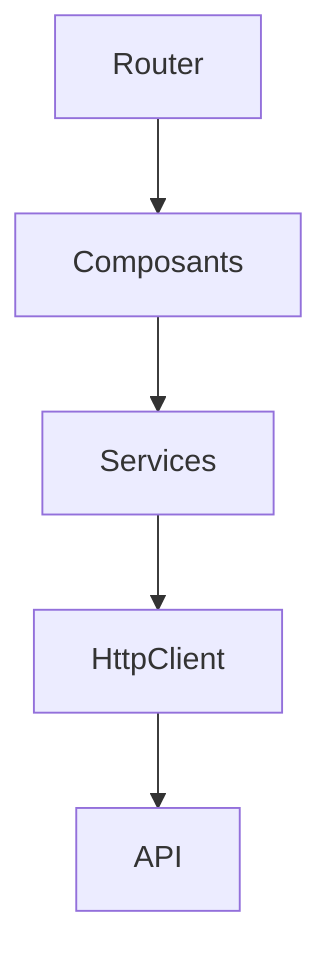

# Angular

> [!info] En une phrase
> Angular est un framework complet de Google pour construire de grandes applications web en TypeScript : composants, routeur, formulaires, appels HTTP, tests et outil en ligne de commande sont fournis.

```dataviewjs
await dv.view("10 — Templates/Scripts/learning", { view: "concept" })
```

## 1 · Comprendre
### Définition
Là où [[React]] n'est qu'une bibliothèque d'affichage, **Angular fournit tout** et impose une structure :
- des [[Composant Angular|composants]] (classe TypeScript + template HTML + style) ;
- des [[Service et injection de dépendances|services]] injectés pour la logique et les appels d'API ;
- [[Observable et RxJS|RxJS]] pour l'asynchrone ;
- un routeur, des formulaires, un client HTTP, des tests ;
- l'[[Angular CLI]] (`ng`) pour créer, générer, lancer et construire.
Toujours en **TypeScript**. Une nouvelle version majeure tous les six mois ; les versions récentes (17+) utilisent les **composants autonomes** (*standalone*), les **signals** et la nouvelle syntaxe `@if` / `@for`.

### Pourquoi ça existe
Les grandes équipes veulent un cadre unique et complet, où chaque projet est organisé pareil.

### Le problème résolu
Moins de choix à faire, une structure commune, des outils intégrés : adapté aux grosses applications d'entreprise.

## 2 · Explorer
### Comment ça fonctionne


### Exemple concret
```bash
npm install -g @angular/cli
ng new taches --style=css --ssr=false
cd taches && ng serve          # http://localhost:4200
```
```ts
@Component({
  selector: "app-compteur",
  standalone: true,
  template: `<button (click)="n.set(n() + 1)">Cliqué {{ n() }} fois</button>`,
})
export class CompteurComponent { n = signal(0); }
```

### Cas d'utilisation
- Applications d'entreprise (banques, administrations, industrie)
- Grands back-offices
- Projets où l'équipe change souvent

> [!warning] À ne pas confondre
> **AngularJS** (version 1, 2010, abandonnée) et **Angular** (2016 et après, réécrit en TypeScript) : deux frameworks différents. Méfie-toi des tutoriels avec `$scope` ou `ng-controller`.

## 3 · Pratiquer
- Crée un projet avec `ng new`, lance `ng serve` et repère `src/app`, `app.config.ts`, `app.routes.ts`

## 4 · Expliquer
> [!quote] Mon résumé, avec mes mots
> _À écrire sans regarder la fiche. Si je bloque, je ne l'ai pas encore compris._

## 5 · Relier
- **Prérequis** : [[TypeScript]] · [[HTML]] · [[Module JavaScript (import et export)]]
- **Complémentaires** : [[React]] · [[Vue.js]]
- **Utilisé par** : [[Composant Angular]]

## 6 · Réviser
> [!question] Me faire interroger
> Je demande à Claude de m'interroger sur cette notion pour vérifier que je l'ai comprise.

### Validation de la maîtrise
La notion est maîtrisée quand j'ai réussi **tous les exercices** qui l'utilisent (statut `reussi` dans l'exercice).

```dataviewjs
await dv.view("10 — Templates/Scripts/learning", { view: "maitrise" })
```
