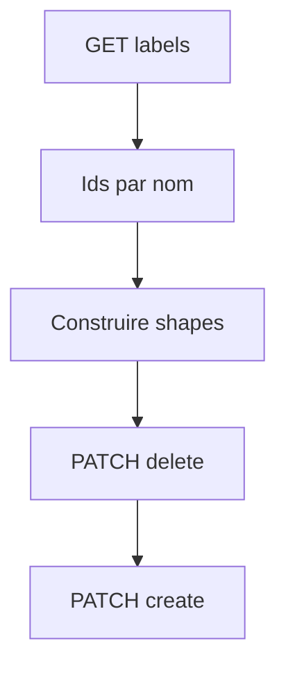

# Annotations dans l'API CVAT

> [!info] En une phrase
> Dans l'API, les annotations d'un job sont un JSON avec trois listes, `shapes`, `tags` et `tracks`, où chaque forme désigne son label et ses attributs par des numéros.

```dataviewjs
await dv.view("10 — Templates/Scripts/learning", { view: "concept" })
```

## 1 · Comprendre
### Définition
`GET /api/jobs/{id}/annotations` renvoie (et `PATCH` / `PUT` reçoivent) :
```json
{"shapes": [...], "tags": [...], "tracks": []}
```
- **shape** : une forme sur une image (une frame) ;
- **tag** : une étiquette sur toute une image, sans géométrie ;
- **track** : un objet suivi sur plusieurs frames (vidéo). Pas utile pour des plans.

### Pourquoi ça existe
- Lire et modifier les annotations par programme, forme par forme, sans passer par un fichier d'export.

### Le problème résolu
- Corriger ou remplacer une partie des annotations (un folio, un label) sans toucher au reste du job.

## 2 · Explorer
### Comment ça fonctionne


### Exemple concret
Une forme :
```json
{
  "type": "polyline",
  "frame": 0,
  "label_id": 2,
  "points": [100.0, 400.0, 300.0, 284.53],
  "attributes": [{"spec_id": 3, "value": "true"}],
  "occluded": false,
  "z_order": 0,
  "source": "manual"
}
```
- `label_id` et `spec_id` viennent de `GET /api/labels?job_id={id}`.
- `points` est toujours une **liste plate** de nombres.
- `value` est toujours du **texte**.

| `action` du `PATCH` | Effet |
| --- | --- |
| `create` | ajoute les formes envoyées |
| `update` | modifie les formes envoyées (avec leur `id`) |
| `delete` | supprime les formes envoyées (avec leur `id`) |
| `PUT` (sans action) | remplace **tout** le job |

### Les `points` selon le type
| `type` | `points` |
| --- | --- |
| `rectangle` | `[xtl, ytl, xbr, ybr]`, plus `"rotation"` en degrés si besoin |
| `polygon`, `polyline`, `points` | `[x1, y1, x2, y2, ...]` |
| `ellipse` | `[cx, cy, cx + rx, cy - ry]` : le centre, puis un point qui donne les deux rayons |
| `cuboid` | 16 nombres : coins haut-gauche, bas-gauche, haut-droite, bas-droite de la face avant, puis de la face arrière |
| `mask` | les nombres du RLE, puis `[left, top, right, bottom]` du rectangle qui contient le masque |
| `skeleton` | `[]` : la géométrie est dans `"elements"`, une liste de formes `points` (une par articulation, chacune avec le `label_id` de son sous-label et `"outside"`) |

Un **tag** va dans `"tags"`, pas dans `"shapes"` : `{"frame": 0, "label_id": 9, "source": "manual", "attributes": []}`.

### Cas d'utilisation
- Réannoter un folio à partir d'un calcul : [[Projet - Réannoter un job CVAT depuis le graphe]].

> [!warning] À ne pas confondre
> - Le `type` d'un rectangle est `rectangle` dans l'API, mais la balise s'appelle `<box>` dans le XML.
> - `label_id` (l'id du label) et `spec_id` (l'id d'un **attribut** de ce label) : deux numérotations différentes.
> - Les ids sont propres à chaque serveur : un script qui les écrit en dur casse sur un autre CVAT.

## 3 · Pratiquer

### Exercice visuel

Sur Excalidraw, **sans regarder la fiche**. Puis je compare avec la fiche, je corrige en rouge ce qui était faux, et j'explique mon dessin avec mes mots (section 4).

> [!example] 🧠 Dessine de mémoire
> Dessine le JSON des annotations d'un job comme un arbre : `shapes`, `tags`, `tracks`, puis une shape avec ses champs (type, label_id, points, frame).

> [!example] 🛣️ Suis le trajet
> Suis un tuyau du graphe jusqu'à CVAT : `pipe_edges` du JSON, la shape construite, le PATCH `action=create`, l'affichage dans le job.

### Mon schéma

> [!tip] Mon dessin Excalidraw
> _Je crée le dessin « Schéma - Annotations dans l'API CVAT » et je l'intègre ici avec `![[Schéma - Annotations dans l'API CVAT.excalidraw]]`._

### Appliquer dans le fil rouge
- [[Réannoter 02 - Envoyer le premier tuyau]]
- [[Réannoter 04 - Tous les tuyaux et leurs attributs]]
- [[Réannoter 05 - Les lignes de cote et les étiquettes]]
- [[Réannoter 06 - Remplacer au lieu d'ajouter]]
- [[Réannoter 07 - Les étiquettes tournées]]

Pour m'aider :
- [[Projet - Réannoter un job CVAT depuis le graphe]]

## 4 · Expliquer
> [!quote] Mon résumé, avec mes mots
> _J'explique mon schéma avec mes mots, sans regarder la fiche. Si je bloque, je ne l'ai pas encore compris._

## 5 · Relier
- **Prérequis** : [[JSON]], [[Appeler une API HTTP (requests)]]
- **Notion parente** :
- **Complémentaires** : [[Format CVAT for images 1.1]], [[SDK]]
- **Utilisé par** :
- **Commandes** :

## 6 · Réviser
> [!question] Me faire interroger
> Je demande à Claude de m'interroger sur cette notion pour vérifier que je l'ai comprise.

### Validation de la maîtrise
La notion est maîtrisée quand je sais :
1. **l'expliquer** de façon fluide, à partir de mon schéma (section 4) ;
2. **l'adapter** à un autre contexte (consigne « Change de contexte », ou Claude m'interroge sur un autre cas) ;
3. **l'appliquer** pour de vrai dans le fil rouge (section 3).

Réussir un exercice ne suffit pas. C'est moi qui passe le statut en `maitrise`.

```dataviewjs
await dv.view("10 — Templates/Scripts/learning", { view: "maitrise" })
```
