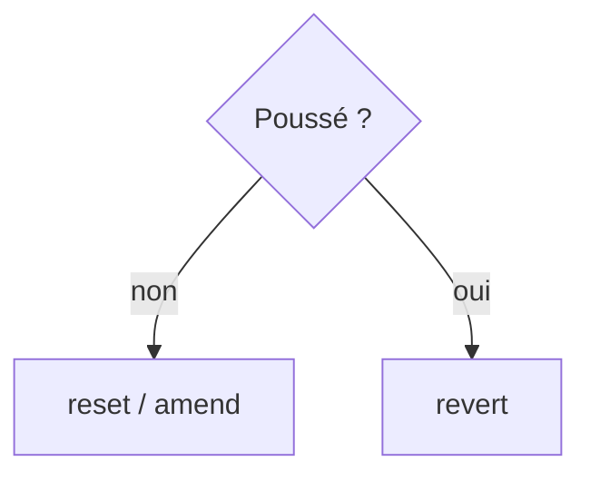

# Annuler dans Git

> [!info] En une phrase
> Selon ce qu'on veut défaire (un fichier modifié, un git add, un commit local, un commit déjà poussé), on utilise restore, reset ou revert.

```dataviewjs
await dv.view("10 — Templates/Scripts/learning", { view: "concept" })
```

## 1 · Comprendre
### Définition
| Je veux annuler… | Commande | Danger |
| --- | --- | --- |
| les modifications d'un fichier (non indexées) | `git restore fichier` | perd ces modifications |
| un `git add` | `git restore --staged fichier` | aucun |
| le dernier commit, en gardant les changements | `git reset --soft HEAD~1` | aucun (local) |
| le dernier commit et ses changements | `git reset --hard HEAD~1` | **perd le travail** |
| un commit **déjà poussé** | `git revert <hash>` | aucun : crée un commit inverse |
| le message du dernier commit (pas encore poussé) | `git commit --amend` | réécrit l'historique |

### Pourquoi ça existe
Se tromper fait partie du travail ; Git permet presque toujours de revenir en arrière.

### Le problème résolu
Supprimer et recloner le dépôt au moindre faux pas.

## 2 · Explorer
### Comment ça fonctionne

Règle : **ne réécris jamais un historique déjà partagé** (reset, amend, rebase) ; utilise `revert`.

### Exemple concret
```bash
git restore zipper.py                 # revenir à la version du dernier commit
git reset --soft HEAD~1               # défaire le commit, garder les fichiers indexés
git revert a1b2c3d                    # annuler proprement un commit poussé
git reflog                            # le filet de sécurité : tout ce que HEAD a pointé
git reset --hard HEAD@{2}             # revenir à un état d'avant (à manier avec soin)
```

### Cas d'utilisation
- Un fichier cassé par erreur
- Un commit poussé qui fait échouer la CI : `revert` puis correction propre

> [!warning] À ne pas confondre
> `reset` (déplace la branche, réécrit) et `revert` (ajoute un commit qui annule, sans réécrire). Et `--hard` efface les modifications non commitées **sans retour possible**.

## 3 · Pratiquer
- Fais l'[[Exercice - Réparer ses erreurs Git]].

## 4 · Expliquer
> [!quote] Mon résumé, avec mes mots
> _À écrire sans regarder la fiche. Si je bloque, je ne l'ai pas encore compris._

## 5 · Relier
- **Prérequis** : [[Commit]] · [[Index Git (staging)]]
- **Complémentaires** : [[Stash]] · [[Rebase]]
- **Commandes** : [[git restore]] · [[git reset]] · [[git revert]] · [[git log]]

## 6 · Réviser
> [!question] Me faire interroger
> Je demande à Claude de m'interroger sur cette notion pour vérifier que je l'ai comprise.

### Validation de la maîtrise
La notion est maîtrisée quand j'ai réussi **tous les exercices** qui l'utilisent (statut `reussi` dans l'exercice).

```dataviewjs
await dv.view("10 — Templates/Scripts/learning", { view: "maitrise" })
```
