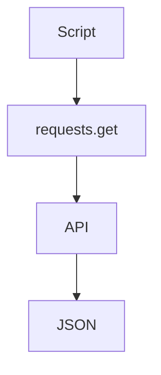

# Appeler une API HTTP (requests)

> [!info] En une phrase
> requests envoie des requêtes HTTP depuis Python (GET, POST…) et récupère la réponse, souvent en JSON.

```dataviewjs
await dv.view("10 — Templates/Scripts/learning", { view: "concept" })
```

## 1 · Comprendre
### Définition
`requests` est le paquet externe le plus utilisé de Python. `requests.get(url)` envoie une requête et renvoie un objet réponse : `.status_code` (200, 404…), `.json()` (le corps décodé en dictionnaire), `.text`, `.headers`.

### Pourquoi ça existe
Énormément de scripts parlent à des services web : API d'un outil (CVAT, GitLab), météo, service interne.

### Le problème résolu
La bibliothèque standard (`urllib`) est verbeuse ; `requests` rend un appel lisible en une ligne.

## 2 · Explorer
### Comment ça fonctionne


### Exemple concret
```python
import requests

r = requests.get("https://api.github.com/repos/python/cpython", timeout=10)
r.raise_for_status()                  # exception si 4xx ou 5xx
depot = r.json()                      # dictionnaire
print(depot["stargazers_count"])

r = requests.post("https://httpbin.org/post",
                  json={"nom": "Oumar"},                    # corps JSON
                  headers={"Authorization": "Bearer XXX"},  # en-tête
                  timeout=10)
print(r.status_code, r.json()["json"])
```
| Élément | Rôle |
| --- | --- |
| `params={"page": 2}` | ajoute `?page=2` à l'URL |
| `json=...` | envoie un corps JSON |
| `headers=...` | en-têtes (authentification) |
| `auth=("user", "mdp")` | authentification simple |
| `timeout=10` | n'attend pas indéfiniment |
| `files={"fichier": (nom, octets, type)}` | envoie un fichier en formulaire multipart (voir [[Envoyer et recevoir un fichier en HTTP]]) |

### Cas d'utilisation
- Récupérer les annotations d'une tâche CVAT (voir aussi [[SDK]])
- Automatiser GitLab via son API
- Vérifier qu'un service répond (code 200)

> [!warning] À ne pas confondre
> Un code 404 ou 500 **ne lève pas** d'exception tout seul : appelle `raise_for_status()` ou teste `status_code`. Et ne mets jamais un jeton en dur dans le code : lis-le dans une [[Variable d'environnement]].

## 3 · Pratiquer
- Appelle l'API publique de GitHub pour un dépôt et affiche trois informations.
- Provoque un 404 et gère-le proprement.

## 4 · Expliquer
> [!quote] Mon résumé, avec mes mots
> _À écrire sans regarder la fiche. Si je bloque, je ne l'ai pas encore compris._

## 5 · Relier
- **Prérequis** : [[pip]] · [[HTTP]] · [[JSON]] · [[Liste et dictionnaire]]
- **Complémentaires** : [[SDK]] · [[API REST]] · [[Envoyer et recevoir un fichier en HTTP]] (envoyer un zip ou une image) · [[Appeler une API sans pip (urllib.request)]] (quand pip est bloqué)

## 6 · Réviser
> [!question] Me faire interroger
> Je demande à Claude de m'interroger sur cette notion pour vérifier que je l'ai comprise.

### Validation de la maîtrise
La notion est maîtrisée quand j'ai réussi **tous les exercices** qui l'utilisent (statut `reussi` dans l'exercice).

```dataviewjs
await dv.view("10 — Templates/Scripts/learning", { view: "maitrise" })
```
