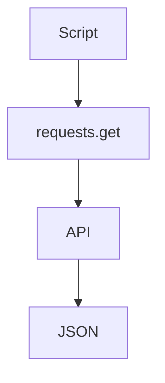

# Appeler une API HTTP

> [!info] En une phrase
> Un programme envoie une requête HTTP (GET, POST…) à une API et lit la réponse, souvent en JSON ; chaque langage a son outil (requests ou urllib en Python, fetch en JavaScript, curl dans le terminal).

## 1 · Comprendre
### Définition
`requests` est le paquet externe le plus utilisé de Python. `requests.get(url)` envoie une requête et renvoie un objet réponse : `.status_code` (200, 404…), `.json()` (le corps décodé en dictionnaire), `.text`, `.headers`.

### Pourquoi ça existe
Énormément de scripts parlent à des services web : API d'un outil (GitLab, GitHub), météo, service interne.

### Le problème résolu
La bibliothèque standard (`urllib`) est verbeuse ; `requests` rend un appel lisible en une ligne.

## 2 · Explorer
### Comment ça fonctionne


### Exemple concret
```python
import requests

r = requests.get("https://api.github.com/repos/python/cpython", timeout=10)
r.raise_for_status()                  # exception si 4xx ou 5xx
depot = r.json()                      # dictionnaire
print(depot["stargazers_count"])

r = requests.post("https://httpbin.org/post",
                  json={"nom": "Oumar"},                    # corps JSON
                  headers={"Authorization": "Bearer XXX"},  # en-tête
                  timeout=10)
print(r.status_code, r.json()["json"])
```
| Élément | Rôle |
| --- | --- |
| `params={"page": 2}` | ajoute `?page=2` à l'URL |
| `json=...` | envoie un corps JSON |
| `headers=...` | en-têtes (authentification) |
| `auth=("user", "mdp")` | authentification simple |
| `timeout=10` | n'attend pas indéfiniment |
| `files={"fichier": (nom, octets, type)}` | envoie un fichier en formulaire multipart (voir [[Envoyer et recevoir un fichier en HTTP]]) |

> [!abstract]- Comment ça s'écrit (référence à chercher, pas à apprendre par cœur)
> L'idée est la même partout ; seule l'écriture change.
>
> **Python (requests, à installer)**
> ```python
> import requests
> r = requests.get("http://localhost:8000/depenses", params={"categorie": "courses"}, timeout=10)
> r.raise_for_status()          # erreur si 4xx ou 5xx
> donnees = r.json()
> requests.post(url, json={"montant": 12.5})
> ```
> `params` va dans l'adresse, `json` dans le corps.
>
> **Python sans pip (urllib.request)**
> ```python
> import json, urllib.request
> with urllib.request.urlopen("http://localhost:8000/depenses", timeout=10) as r:
>     donnees = json.load(r)
> ```
> Livré avec Python : utile quand pip est bloqué.
>
> **JavaScript (fetch)**
> ```js
> const res = await fetch("http://localhost:8000/depenses");
> if (!res.ok) throw new Error(`HTTP ${res.status}`);  // fetch ne lève rien sur un 404
> const donnees = await res.json();
> await fetch(url, { method: "POST", headers: { "Content-Type": "application/json" }, body: JSON.stringify({ montant: 12.5 }) });
> ```
> Dans le navigateur, [[CORS]] s'applique ; pas en Python ni avec curl.
>
> **Terminal (curl)**
> ```bash
> curl -s http://localhost:8000/depenses
> curl -X POST -H "Content-Type: application/json" -d '{"montant": 12.5}' http://localhost:8000/depenses
> ```

### Cas d'utilisation
- Automatiser GitLab via son API
- Vérifier qu'un service répond (code 200)

> [!warning] À ne pas confondre
> Un code 404 ou 500 **ne lève pas** d'exception tout seul : appelle `raise_for_status()` ou teste `status_code`. Et ne mets jamais un jeton en dur dans le code : lis-le dans une [[Variable d'environnement]].

## 3 · Relier
- **Au travail** : [Appeler une API HTTP (requests) au travail](obsidian://open?vault=Travail&file=Appeler%20une%20API%20HTTP%20%28requests%29%20au%20travail)
- **Prérequis** : [[Gestionnaire de paquets]] · [[HTTP]] · [[JSON]] · [[Liste et dictionnaire]]
- **Complémentaires** : [[SDK]] · [[API REST]] · [[Envoyer et recevoir un fichier en HTTP]] (envoyer un zip ou une image) · [[Appeler une API HTTP]] (quand pip est bloqué)
