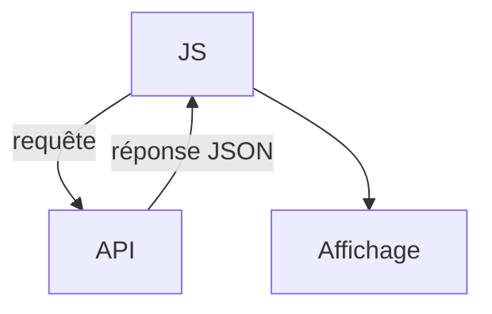

# Appeler une API avec fetch

> [!info] En une phrase
> fetch envoie une requête HTTP depuis JavaScript et renvoie une Promesse de réponse, qu'on lit ensuite en JSON.

```dataviewjs
await dv.view("10 — Templates/Scripts/learning", { view: "concept" })
```

## 1 · Comprendre
### Définition
```js
const rep = await fetch("https://api.exemple.com/taches?page=1", {
  method: "POST",                                   // GET par défaut
  headers: { "Content-Type": "application/json",
             Authorization: `Bearer ${jeton}` },
  body: JSON.stringify({ nom: "Chantier" }),        // objet → texte JSON
});
if (!rep.ok) {                                       // statut hors 200-299
  throw new Error(`Erreur ${rep.status}`);
}
const donnees = await rep.json();                    // texte JSON → objet
```
`fetch` existe dans le navigateur et dans Node (depuis la version 18).

### Pourquoi ça existe
Une interface moderne charge ses données depuis une [[API REST]] au lieu de tout recevoir dans le HTML.

### Le problème résolu
Parler [[HTTP]] depuis le code, avec méthode, en-têtes et corps, puis exploiter la réponse.

## 2 · Explorer
### Comment ça fonctionne


### Exemple concret
```js
async function afficherTaches() {
  const rep = await fetch("/api/taches");
  if (!rep.ok) { document.querySelector("#err").textContent = "Erreur " + rep.status; return; }
  const taches = await rep.json();
  document.querySelector("#liste").innerHTML = "";
  for (const t of taches) {
    const li = document.createElement("li");
    li.textContent = t.nom;
    document.querySelector("#liste").append(li);
  }
}
```
Une API publique pour s'entraîner : `https://jsonplaceholder.typicode.com/todos`.

### Cas d'utilisation
- Le bouton CVAT qui appelle la fonction Nuclio
- Charger des données dans React
- Envoyer un formulaire à une API

> [!warning] À ne pas confondre
> `fetch` ne lève **pas** d'erreur pour un 404 ou un 500 : seulement si le réseau échoue. Il faut tester `rep.ok`. Et une erreur [[CORS]] vient du **serveur** qui n'autorise pas ton site, pas de ton code.

## 3 · Pratiquer
- Affiche la liste des todos de jsonplaceholder dans une page
- Gère le cas d'une adresse qui renvoie 404

## 4 · Expliquer
> [!quote] Mon résumé, avec mes mots
> _À écrire sans regarder la fiche. Si je bloque, je ne l'ai pas encore compris._

## 5 · Relier
- **Prérequis** : [[async et await]] · [[HTTP]] · [[JSON]]
- **Complémentaires** : [[Appeler une API HTTP (requests)]] · [[Code de statut HTTP]]
- **Utilisé par** : [[React]]

## 6 · Réviser
> [!question] Me faire interroger
> Je demande à Claude de m'interroger sur cette notion pour vérifier que je l'ai comprise.

### Validation de la maîtrise
La notion est maîtrisée quand j'ai réussi **tous les exercices** qui l'utilisent (statut `reussi` dans l'exercice).

```dataviewjs
await dv.view("10 — Templates/Scripts/learning", { view: "maitrise" })
```
