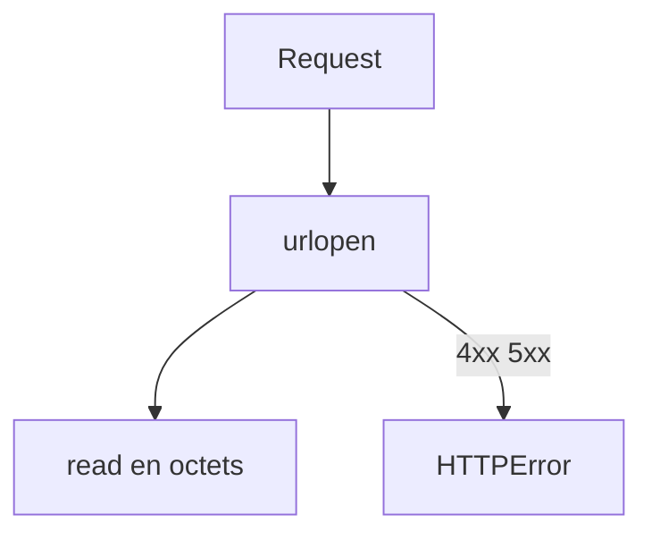

# Appeler une API sans pip (urllib.request)

> [!info] En une phrase
> `urllib.request` fait des requêtes HTTP avec la bibliothèque standard de Python : rien à installer, donc utilisable même quand pip est bloqué par le proxy de l'entreprise.

```dataviewjs
await dv.view("10 — Templates/Scripts/learning", { view: "concept" })
```

## 1 · Comprendre
### Définition
On prépare une requête avec `urllib.request.Request(url, data=..., headers=..., method=...)`, puis on l'envoie avec `urllib.request.urlopen(requete, timeout=...)`. La réponse se lit comme un fichier binaire : `.read()` donne des **octets**.

### Pourquoi ça existe
C'est l'outil HTTP livré avec Python depuis toujours. `requests` a été écrit par-dessus pour être plus agréable, mais il faut l'installer.

### Le problème résolu
Au travail, `pip install requests` passe par Internet et le proxy le bloque (tant que tu n'as pas le PyPI du [[Nexus]]). Avec `urllib.request`, ton script ou ta fonction tourne sans aucune dépendance.

## 2 · Explorer
### Comment ça fonctionne

| Avec requests | Avec urllib.request |
| --- | --- |
| `requests.get(url)` | `urlopen(url)` |
| `r.status_code` | `r.status` |
| `r.content` | `r.read()` |
| `r.json()` | `json.loads(r.read())` |
| `json={...}` | `data=json.dumps(d).encode()` + `Content-Type: application/json` |
| `files={...}` (multipart) | pas d'outil prévu : à fabriquer à la main, on préfère un corps brut |
| 404 = réponse normale | 404 = **exception** `HTTPError` |

### Exemple concret
```python
import json
import urllib.error
import urllib.request

with open("rapport.zip", "rb") as f:
    octets = f.read()

requete = urllib.request.Request(
    "http://localhost:8000/brut",
    data=octets,                                  # des bytes, jamais un str
    headers={"Content-Type": "application/zip"},
    method="POST",
)
try:
    with urllib.request.urlopen(requete, timeout=30) as reponse:
        print(reponse.status, reponse.headers["Content-Type"])
        resultat = json.loads(reponse.read())
except urllib.error.HTTPError as e:              # le serveur a répondu 4xx ou 5xx
    print("Refusé :", e.code, e.read().decode("utf-8"))
except urllib.error.URLError as e:               # pas de réponse du tout
    print("Serveur injoignable :", e.reason)
```

### Cas d'utilisation
- Un script ou une fonction Nuclio sans dépendance externe
- Un appel rapide quand pip n'est pas disponible
- Comprendre ce que `requests` fait pour toi

> [!warning] À ne pas confondre
> - Avec `data=` et sans `Content-Type`, urllib met **tout seul** `application/x-www-form-urlencoded` (le type d'un formulaire texte). Pour un zip ou une image, donne toujours le bon type.
> - `data` doit être des `bytes` : un `str` donne `TypeError`. Pour du JSON : `json.dumps(d).encode("utf-8")`.
> - Une erreur 4xx ou 5xx **lève une exception**, contrairement à requests. Le message du serveur est dans `e.read()`.
> - urllib suit les variables `HTTP_PROXY` / `HTTPS_PROXY`, comme requests. Si elles sont définies, ajoute `NO_PROXY=localhost,127.0.0.1` pour que tes appels locaux ne partent pas vers le [[Proxy]].

## 3 · Pratiquer
- [[Envoi 03 - Le même envoi sans pip]]

## 4 · Expliquer
> [!quote] Mon résumé, avec mes mots
> _À écrire sans regarder la fiche. Si je bloque, je ne l'ai pas encore compris._

## 5 · Relier
- **Prérequis** : [[HTTP]] · [[Exception]] · [[Binaire et octet]]
- **Complémentaires** : [[Appeler une API HTTP (requests)]] · [[Envoyer et recevoir un fichier en HTTP]] · [[Proxy]] · [[Nexus]]
- **Utilisé par** : [[Cours - Envoyer et recevoir des fichiers par HTTP]]

## 6 · Réviser
> [!question] Me faire interroger
> Je demande à Claude de m'interroger sur cette notion pour vérifier que je l'ai comprise.

### Validation de la maîtrise
La notion est maîtrisée quand j'ai réussi **tous les exercices** qui l'utilisent (statut `reussi` dans l'exercice).

```dataviewjs
await dv.view("10 — Templates/Scripts/learning", { view: "maitrise" })
```
