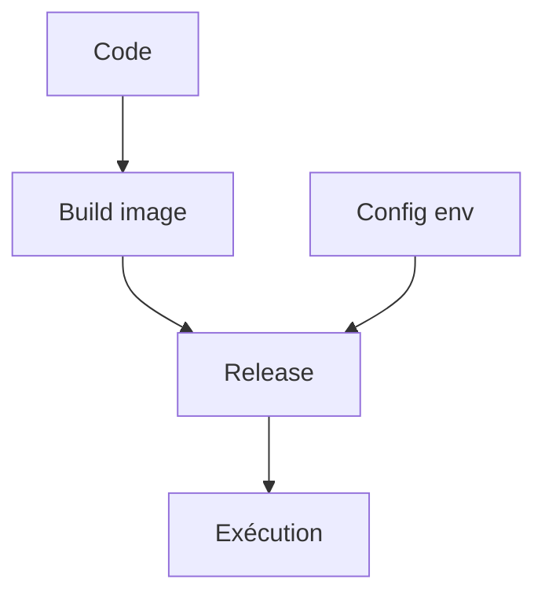

# Application douze facteurs

> [!info] En une phrase
> La méthode des douze facteurs (twelve-factor app) est une liste de règles pour écrire une application facile à déployer, à configurer et à faire tourner en plusieurs copies, notamment dans Docker et le cloud.

```dataviewjs
await dv.view("10 — Templates/Scripts/learning", { view: "concept" })
```

## 1 · Comprendre
### Définition
Les facteurs les plus utiles au début :
1. **Une base de code** suivie dans Git, plusieurs déploiements (dev, test, prod)
2. **Dépendances déclarées** (`requirements.txt`, `package.json`), rien d'installé « à la main »
3. **Configuration dans l'environnement** : adresses, mots de passe, clés via des variables d'environnement, jamais dans le code
4. **Services externes comme ressources** : la base ou CVAT sont des adresses qu'on change par la configuration
5. **Construire, publier, exécuter** séparés (c'est ce que fait ta CI : image, registre, déploiement)
6. **Processus sans état** : ce qui doit durer va en base ou en stockage
9. **Démarrage rapide, arrêt propre**
10. **Dev et prod aussi proches que possible** (Docker aide)
11. **Logs sur la sortie standard**, c'est la plateforme qui les collecte

Les autres : ports exposés, mise à l'échelle par processus, tâches d'admin ponctuelles.

### Pourquoi ça existe
« Ça marche sur ma machine » : mot de passe en dur, fichier écrit sur le disque local, configuration différente partout, impossible de lancer deux copies.

### Le problème résolu
La même image Docker tourne partout, seule la configuration change ; on peut lancer, arrêter et multiplier les copies sans surprise.

## 2 · Explorer
### Comment ça fonctionne


### Exemple concret
```python
# ❌ configuration dans le code
CVAT_URL = "http://192.168.1.20:8080"
MOT_DE_PASSE = "admin123"

# ✅ configuration dans l'environnement
import os
CVAT_URL = os.environ["CVAT_URL"]
MOT_DE_PASSE = os.environ["CVAT_PASSWORD"]   # injecté par Docker ou la CI
logging.basicConfig(stream=sys.stdout)      # logs sur la sortie standard
```

### Cas d'utilisation
- Préparer une appli pour Docker
- Variables CI GitLab
- Déploiement sur plusieurs environnements

> [!warning] À ne pas confondre
> Ce n'est pas une norme à cocher à 100 % : ce sont des règles de bon sens. Le facteur le plus violé par les débutants est le 3 (secrets dans le code et dans Git).

## 3 · Pratiquer
- Vérifie ton script de zip : quels facteurs respecte-t-il, lesquels non ?

## 4 · Expliquer
> [!quote] Mon résumé, avec mes mots
> _À écrire sans regarder la fiche. Si je bloque, je ne l'ai pas encore compris._

## 5 · Relier
- **Prérequis** : [[Variable d'environnement]] · [[Docker]]
- **Complémentaires** : [[Image Docker]] · [[Pipeline GitLab CI]] · [[Journaliser avec logging]]

## 6 · Réviser
> [!question] Me faire interroger
> Je demande à Claude de m'interroger sur cette notion pour vérifier que je l'ai comprise.

### Validation de la maîtrise
La notion est maîtrisée quand j'ai réussi **tous les exercices** qui l'utilisent (statut `reussi` dans l'exercice).

```dataviewjs
await dv.view("10 — Templates/Scripts/learning", { view: "maitrise" })
```
