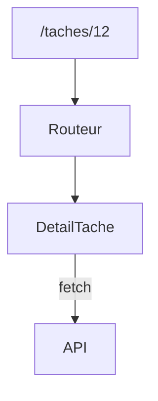

# Application monopage et routage

> [!info] En une phrase
> Une application monopage (SPA) charge une seule page HTML puis change l'affichage en JavaScript ; le routage côté client associe chaque adresse (/taches/12) à un composant sans recharger la page.

## 1 · Comprendre
### Définition
**SPA** (*Single Page Application*) : le serveur envoie un `index.html` presque vide et un gros fichier JavaScript. Ensuite, les données viennent de l'[[API]] en JSON et la navigation se fait **dans le navigateur**.
Le **routeur** (React Router, Vue Router, Angular Router) lit l'adresse et affiche le bon composant :
```tsx
import { BrowserRouter, Routes, Route, Link, useParams } from "react-router-dom";
<BrowserRouter>
  <nav><Link to="/">Accueil</Link> <Link to="/taches">Tâches</Link></nav>
  <Routes>
    <Route path="/" element={<Accueil />} />
    <Route path="/taches" element={<ListeTaches />} />
    <Route path="/taches/:id" element={<DetailTache />} />
    <Route path="*" element={<Introuvable />} />
  </Routes>
</BrowserRouter>
function DetailTache() { const { id } = useParams(); /* … */ }
```

### Pourquoi ça existe
Recharger toute la page à chaque clic est lent et perd l'état de l'interface.

### Le problème résolu
Une navigation instantanée, des adresses partageables (`/taches/12`) et le bouton Précédent qui fonctionne.

## 2 · Explorer
### Comment ça fonctionne


### Exemple concret
Conséquence côté serveur : si on ouvre directement `https://app.ex/taches/12`, le serveur doit renvoyer `index.html` (et pas une 404), puis le routeur fait le reste.
```nginx
location / { try_files $uri /index.html; }
```
Gmail ou GitLab sont des SPA : l'adresse change sans recharger la page, c'est leur routeur qui choisit l'écran.

> [!abstract]- Comment ça s'écrit (référence à chercher, pas à apprendre par cœur)
> L'idée est la même partout ; seule l'écriture change.
>
> **Vue (Vue Router)**
> ```js
> const routes = [
>   { path: "/", component: Liste },
>   { path: "/depenses/:id", component: Detail },
> ];
> // <RouterLink to="/depenses/3"> · useRoute().params.id
> ```
>
> **Angular (Router)**
> ```ts
> export const routes: Routes = [
>   { path: "", component: ListeComponent },
>   { path: "depenses/:id", component: DetailComponent, canActivate: [connecteGuard] },
> ];
> // <a routerLink="/depenses/3"> · route.snapshot.paramMap.get("id")
> ```
>
> **React (React Router)**
> ```jsx
> <Route path="/depenses/:id" element={<Detail />} />
> // <Link to="/depenses/3"> · useParams().id
> ```
> Partout : une liste « adresse → composant », des paramètres dans l'adresse, et un serveur (nginx) qui renvoie `index.html` pour toutes les adresses.

### Cas d'utilisation
- Tout frontend React, Vue ou Angular
- Configuration du serveur ou du reverse proxy d'une SPA

> [!warning] À ne pas confondre
> `<a href>` recharge toute la page ; dans une SPA, utilise le composant `Link` du routeur. Et une SPA n'est pas idéale pour le référencement : les frameworks comme Next.js ou Nuxt génèrent le HTML côté serveur (SSR).

## 3 · Relier
- **Au travail** : [Application monopage et routage au travail](obsidian://open?vault=Travail&file=Application%20monopage%20et%20routage%20au%20travail)
- **Prérequis** : [[Composant d'interface]] · [[Client-serveur]] · [[HTTP]]
- **Complémentaires** : [[Reverse proxy]]
