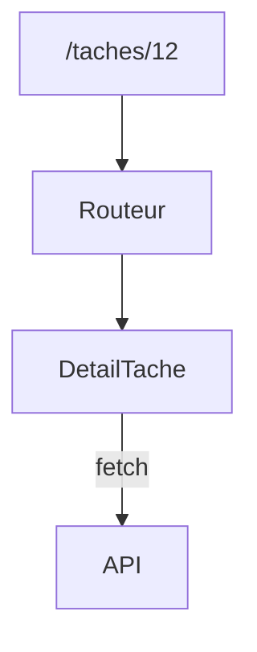

# Application monopage et routage

> [!info] En une phrase
> Une application monopage (SPA) charge une seule page HTML puis change l'affichage en JavaScript ; le routage côté client associe chaque adresse (/taches/12) à un composant sans recharger la page.

```dataviewjs
await dv.view("10 — Templates/Scripts/learning", { view: "concept" })
```

## 1 · Comprendre
### Définition
**SPA** (*Single Page Application*) : le serveur envoie un `index.html` presque vide et un gros fichier JavaScript. Ensuite, les données viennent de l'[[API]] en JSON et la navigation se fait **dans le navigateur**.
Le **routeur** (React Router, Vue Router, Angular Router) lit l'adresse et affiche le bon composant :
```tsx
import { BrowserRouter, Routes, Route, Link, useParams } from "react-router-dom";
<BrowserRouter>
  <nav><Link to="/">Accueil</Link> <Link to="/taches">Tâches</Link></nav>
  <Routes>
    <Route path="/" element={<Accueil />} />
    <Route path="/taches" element={<ListeTaches />} />
    <Route path="/taches/:id" element={<DetailTache />} />
    <Route path="*" element={<Introuvable />} />
  </Routes>
</BrowserRouter>
function DetailTache() { const { id } = useParams(); /* … */ }
```

### Pourquoi ça existe
Recharger toute la page à chaque clic est lent et perd l'état de l'interface.

### Le problème résolu
Une navigation instantanée, des adresses partageables (`/taches/12`) et le bouton Précédent qui fonctionne.

## 2 · Explorer
### Comment ça fonctionne


### Exemple concret
Conséquence côté serveur : si on ouvre directement `https://app.ex/taches/12`, le serveur doit renvoyer `index.html` (et pas une 404), puis le routeur fait le reste.
```nginx
location / { try_files $uri /index.html; }
```
CVAT est une SPA : `/tasks/12/jobs/34` est géré par son routeur React.

### Cas d'utilisation
- Tout frontend React, Vue ou Angular
- Configuration du serveur ou du reverse proxy d'une SPA
- Comprendre les adresses de CVAT

> [!warning] À ne pas confondre
> `<a href>` recharge toute la page ; dans une SPA, utilise le composant `Link` du routeur. Et une SPA n'est pas idéale pour le référencement : les frameworks comme Next.js ou Nuxt génèrent le HTML côté serveur (SSR).

## 3 · Pratiquer

### Exercice visuel

Sur Excalidraw, **sans regarder la fiche**. Puis je compare avec la fiche, je corrige en rouge ce qui était faux, et j'explique mon dessin avec mes mots (section 4).

> [!example] ⚖️ Avant / après
> Avant / après : un site classique qui recharge une page par adresse, puis une SPA. Dessine ce que le serveur envoie dans chaque cas.

> [!example] 🛣️ Suis le trajet
> Dessine ce qui arrive quand tu recharges `/depenses/3` sur le front Vue servi par nginx. Où faut-il une règle pour renvoyer `index.html` ?

### Mon schéma

> [!tip] Mon dessin Excalidraw
> _Je crée le dessin « Schéma - Application monopage et routage » et je l'intègre ici avec `![[Schéma - Application monopage et routage.excalidraw]]`._

### Appliquer dans le fil rouge
- [[MesDépenses 06 - Le front Vue dans Docker]]
- [[MesDépenses 12 - Le front Angular dans Docker]]

## 4 · Expliquer
> [!quote] Mon résumé, avec mes mots
> _J'explique mon schéma avec mes mots, sans regarder la fiche. Si je bloque, je ne l'ai pas encore compris._

## 5 · Relier
- **Prérequis** : [[Composant React]] · [[Client-serveur]] · [[HTTP]]
- **Complémentaires** : [[Reverse proxy]]

## 6 · Réviser
> [!question] Me faire interroger
> Je demande à Claude de m'interroger sur cette notion pour vérifier que je l'ai comprise.

### Validation de la maîtrise
La notion est maîtrisée quand je sais :
1. **l'expliquer** de façon fluide, à partir de mon schéma (section 4) ;
2. **l'adapter** à un autre contexte (consigne « Change de contexte », ou Claude m'interroge sur un autre cas) ;
3. **l'appliquer** pour de vrai dans le fil rouge (section 3).

Réussir un exercice ne suffit pas. C'est moi qui passe le statut en `maitrise`.

```dataviewjs
await dv.view("10 — Templates/Scripts/learning", { view: "maitrise" })
```
