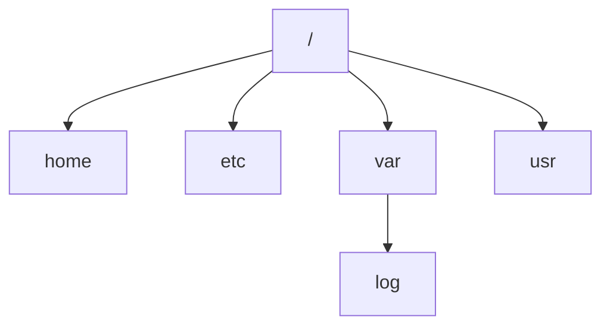

# Arborescence Linux

> [!info] En une phrase
> Sous Linux tout part d'une seule racine /, et chaque dossier système a un rôle précis (programmes, configuration, journaux, données).

```dataviewjs
await dv.view("10 — Templates/Scripts/learning", { view: "concept" })
```

## 1 · Comprendre
### Définition
Pas de `C:` ni de `D:` : un seul arbre qui part de `/`. Les disques et partitions sont **montés** dans un dossier de cet arbre.

| Dossier | Contient |
| --- | --- |
| `/home/oumar` (`~`) | tes fichiers |
| `/root` | le dossier de root |
| `/etc` | la **configuration** (texte) : `/etc/hosts`, `/etc/ssh/sshd_config` |
| `/var` | ce qui change : `/var/log` (journaux), `/var/lib` (données : Docker, bases) |
| `/usr/bin`, `/bin` | les programmes |
| `/usr/local` | ce que l'admin installe à la main |
| `/opt` | logiciels tiers |
| `/tmp` | temporaire, vidé au redémarrage |
| `/dev` | les périphériques (`/dev/null` : le trou noir) |
| `/proc` | infos sur les processus et le noyau |
| `/mnt`, `/media` | points de montage (WSL : `/mnt/c`) |

### Pourquoi ça existe
Toutes les distributions rangent pareil : tu sais où chercher sur n'importe quel serveur.

### Le problème résolu
Chercher au hasard où un logiciel met sa configuration ou ses journaux.

## 2 · Explorer
### Comment ça fonctionne

« Tout est fichier » : un périphérique, un processus, une configuration se lisent comme des fichiers.

### Exemple concret
```bash
ls /
cat /etc/os-release
ls /var/log
df -h            # disques et où ils sont montés
du -sh ~/projets # taille d'un dossier
```

### Cas d'utilisation
- Trouver la configuration d'un service (`/etc/…`) et ses journaux (`/var/log/…`)
- Comprendre les chemins des Dockerfile (`/app`, `/usr/local/bin`)

> [!warning] À ne pas confondre
> `/` (la racine) et `~` (ton dossier personnel). Et `/home` (les dossiers des utilisateurs) avec `/root` (celui de l'administrateur).

## 3 · Pratiquer

### Exercice visuel

Sur Excalidraw, **sans regarder la fiche**. Puis je compare avec la fiche, je corrige en rouge ce qui était faux, et j'explique mon dessin avec mes mots (section 4).

> [!example] 🧠 Dessine de mémoire
> Dessine l'arbre depuis `/` avec `/etc`, `/home`, `/usr/bin`, `/var/log`, `/tmp`, `/mnt/c`. Écris le rôle de chacun.

> [!example] 🔄 Change de contexte
> Redessine l'arbre à l'intérieur du conteneur de l'API. Qu'est-ce qui est pareil, qu'est-ce qui manque ?

### Mon schéma

> [!tip] Mon dessin Excalidraw
> _Je crée le dessin « Schéma - Arborescence Linux » et je l'intègre ici avec `![[Schéma - Arborescence Linux.excalidraw]]`._

### Appliquer dans le fil rouge
- Pas encore d'étape du fil rouge pour cette notion : je l'applique dans mon travail (CVAT, Nuclio) ou je demande une étape à Claude.

## 4 · Expliquer
> [!quote] Mon résumé, avec mes mots
> _J'explique mon schéma avec mes mots, sans regarder la fiche. Si je bloque, je ne l'ai pas encore compris._

## 5 · Relier
- **Prérequis** : [[Système de fichiers]] · [[Bash]]
- **Complémentaires** : [[Permissions Linux]] · [[Lien symbolique]]
- **Commandes** : [[ls]] · [[df]] · [[du]] · [[find]]

## 6 · Réviser
> [!question] Me faire interroger
> Je demande à Claude de m'interroger sur cette notion pour vérifier que je l'ai comprise.

### Validation de la maîtrise
La notion est maîtrisée quand je sais :
1. **l'expliquer** de façon fluide, à partir de mon schéma (section 4) ;
2. **l'adapter** à un autre contexte (consigne « Change de contexte », ou Claude m'interroge sur un autre cas) ;
3. **l'appliquer** pour de vrai dans le fil rouge (section 3).

Réussir un exercice ne suffit pas. C'est moi qui passe le statut en `maitrise`.

```dataviewjs
await dv.view("10 — Templates/Scripts/learning", { view: "maitrise" })
```
