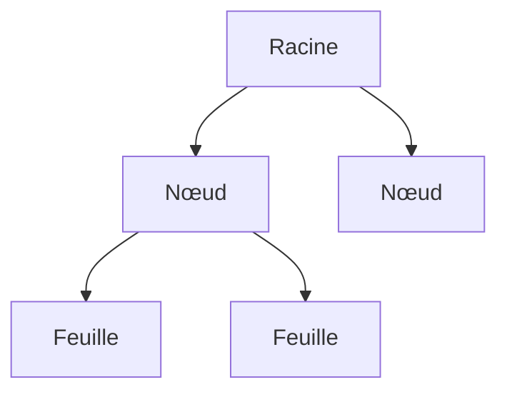

# Arbre et graphe

> [!info] En une phrase
> Un graphe est un ensemble de nœuds reliés par des liens ; un arbre est un graphe sans cycle, avec une racine, où chaque nœud a un seul parent.

```dataviewjs
await dv.view("10 — Templates/Scripts/learning", { view: "concept" })
```

## 1 · Comprendre
### Définition
**Graphe** : des **nœuds** (sommets) et des **arêtes** (liens). Les liens peuvent avoir un **sens** (A dépend de B) et un **poids** (une distance, un coût).
**Arbre** : une **racine**, des **enfants**, des **feuilles** (sans enfant), pas de boucle.
Tu en manipules déjà partout :
| Arbre | Graphe |
| --- | --- |
| le [[Système de fichiers]] (dossiers et fichiers) | les modules de ce parcours et leurs prérequis |
| le [[DOM]] d'une page | les commits Git (un commit a un ou deux parents) |
| un JSON imbriqué | les jobs d'une pipeline et leurs `needs` |
| les composants React | le réseau, Internet, les routes entre villes |
Représenter un graphe en code : une **liste d'adjacence**, un dictionnaire nœud → voisins.
```python
prerequis = {
    "Python": ["Fondamentaux", "Terminal"],
    "Docker": ["Terminal", "Python"],
    "DevOps": ["Git", "Docker", "Tests"],
}
```

### Pourquoi ça existe
Beaucoup de données ne sont ni des listes ni des tableaux : ce sont des relations (dépendances, hiérarchies, chemins).

### Le problème résolu
Disposer d'un modèle unique pour des problèmes très différents : ordre de dépendances, plus court chemin, hiérarchies.

## 2 · Explorer
### Comment ça fonctionne


### Exemple concret
Un arbre en Python (une annotation avec des sous-éléments) :
```python
arbre = {"nom": "projet", "enfants": [
    {"nom": "tâche 1", "enfants": [{"nom": "job 1", "enfants": []}]},
    {"nom": "tâche 2", "enfants": []},
]}
def afficher(n, profondeur=0):
    print("  " * profondeur + n["nom"])
    for e in n["enfants"]:
        afficher(e, profondeur + 1)       # la récursivité suit l'arbre
```
L'ordre dans lequel on peut suivre les modules d'un parcours en respectant les prérequis s'appelle un **tri topologique** (c'est aussi ce que fait la CI avec `needs`, ou npm avec les dépendances).

### Cas d'utilisation
- Dépendances (paquets, jobs de CI, modules)
- Hiérarchies (dossiers, DOM, organisation)
- Chemins (réseau, cartes)

> [!warning] À ne pas confondre
> Un **arbre** n'a pas de cycle : si A dépend de B et B de A, c'est un graphe avec cycle, et un tri topologique est impossible (c'est l'erreur « dépendance circulaire »).

## 3 · Pratiquer

### Exercice visuel

Sur Excalidraw, **sans regarder la fiche**. Puis je compare avec la fiche, je corrige en rouge ce qui était faux, et j'explique mon dessin avec mes mots (section 4).

> [!example] 🧠 Dessine de mémoire
> Dessine le graphe de ton plan CVAT : les tuyaux comme des liens, les points de soudure comme des nœuds. Puis dessine un arbre et montre ce qui le distingue.

> [!example] 🔍 Trouve l'erreur
> Ce schéma est faux. Corrige-le en rouge et explique l'erreur.
>
> ```mermaid
> flowchart TD
>   R[Racine] --> A[Nœud A]
>   A --> B[Nœud B]
>   B --> R
> ```

### Mon schéma

> [!tip] Mon dessin Excalidraw
> _Je crée le dessin « Schéma - Arbre et graphe » et je l'intègre ici avec `![[Schéma - Arbre et graphe.excalidraw]]`._

### Appliquer dans le fil rouge
- Pas encore d'étape du fil rouge pour cette notion : je l'applique dans mon travail (CVAT, Nuclio) ou je demande une étape à Claude.

## 4 · Expliquer
> [!quote] Mon résumé, avec mes mots
> _J'explique mon schéma avec mes mots, sans regarder la fiche. Si je bloque, je ne l'ai pas encore compris._

## 5 · Relier
- **Prérequis** : [[Liste et dictionnaire]] · [[Récursivité]]
- **Complémentaires** : [[Parcours en largeur et en profondeur]]

## 6 · Réviser
> [!question] Me faire interroger
> Je demande à Claude de m'interroger sur cette notion pour vérifier que je l'ai comprise.

### Validation de la maîtrise
La notion est maîtrisée quand je sais :
1. **l'expliquer** de façon fluide, à partir de mon schéma (section 4) ;
2. **l'adapter** à un autre contexte (consigne « Change de contexte », ou Claude m'interroge sur un autre cas) ;
3. **l'appliquer** pour de vrai dans le fil rouge (section 3).

Réussir un exercice ne suffit pas. C'est moi qui passe le statut en `maitrise`.

```dataviewjs
await dv.view("10 — Templates/Scripts/learning", { view: "maitrise" })
```
