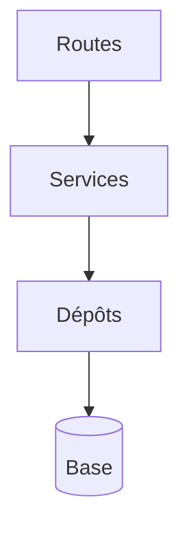

# Architecture en couches

> [!info] En une phrase
> Une application en couches range le code en étages (routes ou contrôleurs, services métier, accès aux données) ; chaque couche n'appelle que celle du dessous.

```dataviewjs
await dv.view("10 — Templates/Scripts/learning", { view: "concept" })
```

## 1 · Comprendre
### Définition
Pour une API classique :
| Couche | Rôle | Exemple |
| --- | --- | --- |
| **Routes / contrôleurs** | HTTP : lire la requête, valider, appeler le service, répondre | `routes/taches.js` |
| **Services** | règles métier, sans rien savoir de HTTP | `services/taches.js` |
| **Dépôts** (*repositories*) | lire et écrire en base | `depots/taches.js` |
| **Modèles** | la forme des données | `types.ts`, modèles de l'ORM |
Règle : les dépendances vont **vers le bas**. Un service ne connaît pas `req` et `res` ; un dépôt ne connaît pas les règles métier.
Variantes plus poussées : **architecture hexagonale** (ports et adaptateurs), **clean architecture** : le métier au centre, l'extérieur (base, HTTP, CVAT) en périphérie et interchangeable.

### Pourquoi ça existe
Dans une API qui grandit, mettre SQL, règles et HTTP dans la même route rend tout illisible et non testable.

### Le problème résolu
Tester le métier sans HTTP ni base, et changer de base ou de framework en ne touchant qu'une couche.

## 2 · Explorer
### Comment ça fonctionne


### Exemple concret
```js
// depots/taches.js
export const trouver = (id) => db.query("SELECT * FROM tache WHERE id = $1", [id]).then((r) => r.rows[0]);
// services/taches.js
export async function terminer(id, utilisateur) {
  const t = await depot.trouver(id);
  if (!t) throw new ErreurApi(404, "TACHE_INTROUVABLE", "Tâche inconnue");
  if (t.auteur !== utilisateur.id) throw new ErreurApi(403, "INTERDIT", "Pas ta tâche");
  return depot.maj(id, { fini: true });
}
// routes/taches.js
router.patch("/:id/terminer", exigerAuth, async (req, res) => res.json(await service.terminer(req.params.id, req.user)));
```
Django (CVAT) a sa variante : modèles, vues (*views*), sérialiseurs, URLs.

### Cas d'utilisation
- Organiser une API Express ou FastAPI
- Lire le code de CVAT
- Tester les règles métier

> [!warning] À ne pas confondre
> Des couches **vides** qui ne font que transmettre (le service appelle le dépôt sans rien ajouter) : pour une petite application, c'est de la cérémonie. Adapte à la taille du projet.

## 3 · Pratiquer

### Exercice visuel

Sur Excalidraw, **sans regarder la fiche**. Puis je compare avec la fiche, je corrige en rouge ce qui était faux, et j'explique mon dessin avec mes mots (section 4).

> [!example] 🧠 Dessine de mémoire
> Dessine l'API MesDépenses en étages : routes, services, accès aux données. Trace les flèches d'appel : qui a le droit d'appeler qui ?

> [!example] 🔍 Trouve l'erreur
> Ce schéma est faux. Corrige-le en rouge et explique l'erreur.
>
> ```mermaid
> flowchart TD
>   R[Routes] --> S[Services]
>   S --> D[Données]
>   D --> R
> ```

### Mon schéma

> [!tip] Mon dessin Excalidraw
> _Je crée le dessin « Schéma - Architecture en couches » et je l'intègre ici avec `![[Schéma - Architecture en couches.excalidraw]]`._

### Appliquer dans le fil rouge
- Pas encore d'étape du fil rouge pour cette notion : je l'applique dans mon travail (CVAT, Nuclio) ou je demande une étape à Claude.

## 4 · Expliquer
> [!quote] Mon résumé, avec mes mots
> _J'explique mon schéma avec mes mots, sans regarder la fiche. Si je bloque, je ne l'ai pas encore compris._

## 5 · Relier
- **Prérequis** : [[Séparation des responsabilités]] · [[API REST]]
- **Complémentaires** : [[MVC]] · [[Doublure de test (mock)]]

## 6 · Réviser
> [!question] Me faire interroger
> Je demande à Claude de m'interroger sur cette notion pour vérifier que je l'ai comprise.

### Validation de la maîtrise
La notion est maîtrisée quand je sais :
1. **l'expliquer** de façon fluide, à partir de mon schéma (section 4) ;
2. **l'adapter** à un autre contexte (consigne « Change de contexte », ou Claude m'interroge sur un autre cas) ;
3. **l'appliquer** pour de vrai dans le fil rouge (section 3).

Réussir un exercice ne suffit pas. C'est moi qui passe le statut en `maitrise`.

```dataviewjs
await dv.view("10 — Templates/Scripts/learning", { view: "maitrise" })
```
