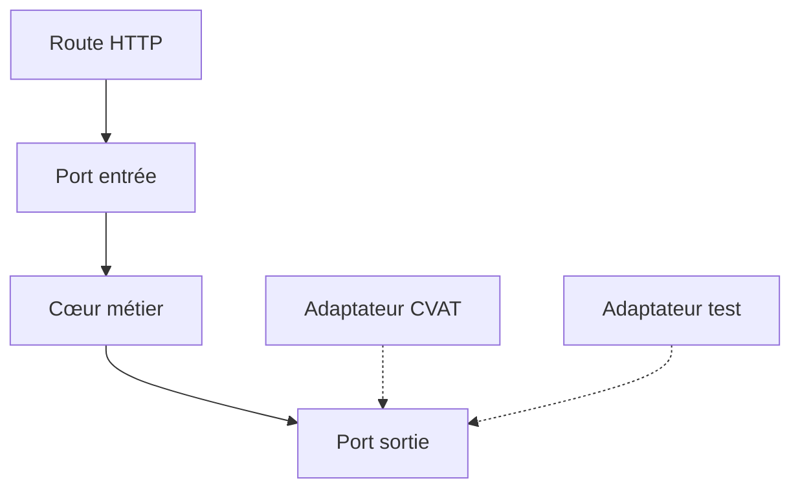

# Architecture hexagonale

> [!info] En une phrase
> L'architecture hexagonale (ports et adaptateurs) met le cœur métier au centre, sans aucune dépendance technique, et branche autour de lui la base, l'API, CVAT ou les fichiers par des adaptateurs interchangeables.

```dataviewjs
await dv.view("10 — Templates/Scripts/learning", { view: "concept" })
```

## 1 · Comprendre
### Définition
**Le cœur (domaine)** : les règles métier, en code simple, sans import de framework, de base ou de SDK.

**Les ports** : des interfaces définies *par le cœur* (« j'ai besoin d'une source d'annotations », « j'ai besoin de stocker une image »).

**Les adaptateurs** : le code technique qui *implémente* un port (une source CVAT, une source fichier, un stockage disque, un stockage S3) ou qui *appelle* le cœur (une route HTTP, une commande CLI, une fonction Nuclio).

**La règle d'or :** les dépendances pointent **vers le centre**. Le cœur ne connaît personne ; ce sont les adaptateurs qui le connaissent.

La *clean architecture* et l'architecture en *oignon* sont des variantes de la même idée.

### Pourquoi ça existe
Dans une architecture en couches classique, la couche métier dépend souvent de la couche données (elle importe l'ORM, le SDK). Changer de base ou tester le métier seul devient pénible.

### Le problème résolu
Tester les règles métier sans base, sans réseau ni CVAT, et changer une technologie (base, framework, fournisseur) sans toucher au métier.

## 2 · Explorer
### Comment ça fonctionne


### Exemple concret
```python
# coeur/export.py : aucun import de cvat_sdk, de Flask ou de Nuclio
class SourceAnnotations(Protocol):            # port de sortie
    def annotations(self, tache_id: int) -> list[dict]: ...

def exporter_png(source: SourceAnnotations, tache_id: int) -> bytes:   # cas d'usage
    formes = source.annotations(tache_id)
    return dessiner(formes)

# adaptateurs/cvat.py : le seul fichier qui connaît le SDK
class SourceCvat:
    def __init__(self, client): self.client = client
    def annotations(self, tache_id): ...

# adaptateurs/nuclio.py : adaptateur d'entrée
def handler(context, event):
    return exporter_png(SourceCvat(client()), event.body["tache_id"])
```
Dans les tests, on passe une `SourceFichier` ou un faux objet : le cœur est testé en quelques millisecondes.

### Cas d'utilisation
- Fonction d'export CVAT testable sans serveur CVAT
- Application qui doit pouvoir changer de base ou de fournisseur cloud
- Logique métier riche et durable

> [!warning] À ne pas confondre
> L'hexagonale n'impose pas six côtés ni beaucoup de dossiers. Pour un script de 50 lignes, c'est de la sur-ingénierie : commence par séparer les responsabilités, et passe aux ports quand une dépendance technique gêne les tests.

## 3 · Pratiquer
- Dessine les ports et adaptateurs de ta fonction Nuclio d'export

## 4 · Expliquer
> [!quote] Mon résumé, avec mes mots
> _À écrire sans regarder la fiche. Si je bloque, je ne l'ai pas encore compris._

## 5 · Relier
- **Prérequis** : [[Architecture en couches]] · [[Interface et polymorphisme]]
- **Complémentaires** : [[Patron Adaptateur (Adapter)]] · [[Doublure de test (mock)]] · [[Principes SOLID]]

## 6 · Réviser
> [!question] Me faire interroger
> Je demande à Claude de m'interroger sur cette notion pour vérifier que je l'ai comprise.

### Validation de la maîtrise
La notion est maîtrisée quand j'ai réussi **tous les exercices** qui l'utilisent (statut `reussi` dans l'exercice).

```dataviewjs
await dv.view("10 — Templates/Scripts/learning", { view: "maitrise" })
```
