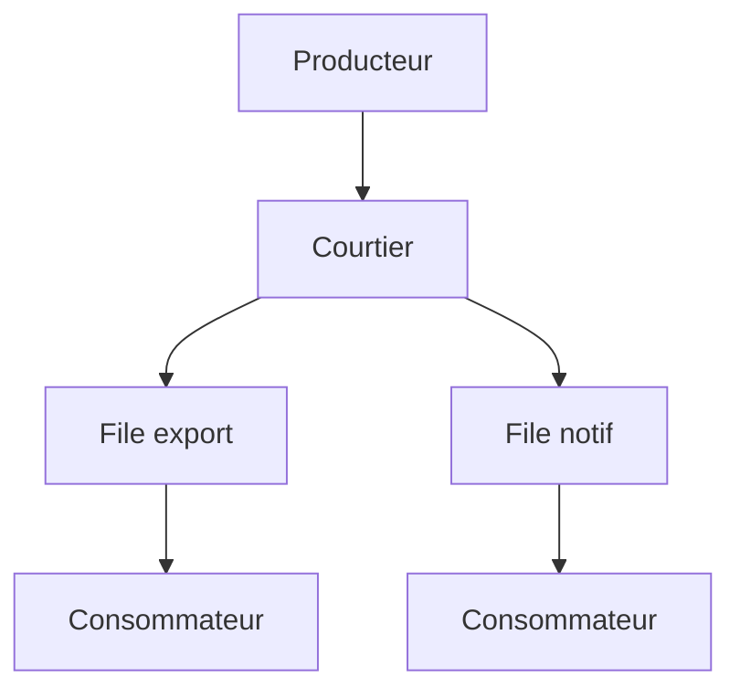

# Architecture événementielle

> [!info] En une phrase
> Dans une architecture événementielle, les services ne s'appellent pas directement : l'un publie un événement (« image exportée ») dans une file ou un bus de messages, et ceux que ça intéresse le traitent quand ils peuvent.

```dataviewjs
await dv.view("10 — Templates/Scripts/learning", { view: "concept" })
```

## 1 · Comprendre
### Définition
**Événement** : un fait passé, au nom au passé (`annotation.creee`, `export.termine`), avec ses données.

**Producteur** : publie l'événement, sans savoir qui l'écoute.

**Consommateur** : s'abonne et réagit, à son rythme.

**Courtier (broker)** : stocke et distribue les messages : RabbitMQ, Kafka, Redis Streams, ou les files intégrées des clouds. Le message attend dans une **file** (queue) si le consommateur est occupé ou en panne.

C'est le patron Observateur à l'échelle de plusieurs programmes.

### Pourquoi ça existe
Quand un service en appelle cinq autres en direct (HTTP), il attend chacun, échoue si l'un tombe, et doit être modifié à chaque nouveau besoin.

### Le problème résolu
Découpler les services, absorber les pics (les messages patientent dans la file), réessayer sans perdre de travail, ajouter un consommateur sans toucher au producteur.

## 2 · Explorer
### Comment ça fonctionne


### Exemple concret
CVAT fonctionne déjà ainsi : quand tu lances une tâche lourde, la requête HTTP crée un **job** dans une file (Redis + RQ), et un *worker* le traite en arrière-plan. Les webhooks de CVAT publient aussi des événements (`create:job`, `update:task`).

```python
# producteur : répond tout de suite
file.publier("export.demande", {"tache_id": 42})
return 202   # Accepted : « c'est noté, ce sera fait »

# consommateur (autre processus)
for message in file.ecouter("export.demande"):
    png = exporter_png(source, message["tache_id"])
    file.publier("export.termine", {"tache_id": 42, "chemin": chemin})
    message.acquitter()    # sinon il sera redistribué
```

### Cas d'utilisation
- Traitements longs (export, entraînement, envoi de mails)
- Webhooks et notifications
- Microservices qui doivent rester indépendants

> [!warning] À ne pas confondre
> Plus de souplesse, mais moins de visibilité : un flux réparti est plus dur à suivre et à déboguer, l'ordre des messages et les doublons sont à gérer (un consommateur doit supporter de recevoir deux fois le même message). Ne pas confondre avec la boucle d'événements de JavaScript, qui est interne à un seul programme.

## 3 · Pratiquer
- Explique avec un schéma comment CVAT traite une exportation lourde en arrière-plan

## 4 · Expliquer
> [!quote] Mon résumé, avec mes mots
> _À écrire sans regarder la fiche. Si je bloque, je ne l'ai pas encore compris._

## 5 · Relier
- **Prérequis** : [[Monolithe et microservices]]
- **Complémentaires** : [[Patron Observateur (Observer)]] · [[Patron Commande (Command)]] · [[Boucle d'événements]]

## 6 · Réviser
> [!question] Me faire interroger
> Je demande à Claude de m'interroger sur cette notion pour vérifier que je l'ai comprise.

### Validation de la maîtrise
La notion est maîtrisée quand j'ai réussi **tous les exercices** qui l'utilisent (statut `reussi` dans l'exercice).

```dataviewjs
await dv.view("10 — Templates/Scripts/learning", { view: "maitrise" })
```
