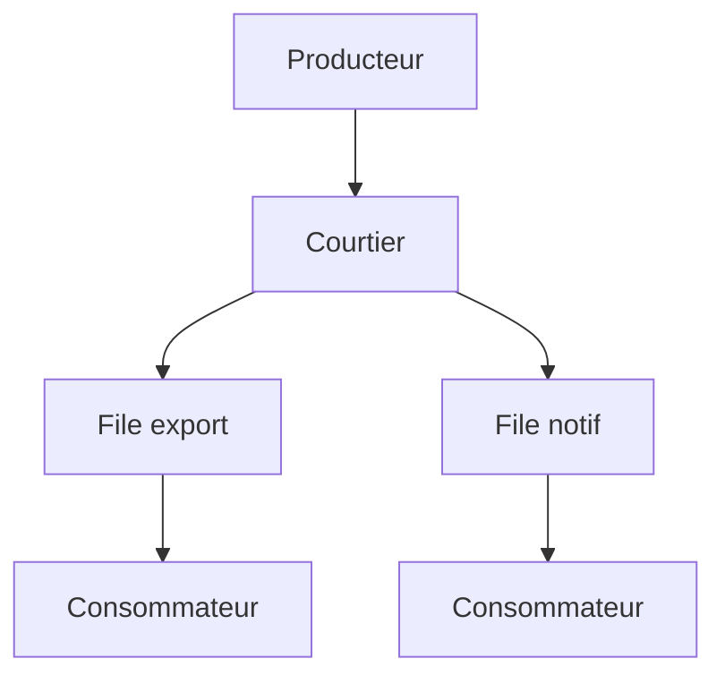

# Architecture événementielle

> [!info] En une phrase
> Dans une architecture événementielle, les services ne s'appellent pas directement : l'un publie un événement (« image exportée ») dans une file ou un bus de messages, et ceux que ça intéresse le traitent quand ils peuvent.

```dataviewjs
await dv.view("10 — Templates/Scripts/learning", { view: "concept" })
```

## 1 · Comprendre
### Définition
**Événement** : un fait passé, au nom au passé (`annotation.creee`, `export.termine`), avec ses données.

**Producteur** : publie l'événement, sans savoir qui l'écoute.

**Consommateur** : s'abonne et réagit, à son rythme.

**Courtier (broker)** : stocke et distribue les messages : RabbitMQ, Kafka, Redis Streams, ou les files intégrées des clouds. Le message attend dans une **file** (queue) si le consommateur est occupé ou en panne.

C'est le patron Observateur à l'échelle de plusieurs programmes.

### Pourquoi ça existe
Quand un service en appelle cinq autres en direct (HTTP), il attend chacun, échoue si l'un tombe, et doit être modifié à chaque nouveau besoin.

### Le problème résolu
Découpler les services, absorber les pics (les messages patientent dans la file), réessayer sans perdre de travail, ajouter un consommateur sans toucher au producteur.

## 2 · Explorer
### Comment ça fonctionne


### Exemple concret
Beaucoup d'applications web fonctionnent ainsi : une tâche lourde crée un **job** dans une file (Redis, RabbitMQ), et un *worker* le traite en arrière-plan. Les webhooks (GitLab, GitHub) publient aussi des événements (`push`, `merge_request`).

```python
# producteur : répond tout de suite
file.publier("export.demande", {"tache_id": 42})
return 202   # Accepted : « c'est noté, ce sera fait »

# consommateur (autre processus)
for message in file.ecouter("export.demande"):
    png = exporter_png(source, message["tache_id"])
    file.publier("export.termine", {"tache_id": 42, "chemin": chemin})
    message.acquitter()    # sinon il sera redistribué
```

### Cas d'utilisation
- Traitements longs (export, entraînement, envoi de mails)
- Webhooks et notifications
- Microservices qui doivent rester indépendants

> [!warning] À ne pas confondre
> Plus de souplesse, mais moins de visibilité : un flux réparti est plus dur à suivre et à déboguer, l'ordre des messages et les doublons sont à gérer (un consommateur doit supporter de recevoir deux fois le même message). Ne pas confondre avec la boucle d'événements de JavaScript, qui est interne à un seul programme.

## 3 · Pratiquer

### Exercice visuel

Sur Excalidraw, **sans regarder la fiche**. Puis je compare avec la fiche, je corrige en rouge ce qui était faux, et j'explique mon dessin à voix haute ou à Claude dans le chat.

> [!example] ⚖️ Avant / après
> Avant / après : un service qui appelle directement trois autres services, puis un service qui publie un événement « dépense ajoutée ». Dessine qui connaît qui.

> [!example] 🛣️ Suis le trajet
> Suis l'événement « dépense ajoutée » : qui le publie, où il passe, qui le reçoit et ce que chacun en fait.

### Mon schéma

> [!tip] Mon dessin Excalidraw
> _Je crée le dessin « Schéma - Architecture événementielle » et je l'intègre ici avec `![[Schéma - Architecture événementielle.excalidraw]]`, puis je coche `schema`._

### Appliquer dans le fil rouge
- Pas encore d'étape du fil rouge pour cette notion : elle sera pratiquée dans le fil rouge de son niveau (voir [[Niveaux]]).

## 4 · Relier
- **Prérequis** : [[Monolithe et microservices]]
- **Complémentaires** : [[Patron Observateur (Observer)]] · [[Patron Commande (Command)]] · [[Boucle d'événements]]

## 5 · Réviser
> [!question] Me faire interroger
> Je demande à Claude de m'interroger sur cette notion pour vérifier que je l'ai comprise.

### Validation (compris, puis maîtrisé)
Trois cases à cocher dans les propriétés de la fiche :
- `schema` : mon dessin du concept est dans « Mon schéma » ;
- `exercice_visuel` : j'ai fait et corrigé les exercices visuels de la section 3 ;
- `fil_rouge` : je l'ai appliqué dans le fil rouge (coché tout seul quand une étape qui l'utilise est réussie).

Les trois cochées : la notion compte comme **comprise**. **Maîtrisé** : c'est moi qui le mets dans `status`, quand je le sens.

```dataviewjs
await dv.view("10 — Templates/Scripts/learning", { view: "maitrise" })
```
