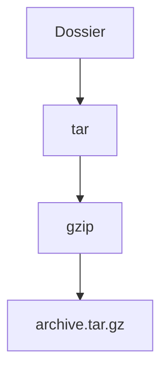

# Archive tar et compression

> [!info] En une phrase
> tar regroupe des fichiers en une archive ; gzip ou xz la compressent : le .tar.gz est le zip du monde Linux.

```dataviewjs
await dv.view("10 — Templates/Scripts/learning", { view: "concept" })
```

## 1 · Comprendre
### Définition
`tar` met plusieurs fichiers dans un seul (en gardant droits et arborescence). On le compresse souvent : `.tar.gz` (gzip, rapide), `.tar.xz` (plus petit, plus lent). Les images Docker et beaucoup de logiciels sont distribués ainsi.

### Pourquoi ça existe
Sauvegarder ou transférer un dossier entier, avec ses droits Linux (ce que le zip garde mal).

### Le problème résolu
Envoyer des centaines de fichiers un par un, et perdre les droits d'exécution en route.

## 2 · Explorer
### Comment ça fonctionne


### Exemple concret
```bash
tar -czf sauvegarde.tar.gz projets/          # c créer, z gzip, f fichier
tar -tzf sauvegarde.tar.gz                   # t lister
tar -xzf sauvegarde.tar.gz -C /tmp/restau    # x extraire, dans un dossier
zip -r archive.zip projets/ ; unzip archive.zip
docker save mon-zipper | gzip > image.tar.gz # une image Docker en archive
```

### Cas d'utilisation
- Sauvegarder un dossier de données avant une manipulation
- Récupérer et installer un outil livré en `.tar.gz`

> [!warning] À ne pas confondre
> `tar -c` (créer) et `tar -x` (extraire) : une lettre de différence. Et extraire une archive inconnue dans le dossier courant peut éparpiller des fichiers : liste d'abord avec `-t`.

## 3 · Pratiquer
- Archive un dossier en `.tar.gz` et en `.zip`, compare les tailles, extrais les deux ailleurs et vérifie les droits d'un script.

## 4 · Expliquer
> [!quote] Mon résumé, avec mes mots
> _À écrire sans regarder la fiche. Si je bloque, je ne l'ai pas encore compris._

## 5 · Relier
- **Prérequis** : [[Arborescence Linux]] · [[Permissions Linux]]
- **Complémentaires** : [[Archive zip (zipfile)]]
- **Commandes** : [[tar]]

## 6 · Réviser
> [!question] Me faire interroger
> Je demande à Claude de m'interroger sur cette notion pour vérifier que je l'ai comprise.

### Validation de la maîtrise
- [ ] Je l'explique sans notes, en 3 phrases, à quelqu'un qui ne connaît pas
- [ ] J'ai réussi un exercice qui l'utilise
- [ ] Je l'ai utilisé dans un projet
- [ ] Je sais dire quand ne pas l'utiliser (ou ce qu'il ne faut pas confondre)
