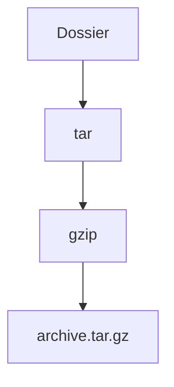

# Archive tar et compression

> [!info] En une phrase
> tar regroupe des fichiers en une archive ; gzip ou xz la compressent : le .tar.gz est le zip du monde Linux.

```dataviewjs
await dv.view("10 — Templates/Scripts/learning", { view: "concept" })
```

## 1 · Comprendre
### Définition
`tar` met plusieurs fichiers dans un seul (en gardant droits et arborescence). On le compresse souvent : `.tar.gz` (gzip, rapide), `.tar.xz` (plus petit, plus lent). Les images Docker et beaucoup de logiciels sont distribués ainsi.

### Pourquoi ça existe
Sauvegarder ou transférer un dossier entier, avec ses droits Linux (ce que le zip garde mal).

### Le problème résolu
Envoyer des centaines de fichiers un par un, et perdre les droits d'exécution en route.

## 2 · Explorer
### Comment ça fonctionne


### Exemple concret
```bash
tar -czf sauvegarde.tar.gz projets/          # c créer, z gzip, f fichier
tar -tzf sauvegarde.tar.gz                   # t lister
tar -xzf sauvegarde.tar.gz -C /tmp/restau    # x extraire, dans un dossier
zip -r archive.zip projets/ ; unzip archive.zip
docker save mon-zipper | gzip > image.tar.gz # une image Docker en archive
```

### Cas d'utilisation
- Sauvegarder un dossier de données avant une manipulation
- Récupérer et installer un outil livré en `.tar.gz`

> [!warning] À ne pas confondre
> `tar -c` (créer) et `tar -x` (extraire) : une lettre de différence. Et extraire une archive inconnue dans le dossier courant peut éparpiller des fichiers : liste d'abord avec `-t`.

## 3 · Pratiquer

### Exercice visuel

Sur Excalidraw, **sans regarder la fiche**. Puis je compare avec la fiche, je corrige en rouge ce qui était faux, et j'explique mon dessin à voix haute ou à Claude dans le chat.

> [!example] ⚖️ Avant / après
> Avant / après : un dossier, puis `dossier.tar`, puis `dossier.tar.gz`. Dessine ce que fait chaque étape (regrouper, compresser).

> [!example] 🔄 Change de contexte
> Redessine-le à côté d'un `.zip`. Quelle différence dans l'ordre regrouper / compresser ?

### Mon schéma

> [!tip] Mon dessin Excalidraw
> _Je crée le dessin « Schéma - Archive tar et compression » et je l'intègre ici avec `![[Schéma - Archive tar et compression.excalidraw]]`, puis je coche `schema`._

### Appliquer dans le fil rouge
- [[Dépenses 11 - Sauvegarder ses données]]

## 4 · Relier
- **Prérequis** : [[Arborescence Linux]] · [[Permissions Linux]]
- **Complémentaires** : [[Archive zip (zipfile)]]
- **Commandes** : [[tar]]

## 5 · Réviser
> [!question] Me faire interroger
> Je demande à Claude de m'interroger sur cette notion pour vérifier que je l'ai comprise.

### Validation de la maîtrise
Trois cases à cocher dans les propriétés de la fiche :
- `schema` : mon dessin du concept est dans « Mon schéma » ;
- `exercice_visuel` : j'ai fait et corrigé les exercices visuels de la section 3 ;
- `fil_rouge` : je l'ai appliqué dans le fil rouge (coché tout seul quand une étape qui l'utilise est réussie).

Les trois cochées : la notion compte comme **comprise**. **Maîtrisé** : c'est moi qui le mets dans `status`, quand je le sens.

```dataviewjs
await dv.view("10 — Templates/Scripts/learning", { view: "maitrise" })
```
