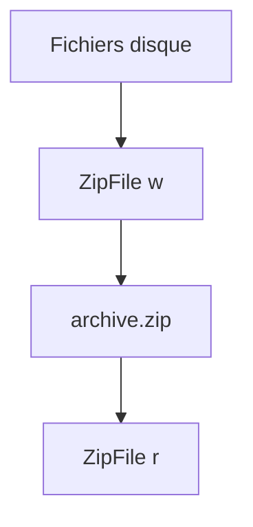

# Archive zip (zipfile)

> [!info] En une phrase
> zipfile crée, lit et extrait des archives .zip fichier par fichier, en choisissant le nom de chaque fichier dans l'archive.

```dataviewjs
await dv.view("10 — Templates/Scripts/learning", { view: "concept" })
```

## 1 · Comprendre
### Définition
Une **archive zip** regroupe plusieurs fichiers (et dossiers) dans un seul fichier, en général **compressé**. Le module `zipfile` ouvre un `ZipFile` en mode `"w"` (créer), `"a"` (ajouter) ou `"r"` (lire).

Chaque fichier ajouté a deux chemins : où il est **sur le disque**, et son nom **dans l'archive** (`arcname`).

### Pourquoi ça existe
Envoyer ou stocker un ensemble de fichiers comme un seul, plus léger.

### Le problème résolu
`shutil.make_archive` zippe un dossier entier d'un coup ; `zipfile` permet de **choisir** quels fichiers mettre, sous quel nom, et de lire une archive sans tout extraire.

## 2 · Explorer
### Comment ça fonctionne

| Pour… | On écrit |
| --- | --- |
| créer | `with zipfile.ZipFile("a.zip", "w", zipfile.ZIP_DEFLATED) as z:` |
| ajouter un fichier | `z.write(chemin_disque, arcname="dans/archive.png")` |
| ajouter du texte | `z.writestr("lisezmoi.txt", "contenu")` |
| lister | `z.namelist()` |
| extraire | `z.extractall("dossier")` |
| lire un fichier sans extraire | `z.read("nom")` |

### Exemple concret
```python
import zipfile
from pathlib import Path

source = Path("donnees")
with zipfile.ZipFile("images.zip", "w", compression=zipfile.ZIP_DEFLATED) as z:
    for f in source.rglob("*.png"):
        z.write(f, arcname=f.relative_to(source))   # garde l'arborescence, sans "donnees/"

with zipfile.ZipFile("images.zip") as z:
    print(z.namelist())
```

### Cas d'utilisation
- Zipper une sélection de fichiers (ton script)
- Lire l'export d'un outil (CVAT exporte ses annotations en `.zip`)

> [!warning] À ne pas confondre
> Sans `arcname`, l'archive garde le chemin complet du disque (`C:/Users/...` ou `/data/...`). Sans `ZIP_DEFLATED`, les fichiers sont seulement **stockés**, pas compressés. Et ne crée pas l'archive **dans** le dossier que tu zippes : elle finirait par s'inclure elle-même.

## 3 · Pratiquer
- Zippe seulement les `.txt` d'un dossier de test, puis liste le contenu de l'archive.
- Compare la taille de l'archive avec et sans `ZIP_DEFLATED`.
- Extrais l'archive dans un nouveau dossier et vérifie que l'arborescence est la bonne.

## 4 · Expliquer
> [!quote] Mon résumé, avec mes mots
> _À écrire sans regarder la fiche. Si je bloque, je ne l'ai pas encore compris._

## 5 · Relier
- **Prérequis** : [[Chemin de fichier en Python (pathlib)]] · [[Boucle (for, while)]]
- **Complémentaires** : [[Copier et déplacer des fichiers (shutil)]] · [[Exception]]
- **Utilisé par** : [[Cours - Manipuler des fichiers et des archives]]

## 6 · Réviser
> [!question] Me faire interroger
> Je demande à Claude de m'interroger sur cette notion pour vérifier que je l'ai comprise.

### Validation de la maîtrise
La notion est maîtrisée quand j'ai réussi **tous les exercices** qui l'utilisent (statut `reussi` dans l'exercice).

```dataviewjs
await dv.view("10 — Templates/Scripts/learning", { view: "maitrise" })
```
