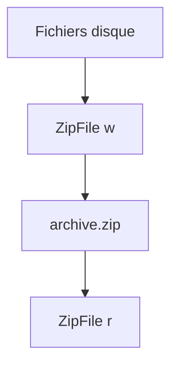

# Archive zip (zipfile)

> [!info] En une phrase
> zipfile crée, lit et extrait des archives .zip fichier par fichier, en choisissant le nom de chaque fichier dans l'archive.

```dataviewjs
await dv.view("10 — Templates/Scripts/learning", { view: "concept" })
```

## 1 · Comprendre
### Définition
Une **archive zip** regroupe plusieurs fichiers (et dossiers) dans un seul fichier, en général **compressé**. Le module `zipfile` ouvre un `ZipFile` en mode `"w"` (créer), `"a"` (ajouter) ou `"r"` (lire).

Chaque fichier ajouté a deux chemins : où il est **sur le disque**, et son nom **dans l'archive** (`arcname`).

### Pourquoi ça existe
Envoyer ou stocker un ensemble de fichiers comme un seul, plus léger.

### Le problème résolu
`shutil.make_archive` zippe un dossier entier d'un coup ; `zipfile` permet de **choisir** quels fichiers mettre, sous quel nom, et de lire une archive sans tout extraire.

## 2 · Explorer
### Comment ça fonctionne

| Pour… | On écrit |
| --- | --- |
| créer | `with zipfile.ZipFile("a.zip", "w", zipfile.ZIP_DEFLATED) as z:` |
| ajouter un fichier | `z.write(chemin_disque, arcname="dans/archive.png")` |
| ajouter du texte | `z.writestr("lisezmoi.txt", "contenu")` |
| lister | `z.namelist()` |
| extraire | `z.extractall("dossier")` |
| lire un fichier sans extraire | `z.read("nom")` |

### Exemple concret
```python
import zipfile
from pathlib import Path

source = Path("donnees")
with zipfile.ZipFile("images.zip", "w", compression=zipfile.ZIP_DEFLATED) as z:
    for f in source.rglob("*.png"):
        z.write(f, arcname=f.relative_to(source))   # garde l'arborescence, sans "donnees/"

with zipfile.ZipFile("images.zip") as z:
    print(z.namelist())
```

### Cas d'utilisation
- Zipper une sélection de fichiers (ton script)

> [!warning] À ne pas confondre
> Sans `arcname`, l'archive garde le chemin complet du disque (`C:/Users/...` ou `/data/...`). Sans `ZIP_DEFLATED`, les fichiers sont seulement **stockés**, pas compressés. Et ne crée pas l'archive **dans** le dossier que tu zippes : elle finirait par s'inclure elle-même.

## 3 · Pratiquer

### Exercice visuel

Sur Excalidraw, **sans regarder la fiche**. Puis je compare avec la fiche, je corrige en rouge ce qui était faux, et j'explique mon dessin à voix haute ou à Claude dans le chat.

> [!example] 🧠 Dessine de mémoire
> Dessine une archive zip comme une boîte avec des fichiers dedans, chacun avec son nom dans l'archive et sa taille compressée.

> [!example] 🛣️ Suis le trajet
> Suis un dossier de trois images jusqu'au zip : la boucle, `writestr` ou `write`, le nom choisi, l'archive finale.

### Mon schéma

> [!tip] Mon dessin Excalidraw
> _Je crée le dessin « Schéma - Archive zip (zipfile) » et je l'intègre ici avec `![[Schéma - Archive zip (zipfile).excalidraw]]`, puis je coche `schema`._

### Appliquer dans le fil rouge
- [[MesDépenses 13 - Sauvegarder la base avec un script]]

## 4 · Relier
- **Au travail** : [[Archive zip (zipfile) au travail]]
- **Prérequis** : [[Chemin de fichier]] · [[Boucle (for, while)]]
- **Complémentaires** : [[Copier et déplacer des fichiers (shutil)]] · [[Exception]]
- **Utilisé par** : [[Cours - Manipuler des fichiers et des archives]] · [[Fichier en mémoire (io.BytesIO)]] (un zip sans fichier) · [[Cours - Envoyer et recevoir des fichiers par HTTP]]

## 5 · Réviser
> [!question] Me faire interroger
> Je demande à Claude de m'interroger sur cette notion pour vérifier que je l'ai comprise.

### Validation (compris, puis maîtrisé)
Trois cases à cocher dans les propriétés de la fiche :
- `schema` : mon dessin du concept est dans « Mon schéma » ;
- `exercice_visuel` : j'ai fait et corrigé les exercices visuels de la section 3 ;
- `fil_rouge` : je l'ai appliqué dans le fil rouge (coché tout seul quand une étape qui l'utilise est réussie).

Les trois cochées : la notion compte comme **comprise**. **Maîtrisé** : c'est moi qui le mets dans `status`, quand je le sens.

```dataviewjs
await dv.view("10 — Templates/Scripts/learning", { view: "maitrise" })
```
