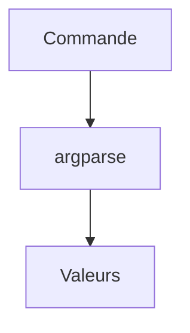

# Arguments de ligne de commande

> [!info] En une phrase
> Les valeurs tapées après le nom du script (python zipper.py photos --sortie export.zip), que le script récupère pour savoir sur quoi travailler.

```dataviewjs
await dv.view("10 — Templates/Scripts/learning", { view: "concept" })
```

## 1 · Comprendre
### Définition
Tout ce qui suit `python script.py` est transmis au script. Deux façons de le lire :
- `sys.argv` : la liste brute (`sys.argv[0]` est le nom du script).
- `argparse` (standard) : décrit les arguments attendus, vérifie, et génère `--help` tout seul.

### Pourquoi ça existe
Lancer le même script sur des dossiers différents sans modifier son code, depuis le terminal, Docker ou la CI.

### Le problème résolu
Un script avec le chemin écrit en dur ne sert qu'une fois ; il faut l'éditer à chaque usage.

## 2 · Explorer
### Comment ça fonctionne


### Exemple concret
```python
import argparse
from pathlib import Path

parser = argparse.ArgumentParser(description="Zippe les fichiers d'un dossier.")
parser.add_argument("dossier", type=Path, help="dossier à traiter")
parser.add_argument("--sortie", type=Path, default=Path("archive.zip"))
parser.add_argument("--extension", default=".png")
args = parser.parse_args()

print(args.dossier, args.sortie, args.extension)
```
```bash
python zipper.py photos --sortie export.zip
python zipper.py --help            # aide générée
```
| Sorte | Exemple | Obligatoire ? |
| --- | --- | --- |
| positionnel | `dossier` | oui |
| option | `--sortie export.zip` | non, valeur par défaut |
| drapeau | `--verbeux` (`action="store_true"`) | non, vaut `True` si présent |

### Cas d'utilisation
- Passer le dossier source et le nom de l'archive au script
- Dans Docker : les arguments après le nom de l'image arrivent au script (voir [[Python dans Docker]])

> [!warning] À ne pas confondre
> Argument de ligne de commande (`python s.py photos`) et [[Variable d'environnement]] (`DOSSIER=photos`). Les arguments disent **quoi traiter**, les variables d'environnement règlent plutôt **la configuration** (adresse d'un serveur, secret).

## 3 · Pratiquer
- Ajoute `argparse` à un de tes scripts avec un argument positionnel et une option, puis lance `--help`.
- Lance-le sans argument et lis le message d'erreur et le code de sortie.

## 4 · Expliquer
> [!quote] Mon résumé, avec mes mots
> _À écrire sans regarder la fiche. Si je bloque, je ne l'ai pas encore compris._

## 5 · Relier
- **Prérequis** : [[Fonction]] · [[Code de sortie]]
- **Complémentaires** : [[Variable d'environnement]]
- **Utilisé par** : [[Python dans Docker]]

## 6 · Réviser
> [!question] Me faire interroger
> Je demande à Claude de m'interroger sur cette notion pour vérifier que je l'ai comprise.

### Validation de la maîtrise
La notion est maîtrisée quand j'ai réussi **tous les exercices** qui l'utilisent (statut `reussi` dans l'exercice).

```dataviewjs
await dv.view("10 — Templates/Scripts/learning", { view: "maitrise" })
```
