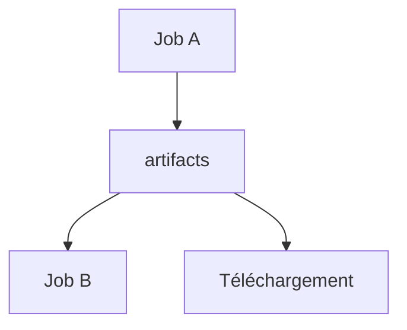

# Artefacts GitLab CI

> [!info] En une phrase
> Les fichiers qu'un job garde à la fin pour les transmettre aux jobs suivants ou les rendre téléchargeables.

```dataviewjs
await dv.view("10 — Templates/Scripts/learning", { view: "concept" })
```

## 1 · Comprendre
### Définition
Chaque job démarre dans un environnement **neuf** : ce qu'un job a créé disparaît à sa fin. `artifacts: paths:` liste les fichiers à **conserver** ; GitLab les envoie au serveur, les fournit aux jobs suivants et les affiche dans l'interface (bouton *Download*).

### Pourquoi ça existe
Passer un résultat d'un job à l'autre (un rapport, un fichier construit) et le récupérer après la pipeline.

### Le problème résolu
Refaire le même travail dans chaque job, ou perdre les rapports de tests à la fin du job.

## 2 · Explorer
### Comment ça fonctionne


### Exemple concret
```yaml
zipper:
  stage: build
  image: python:3.12-slim
  script:
    - python zipper.py donnees --sortie export.zip
  artifacts:
    paths:
      - export.zip
    expire_in: 1 week
    when: always            # garder même si le job échoue (utile pour des logs)

verifier:
  stage: test
  needs: [zipper]           # récupère aussi les artefacts de zipper
  script:
    - python -m zipfile -l export.zip
```
Rapport de tests affiché dans GitLab : `pytest --junitxml=rapport.xml` et `artifacts: reports: junit: rapport.xml`.

### Cas d'utilisation
- Garder les logs ou rapports de tests
- Transmettre un fichier généré à un job suivant

> [!warning] À ne pas confondre
> **Artefacts** (résultats d'un job, transmis aux suivants) et **cache** (`cache:`, accélère des jobs en gardant par exemple les téléchargements pip, sans garantie). Et une **image Docker** ne passe pas par les artefacts : elle passe par un [[Registre Docker]].

## 3 · Pratiquer
- Crée un job qui génère un fichier texte en artefact, et un second job qui l'affiche.
- Télécharge l'artefact depuis l'interface de GitLab.

## 4 · Expliquer
> [!quote] Mon résumé, avec mes mots
> _À écrire sans regarder la fiche. Si je bloque, je ne l'ai pas encore compris._

## 5 · Relier
- **Prérequis** : [[Pipeline GitLab CI]]
- **Complémentaires** : [[Registre Docker]]

## 6 · Réviser
> [!question] Me faire interroger
> Je demande à Claude de m'interroger sur cette notion pour vérifier que je l'ai comprise.

### Validation de la maîtrise
- [ ] Je l'explique sans notes, en 3 phrases, à quelqu'un qui ne connaît pas
- [ ] J'ai réussi un exercice qui l'utilise
- [ ] Je l'ai utilisé dans un projet
- [ ] Je sais dire quand ne pas l'utiliser (ou ce qu'il ne faut pas confondre)
