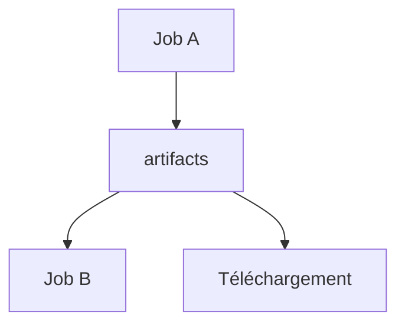

# Artefacts GitLab CI

> [!info] En une phrase
> Les fichiers qu'un job garde à la fin pour les transmettre aux jobs suivants ou les rendre téléchargeables.

```dataviewjs
await dv.view("10 — Templates/Scripts/learning", { view: "concept" })
```

## 1 · Comprendre
### Définition
Chaque job démarre dans un environnement **neuf** : ce qu'un job a créé disparaît à sa fin. `artifacts: paths:` liste les fichiers à **conserver** ; GitLab les envoie au serveur, les fournit aux jobs suivants et les affiche dans l'interface (bouton *Download*).

### Pourquoi ça existe
Passer un résultat d'un job à l'autre (un rapport, un fichier construit) et le récupérer après la pipeline.

### Le problème résolu
Refaire le même travail dans chaque job, ou perdre les rapports de tests à la fin du job.

## 2 · Explorer
### Comment ça fonctionne


### Exemple concret
```yaml
zipper:
  stage: build
  image: python:3.12-slim
  script:
    - python zipper.py donnees --sortie export.zip
  artifacts:
    paths:
      - export.zip
    expire_in: 1 week
    when: always            # garder même si le job échoue (utile pour des logs)

verifier:
  stage: test
  needs: [zipper]           # récupère aussi les artefacts de zipper
  script:
    - python -m zipfile -l export.zip
```
Rapport de tests affiché dans GitLab : `pytest --junitxml=rapport.xml` et `artifacts: reports: junit: rapport.xml`.

### Cas d'utilisation
- Garder les logs ou rapports de tests
- Transmettre un fichier généré à un job suivant

> [!warning] À ne pas confondre
> **Artefacts** (résultats d'un job, transmis aux suivants) et **cache** (`cache:`, accélère des jobs en gardant par exemple les téléchargements pip, sans garantie). Et une **image Docker** ne passe pas par les artefacts : elle passe par un [[Registre Docker]].

## 3 · Pratiquer

### Exercice visuel

Sur Excalidraw, **sans regarder la fiche**. Puis je compare avec la fiche, je corrige en rouge ce qui était faux, et j'explique mon dessin à voix haute ou à Claude dans le chat.

> [!example] 🛣️ Suis le trajet
> Dessine deux jobs : le premier produit `dist/`, le garde en artefact ; le second le récupère. Montre le chemin du dossier entre les deux.

> [!example] 🔍 Trouve l'erreur
> Ce schéma est faux. Corrige-le en rouge et explique l'erreur.
>
> ```mermaid
> flowchart TD
>   J1[Job build] --> D[dist créé]
>   D --> J2[Job suivant]
>   J2 --> V[dist présent]
> ```

### Mon schéma

> [!tip] Mon dessin Excalidraw
> _Je crée le dessin « Schéma - Artefacts GitLab CI » et je l'intègre ici avec `![[Schéma - Artefacts GitLab CI.excalidraw]]`, puis je coche `schema`._

### Appliquer dans le fil rouge
- [[MesDépenses 09 - La CI du front Vue]]
- [[Fil rouge 07 - Tester l'image et ranger la pipeline]]

## 4 · Relier
- **Prérequis** : [[Pipeline GitLab CI]]
- **Complémentaires** : [[Registre Docker]]

## 5 · Réviser
> [!question] Me faire interroger
> Je demande à Claude de m'interroger sur cette notion pour vérifier que je l'ai comprise.

### Validation de la maîtrise
Trois cases à cocher dans les propriétés de la fiche :
- `schema` : mon dessin du concept est dans « Mon schéma » ;
- `exercice_visuel` : j'ai fait et corrigé les exercices visuels de la section 3 ;
- `fil_rouge` : je l'ai appliqué dans le fil rouge (coché tout seul quand une étape qui l'utilise est réussie).

Les trois cochées : la notion compte comme **comprise**. **Maîtrisé** : c'est moi qui le mets dans `status`, quand je le sens.

```dataviewjs
await dv.view("10 — Templates/Scripts/learning", { view: "maitrise" })
```
