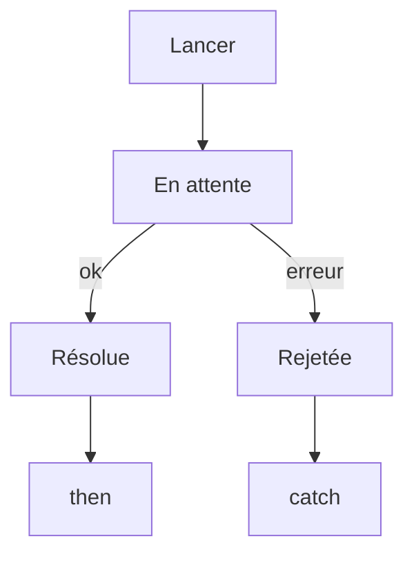

# Asynchrone et Promesse

> [!info] En une phrase
> Une opération asynchrone (réseau, fichier, minuterie) finit plus tard ; une Promesse représente ce résultat futur, qui sera tenu (résolu) ou rompu (rejeté).

```dataviewjs
await dv.view("10 — Templates/Scripts/learning", { view: "concept" })
```

## 1 · Comprendre
### Définition
JavaScript n'exécute qu'**une chose à la fois** (un seul fil). Pour ne pas bloquer la page pendant un appel réseau, l'opération est lancée, puis le code continue ; quand le résultat arrive, une fonction est appelée. C'est la **boucle d'événements**.

Une **Promesse** (`Promise`) est un objet dans l'un de ces états : *en attente*, *résolue* (avec une valeur) ou *rejetée* (avec une erreur).
```js
fetch("/api/taches")                  // renvoie une Promesse
  .then((rep) => rep.json())          // quand la réponse arrive
  .then((taches) => console.log(taches))
  .catch((err) => console.error(err)) // si ça échoue
  .finally(() => console.log("fini"));
```

### Pourquoi ça existe
Le réseau est lent (des millisecondes à des secondes). Bloquer en attendant figerait toute l'interface.

### Le problème résolu
Enchaîner des opérations qui prennent du temps sans imbriquer des callbacks à l'infini (le « callback hell »).

## 2 · Explorer
### Comment ça fonctionne


### Exemple concret
```js
console.log("1");
setTimeout(() => console.log("3"), 0);
Promise.resolve().then(() => console.log("2bis"));
console.log("2");
// Affiche : 1, 2, 2bis, 3 : le code asynchrone passe APRÈS le code en cours
```
Plusieurs à la fois : `await Promise.all([p1, p2])` attend toutes les promesses.

### Cas d'utilisation
- Tout appel d'API
- Lecture de fichiers dans Node
- Attendre une animation ou une minuterie

> [!warning] À ne pas confondre
> Une Promesse n'est **pas** la valeur : `const data = fetch(url)` donne une Promesse, pas les données. Il faut `.then()` ou `await`.

## 3 · Pratiquer
- Prédis l'ordre d'affichage d'un mélange de `console.log`, `setTimeout` et `Promise.then`, puis vérifie
- Écris une fonction `attendre(ms)` qui renvoie une Promesse résolue après ms millisecondes

## 4 · Expliquer
> [!quote] Mon résumé, avec mes mots
> _À écrire sans regarder la fiche. Si je bloque, je ne l'ai pas encore compris._

## 5 · Relier
- **Prérequis** : [[Fonction fléchée et callback]]
- **Complémentaires** : [[async et await]] · [[Boucle d'événements]]
- **Utilisé par** : [[Appeler une API avec fetch]]

## 6 · Réviser
> [!question] Me faire interroger
> Je demande à Claude de m'interroger sur cette notion pour vérifier que je l'ai comprise.

### Validation de la maîtrise
La notion est maîtrisée quand j'ai réussi **tous les exercices** qui l'utilisent (statut `reussi` dans l'exercice).

```dataviewjs
await dv.view("10 — Templates/Scripts/learning", { view: "maitrise" })
```
