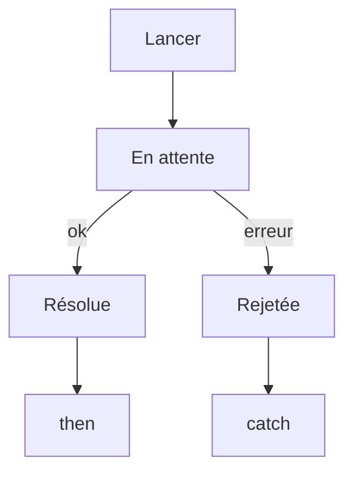

# Asynchrone et Promesse

> [!info] En une phrase
> Une opération asynchrone (réseau, fichier, minuterie) finit plus tard ; une Promesse représente ce résultat futur, qui sera tenu (résolu) ou rompu (rejeté).

```dataviewjs
await dv.view("10 — Templates/Scripts/learning", { view: "concept" })
```

## 1 · Comprendre
### Définition
JavaScript n'exécute qu'**une chose à la fois** (un seul fil). Pour ne pas bloquer la page pendant un appel réseau, l'opération est lancée, puis le code continue ; quand le résultat arrive, une fonction est appelée. C'est la **boucle d'événements**.

Une **Promesse** (`Promise`) est un objet dans l'un de ces états : *en attente*, *résolue* (avec une valeur) ou *rejetée* (avec une erreur).
```js
fetch("/api/taches")                  // renvoie une Promesse
  .then((rep) => rep.json())          // quand la réponse arrive
  .then((taches) => console.log(taches))
  .catch((err) => console.error(err)) // si ça échoue
  .finally(() => console.log("fini"));
```

### Pourquoi ça existe
Le réseau est lent (des millisecondes à des secondes). Bloquer en attendant figerait toute l'interface.

### Le problème résolu
Enchaîner des opérations qui prennent du temps sans imbriquer des callbacks à l'infini (le « callback hell »).

## 2 · Explorer
### Comment ça fonctionne


### Exemple concret
```js
console.log("1");
setTimeout(() => console.log("3"), 0);
Promise.resolve().then(() => console.log("2bis"));
console.log("2");
// Affiche : 1, 2, 2bis, 3 : le code asynchrone passe APRÈS le code en cours
```
Plusieurs à la fois : `await Promise.all([p1, p2])` attend toutes les promesses.

### Cas d'utilisation
- Tout appel d'API
- Lecture de fichiers dans Node
- Attendre une animation ou une minuterie

> [!warning] À ne pas confondre
> Une Promesse n'est **pas** la valeur : `const data = fetch(url)` donne une Promesse, pas les données. Il faut `.then()` ou `await`.

## 3 · Pratiquer

### Exercice visuel

Sur Excalidraw, **sans regarder la fiche**. Puis je compare avec la fiche, je corrige en rouge ce qui était faux, et j'explique mon dessin avec mes mots (section 4).

> [!example] 🧠 Dessine de mémoire
> Dessine une Promesse comme un ticket de commande : ses trois états (en attente, tenue, rompue) et ce qui fait passer de l'un à l'autre.

> [!example] ⚖️ Avant / après
> Avant / après : charger les dépenses en bloquant la page, puis avec une Promesse. Dessine ce que l'utilisateur peut faire pendant l'attente.

### Mon schéma

> [!tip] Mon dessin Excalidraw
> _Je crée le dessin « Schéma - Asynchrone et Promesse » et je l'intègre ici avec `![[Schéma - Asynchrone et Promesse.excalidraw]]`._

### Appliquer dans le fil rouge
- Pas encore d'étape du fil rouge pour cette notion : je l'applique dans mon travail (CVAT, Nuclio) ou je demande une étape à Claude.

## 4 · Expliquer
> [!quote] Mon résumé, avec mes mots
> _J'explique mon schéma avec mes mots, sans regarder la fiche. Si je bloque, je ne l'ai pas encore compris._

## 5 · Relier
- **Prérequis** : [[Fonction fléchée et callback]]
- **Complémentaires** : [[async et await]] · [[Boucle d'événements]]
- **Utilisé par** : [[Appeler une API avec fetch]]

## 6 · Réviser
> [!question] Me faire interroger
> Je demande à Claude de m'interroger sur cette notion pour vérifier que je l'ai comprise.

### Validation de la maîtrise
La notion est maîtrisée quand je sais :
1. **l'expliquer** de façon fluide, à partir de mon schéma (section 4) ;
2. **l'adapter** à un autre contexte (consigne « Change de contexte », ou Claude m'interroge sur un autre cas) ;
3. **l'appliquer** pour de vrai dans le fil rouge (section 3).

Réussir un exercice ne suffit pas. C'est moi qui passe le statut en `maitrise`.

```dataviewjs
await dv.view("10 — Templates/Scripts/learning", { view: "maitrise" })
```
