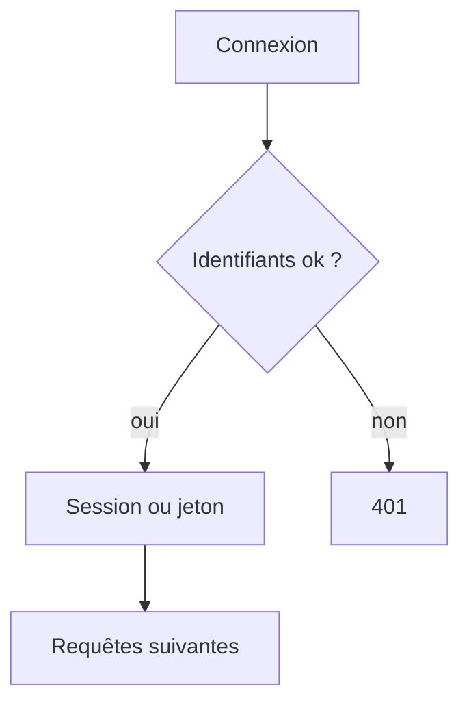

# Authentification

> [!info] En une phrase
> L'authentification vérifie qui tu es (mot de passe, clé, jeton) ; l'autorisation, qui vient après, décide ce que tu as le droit de faire.

```dataviewjs
await dv.view("10 — Templates/Scripts/learning", { view: "concept" })
```

## 1 · Comprendre
### Définition
- **Authentification** (*authN*) : prouver son identité. Facteurs : ce que je **sais** (mot de passe), ce que j'**ai** (téléphone, clé de sécurité), ce que je **suis** (empreinte). Deux facteurs = **2FA / MFA**.
- **Autorisation** (*authZ*) : une fois identifié, ai-je le droit ? Voir [[Autorisation et rôles]].
Après la connexion, le serveur doit reconnaître l'utilisateur à **chaque** requête (HTTP ne se souvient de rien) : soit avec une [[Session et cookie|session]] côté serveur, soit avec un **jeton** comme un [[JWT]], envoyé dans `Authorization: Bearer …`.

### Pourquoi ça existe
Une application qui a des données privées doit savoir qui lui parle.

### Le problème résolu
Réserver les données et les actions aux bonnes personnes, et tracer qui fait quoi.

## 2 · Explorer
### Comment ça fonctionne


### Exemple concret
```bash
# 1. se connecter : le serveur vérifie et renvoie un jeton
curl -X POST https://api.exemple.com/login -H "Content-Type: application/json" \
     -d '{"email":"oumar@ex.com","motDePasse":"…"}'
# {"jeton":"eyJhbGciOi…"}
# 2. chaque requête suivante présente le jeton
curl https://api.exemple.com/moi -H "Authorization: Bearer eyJhbGciOi…"
```
Une API web accepte souvent une session (navigateur), un jeton (`Authorization: Token …`) ou une connexion via un fournisseur ([[OAuth 2 et OpenID Connect]]).

### Cas d'utilisation
- Connexion à une application
- Appels d'API par un script (jeton)
- Connexion d'entreprise (SSO)

> [!warning] À ne pas confondre
> **Authentification** (qui ?) et **autorisation** (le droit ?) ; d'où **401** (pas authentifié) et **403** (authentifié mais refusé).

## 3 · Pratiquer

### Exercice visuel

Sur Excalidraw, **sans regarder la fiche**. Puis je compare avec la fiche, je corrige en rouge ce qui était faux, et j'explique mon dessin à voix haute ou à Claude dans le chat.

> [!example] 🧠 Dessine de mémoire
> Dessine deux portes : l'authentification (qui es-tu ?) puis l'autorisation (as-tu le droit ?). Place un exemple de ton application à chaque porte.

> [!example] 🛣️ Suis le trajet
> Suis ta connexion à une appli web : identifiants, réponse du serveur, ce que le navigateur garde pour les requêtes suivantes.

### Mon schéma

> [!tip] Mon dessin Excalidraw
> _Je crée le dessin « Schéma - Authentification » et je l'intègre ici avec `![[Schéma - Authentification.excalidraw]]`, puis je coche `schema`._

### Appliquer dans le fil rouge
- Pas encore d'étape du fil rouge pour cette notion : elle sera pratiquée dans le fil rouge de son niveau (voir [[Niveaux]]).

## 4 · Relier
- **Prérequis** : [[HTTP]] · [[En-tête HTTP]]
- **Complémentaires** : [[Autorisation et rôles]] · [[Session et cookie]] · [[JWT]]
- **Utilisé par** : [[OAuth 2 et OpenID Connect]]

## 5 · Réviser
> [!question] Me faire interroger
> Je demande à Claude de m'interroger sur cette notion pour vérifier que je l'ai comprise.

### Validation (compris, puis maîtrisé)
Trois cases à cocher dans les propriétés de la fiche :
- `schema` : mon dessin du concept est dans « Mon schéma » ;
- `exercice_visuel` : j'ai fait et corrigé les exercices visuels de la section 3 ;
- `fil_rouge` : je l'ai appliqué dans le fil rouge (coché tout seul quand une étape qui l'utilise est réussie).

Les trois cochées : la notion compte comme **comprise**. **Maîtrisé** : c'est moi qui le mets dans `status`, quand je le sens.

```dataviewjs
await dv.view("10 — Templates/Scripts/learning", { view: "maitrise" })
```
