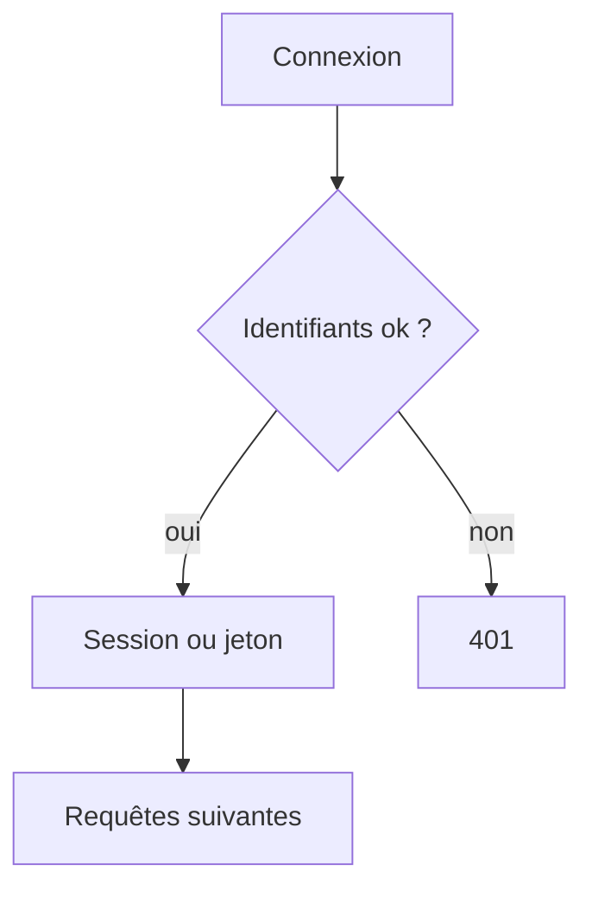

# Authentification

> [!info] En une phrase
> L'authentification vérifie qui tu es (mot de passe, clé, jeton) ; l'autorisation, qui vient après, décide ce que tu as le droit de faire.

```dataviewjs
await dv.view("10 — Templates/Scripts/learning", { view: "concept" })
```

## 1 · Comprendre
### Définition
- **Authentification** (*authN*) : prouver son identité. Facteurs : ce que je **sais** (mot de passe), ce que j'**ai** (téléphone, clé de sécurité), ce que je **suis** (empreinte). Deux facteurs = **2FA / MFA**.
- **Autorisation** (*authZ*) : une fois identifié, ai-je le droit ? Voir [[Autorisation et rôles]].
Après la connexion, le serveur doit reconnaître l'utilisateur à **chaque** requête (HTTP ne se souvient de rien) : soit avec une [[Session et cookie|session]] côté serveur, soit avec un **jeton** comme un [[JWT]], envoyé dans `Authorization: Bearer …`.

### Pourquoi ça existe
Une application qui a des données privées doit savoir qui lui parle.

### Le problème résolu
Réserver les données et les actions aux bonnes personnes, et tracer qui fait quoi.

## 2 · Explorer
### Comment ça fonctionne


### Exemple concret
```bash
# 1. se connecter : le serveur vérifie et renvoie un jeton
curl -X POST https://api.exemple.com/login -H "Content-Type: application/json" \
     -d '{"email":"oumar@ex.com","motDePasse":"…"}'
# {"jeton":"eyJhbGciOi…"}
# 2. chaque requête suivante présente le jeton
curl https://api.exemple.com/moi -H "Authorization: Bearer eyJhbGciOi…"
```
CVAT accepte une session (navigateur), un jeton (`Authorization: Token …`) ou une connexion via un fournisseur ([[OAuth 2 et OpenID Connect]]).

### Cas d'utilisation
- Connexion à une application
- Appels d'API par un script (jeton)
- Connexion d'entreprise (SSO)

> [!warning] À ne pas confondre
> **Authentification** (qui ?) et **autorisation** (le droit ?) ; d'où **401** (pas authentifié) et **403** (authentifié mais refusé).

## 3 · Pratiquer
- Pour trois applications que tu utilises, note comment tu t'authentifies et comment elles te reconnaissent ensuite

## 4 · Expliquer
> [!quote] Mon résumé, avec mes mots
> _À écrire sans regarder la fiche. Si je bloque, je ne l'ai pas encore compris._

## 5 · Relier
- **Prérequis** : [[HTTP]] · [[En-tête HTTP]]
- **Complémentaires** : [[Autorisation et rôles]] · [[Session et cookie]] · [[JWT]]
- **Utilisé par** : [[OAuth 2 et OpenID Connect]]

## 6 · Réviser
> [!question] Me faire interroger
> Je demande à Claude de m'interroger sur cette notion pour vérifier que je l'ai comprise.

### Validation de la maîtrise
La notion est maîtrisée quand j'ai réussi **tous les exercices** qui l'utilisent (statut `reussi` dans l'exercice).

```dataviewjs
await dv.view("10 — Templates/Scripts/learning", { view: "maitrise" })
```
