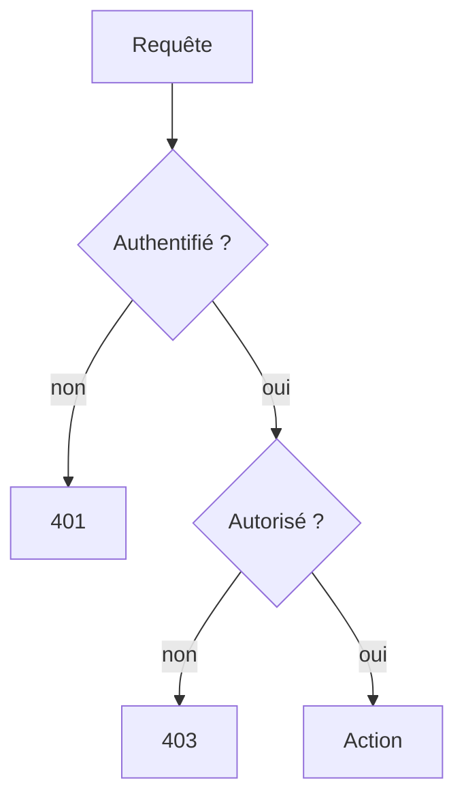

# Autorisation et rôles

> [!info] En une phrase
> L'autorisation décide si un utilisateur identifié peut faire une action sur une ressource, souvent selon son rôle (admin, annotateur, lecteur) et selon qui possède la ressource.

```dataviewjs
await dv.view("10 — Templates/Scripts/learning", { view: "concept" })
```

## 1 · Comprendre
### Définition
Deux vérifications, **à chaque requête, côté serveur** :
1. **Par rôle** (*RBAC*) : un `lecteur` ne peut pas supprimer de tâche.
2. **Par propriété** : un utilisateur ne peut modifier **que ses** tâches, même s'il a le bon rôle.
Principe du **moindre privilège** : chaque utilisateur, jeton, compte de service ou conteneur a **le minimum** de droits nécessaires.
CVAT a des rôles globaux (admin, user, worker) et des rôles par organisation (owner, maintainer, supervisor, worker).

### Pourquoi ça existe
Être connecté ne veut pas dire avoir tous les droits.

### Le problème résolu
Empêcher un utilisateur d'accéder aux données d'un autre en changeant simplement un identifiant dans l'URL.

## 2 · Explorer
### Comment ça fonctionne


### Exemple concret
```js
const exigerRole = (...roles) => (req, res, next) =>
  roles.includes(req.user.role) ? next() : res.status(403).json({ erreur: "Interdit" });

app.delete("/taches/:id", exigerAuth, exigerRole("admin", "superviseur"), async (req, res) => { /* … */ });

app.patch("/notes/:id", exigerAuth, async (req, res) => {
  const note = await trouverNote(req.params.id);
  if (!note) return res.sendStatus(404);
  if (note.auteurId !== req.user.sub) return res.sendStatus(403);   // propriété
  // …
});
```
La faille la plus fréquente du web (*Broken Access Control*, n° 1 de l'OWASP) : oublier ce second test.

### Cas d'utilisation
- Interfaces d'administration
- API multi-utilisateurs
- Jetons de CI et comptes de service avec des droits limités

> [!warning] À ne pas confondre
> Cacher un bouton dans l'interface n'est **pas** une autorisation : n'importe qui peut appeler l'API directement. Le contrôle se fait sur le serveur.

## 3 · Pratiquer

### Exercice visuel

Sur Excalidraw, **sans regarder la fiche**. Puis je compare avec la fiche, je corrige en rouge ce qui était faux, et j'explique mon dessin avec mes mots (section 4).

> [!example] 🧠 Dessine de mémoire
> Dessine deux rôles (lecteur, administrateur) et les routes de MesDépenses que chacun peut appeler.

> [!example] 🔍 Trouve l'erreur
> Ce schéma est faux. Corrige-le en rouge et explique l'erreur.
>
> ```mermaid
> flowchart TD
>   F[Bouton caché] --> S[Route protégée]
>   S --> OK[Sécurité assurée]
> ```

### Mon schéma

> [!tip] Mon dessin Excalidraw
> _Je crée le dessin « Schéma - Autorisation et rôles » et je l'intègre ici avec `![[Schéma - Autorisation et rôles.excalidraw]]`._

### Appliquer dans le fil rouge
- Pas encore d'étape du fil rouge pour cette notion : je l'applique dans mon travail (CVAT, Nuclio) ou je demande une étape à Claude.

## 4 · Expliquer
> [!quote] Mon résumé, avec mes mots
> _J'explique mon schéma avec mes mots, sans regarder la fiche. Si je bloque, je ne l'ai pas encore compris._

## 5 · Relier
- **Prérequis** : [[Authentification]]
- **Complémentaires** : [[Permissions Linux]] · [[Middleware]]

## 6 · Réviser
> [!question] Me faire interroger
> Je demande à Claude de m'interroger sur cette notion pour vérifier que je l'ai comprise.

### Validation de la maîtrise
La notion est maîtrisée quand je sais :
1. **l'expliquer** de façon fluide, à partir de mon schéma (section 4) ;
2. **l'adapter** à un autre contexte (consigne « Change de contexte », ou Claude m'interroge sur un autre cas) ;
3. **l'appliquer** pour de vrai dans le fil rouge (section 3).

Réussir un exercice ne suffit pas. C'est moi qui passe le statut en `maitrise`.

```dataviewjs
await dv.view("10 — Templates/Scripts/learning", { view: "maitrise" })
```
