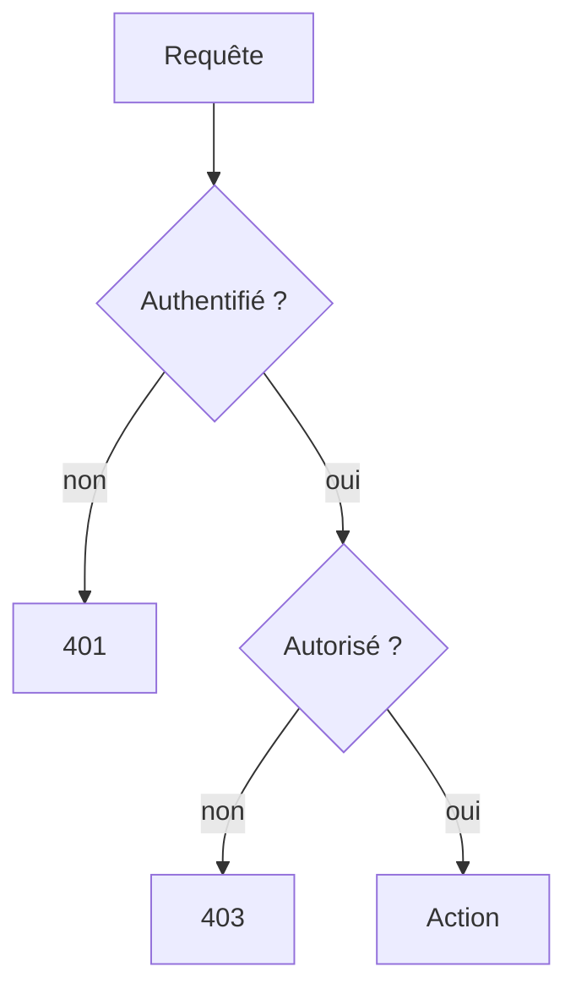

# Autorisation et rôles

> [!info] En une phrase
> L'autorisation décide si un utilisateur identifié peut faire une action sur une ressource, souvent selon son rôle (admin, annotateur, lecteur) et selon qui possède la ressource.

## 1 · Comprendre
### Définition
Deux vérifications, **à chaque requête, côté serveur** :
1. **Par rôle** (*RBAC*) : un `lecteur` ne peut pas supprimer de tâche.
2. **Par propriété** : un utilisateur ne peut modifier **que ses** tâches, même s'il a le bon rôle.
Principe du **moindre privilège** : chaque utilisateur, jeton, compte de service ou conteneur a **le minimum** de droits nécessaires.
GitLab a des rôles par projet (guest, reporter, developer, maintainer, owner) : chacun débloque plus d'actions.

### Pourquoi ça existe
Être connecté ne veut pas dire avoir tous les droits.

### Le problème résolu
Empêcher un utilisateur d'accéder aux données d'un autre en changeant simplement un identifiant dans l'URL.

## 2 · Explorer
### Comment ça fonctionne


### Exemple concret
```js
const exigerRole = (...roles) => (req, res, next) =>
  roles.includes(req.user.role) ? next() : res.status(403).json({ erreur: "Interdit" });

app.delete("/taches/:id", exigerAuth, exigerRole("admin", "superviseur"), async (req, res) => { /* … */ });

app.patch("/notes/:id", exigerAuth, async (req, res) => {
  const note = await trouverNote(req.params.id);
  if (!note) return res.sendStatus(404);
  if (note.auteurId !== req.user.sub) return res.sendStatus(403);   // propriété
  // …
});
```
La faille la plus fréquente du web (*Broken Access Control*, n° 1 de l'OWASP) : oublier ce second test.

### Cas d'utilisation
- Interfaces d'administration
- API multi-utilisateurs
- Jetons de CI et comptes de service avec des droits limités

> [!warning] À ne pas confondre
> Cacher un bouton dans l'interface n'est **pas** une autorisation : n'importe qui peut appeler l'API directement. Le contrôle se fait sur le serveur.

## 3 · Relier
- **Prérequis** : [[Authentification]]
- **Complémentaires** : [[Permissions Linux]] · [[Middleware]]
