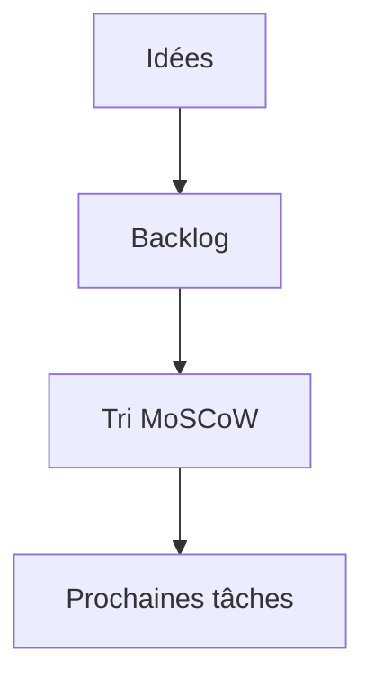

# Backlog et priorisation

> [!info] En une phrase
> Le backlog est la **liste ordonnée de tout ce qui reste à faire** sur un produit (stories, bugs, dette technique). La priorisation consiste à décider l'ordre : on fait d'abord ce qui apporte le plus de valeur ou réduit le plus de risque.

```dataviewjs
await dv.view("10 — Templates/Scripts/learning", { view: "concept" })
```

## 1 · Comprendre
### Définition
**Le haut du backlog** contient des éléments petits, clairs, prêts à être développés. Le bas peut rester flou : on le précisera plus tard (ou jamais).

**On le revoit régulièrement** (*affinage*, *refinement*) : découper, préciser, réordonner, supprimer ce qui n'a plus de sens.

**Méthode MoSCoW** pour trier :
- **M**ust : indispensable, sinon le produit ne sert à rien (le MVP) ;
- **S**hould : important, mais on peut livrer sans ;
- **C**ould : agréable si on a le temps ;
- **W**on't (this time) : pas maintenant, et on le dit clairement.

**Valeur contre effort** : ce qui rapporte beaucoup pour peu d'effort passe en premier ; ce qui rapporte peu pour beaucoup d'effort descend.

**Les risques d'abord** : ce qui est incertain techniquement se traite tôt (c'est le rôle d'un POC).

### Pourquoi ça existe
Il y a toujours plus d'idées que de temps. Sans ordre clair, on travaille sur ce qui est amusant ou urgent plutôt que sur ce qui compte.

### Le problème résolu
Savoir à tout moment quelle est la prochaine chose la plus utile à faire.

## 2 · Explorer
### Comment ça fonctionne


### Exemple concret
```text
Backlog de l'export CVAT (ordonné)
1. [Must]   Construire l'image CVAT en CI avec le Nexus        (risque élevé)
2. [Must]   Fonction Nuclio qui renvoie un PNG
3. [Must]   Bouton React qui appelle la fonction
4. [Must]   Message d'erreur clair si l'export échoue
5. [Should] Journaliser chaque export
6. [Could]  Choisir l'épaisseur du trait
7. [Won't]  Export PDF (pas pour cette version)
```

### Cas d'utilisation
- Décider quoi mettre dans le MVP
- Dire non (ou « pas maintenant ») à une demande sans la perdre

> [!warning] À ne pas confondre
> Le backlog n'est pas une liste de promesses : un élément qui y figure peut être retiré. Et tout mettre en « Must » revient à ne pas prioriser.

## 3 · Pratiquer
- Classe les tâches de ton projet CVAT avec MoSCoW et mets-les dans l'ordre

## 4 · Expliquer
> [!quote] Mon résumé, avec mes mots
> _À écrire sans regarder la fiche. Si je bloque, je ne l'ai pas encore compris._

## 5 · Relier
- **Prérequis** : [[User story]]
- **Complémentaires** : [[Méthode agile (Scrum et Kanban)]] · [[MVP (produit minimum viable)]] · [[Principes DRY, KISS et YAGNI]]

## 6 · Réviser
> [!question] Me faire interroger
> Je demande à Claude de m'interroger sur cette notion pour vérifier que je l'ai comprise.

### Validation de la maîtrise
La notion est maîtrisée quand j'ai réussi **tous les exercices** qui l'utilisent (statut `reussi` dans l'exercice).

```dataviewjs
await dv.view("10 — Templates/Scripts/learning", { view: "maitrise" })
```
