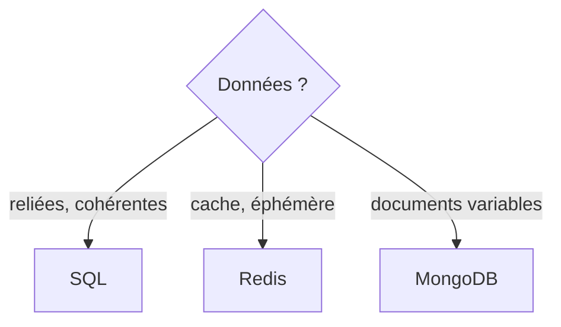

# Base NoSQL

> [!info] En une phrase
> NoSQL désigne les bases qui ne rangent pas les données en tables reliées : documents JSON (MongoDB), clé-valeur (Redis), colonnes ou graphes, chacune adaptée à un usage.

```dataviewjs
await dv.view("10 — Templates/Scripts/learning", { view: "concept" })
```

## 1 · Comprendre
### Définition
| Famille | Exemple | Stocke | Bon pour |
| --- | --- | --- | --- |
| Document | MongoDB | des documents JSON | données de forme variable |
| Clé-valeur | **Redis** | `clé → valeur`, en mémoire | cache, sessions, files d'attente |
| Colonnes | Cassandra | énormes volumes distribués | journaux, capteurs |
| Graphe | Neo4j | nœuds et relations | réseaux, recommandations |
Elles sacrifient souvent les jointures et une partie des garanties [[Transaction|ACID]] pour la souplesse ou la vitesse.

### Pourquoi ça existe
Certains besoins (cache ultra-rapide, documents sans schéma fixe, volumes énormes) collent mal aux tables relationnelles.

### Le problème résolu
Choisir l'outil adapté au lieu de tout forcer dans une base SQL, ou l'inverse.

## 2 · Explorer
### Comment ça fonctionne


### Exemple concret
```bash
docker run -d --name redis -p 6379:6379 redis:7
docker exec -it redis redis-cli
> SET session:abc "oumar" EX 3600
> GET session:abc
"oumar"
> TTL session:abc
(integer) 3598
```
CVAT utilise PostgreSQL pour ses données **et** Redis pour ses files de tâches et son cache.

### Cas d'utilisation
- Cache devant une API lente
- Sessions d'utilisateurs
- File de tâches en arrière-plan

> [!warning] À ne pas confondre
> « NoSQL » ne veut pas dire « plus moderne » ni « sans structure » : pour des données reliées qui doivent rester cohérentes, une base relationnelle reste le choix par défaut.

## 3 · Pratiquer
- Lance Redis dans Docker et utilise `SET` avec expiration, `GET`, `INCR` et `DEL`

## 4 · Expliquer
> [!quote] Mon résumé, avec mes mots
> _À écrire sans regarder la fiche. Si je bloque, je ne l'ai pas encore compris._

## 5 · Relier
- **Prérequis** : [[Base de données relationnelle]] · [[JSON]]
- **Complémentaires** : [[Docker]]

## 6 · Réviser
> [!question] Me faire interroger
> Je demande à Claude de m'interroger sur cette notion pour vérifier que je l'ai comprise.

### Validation de la maîtrise
La notion est maîtrisée quand j'ai réussi **tous les exercices** qui l'utilisent (statut `reussi` dans l'exercice).

```dataviewjs
await dv.view("10 — Templates/Scripts/learning", { view: "maitrise" })
```
