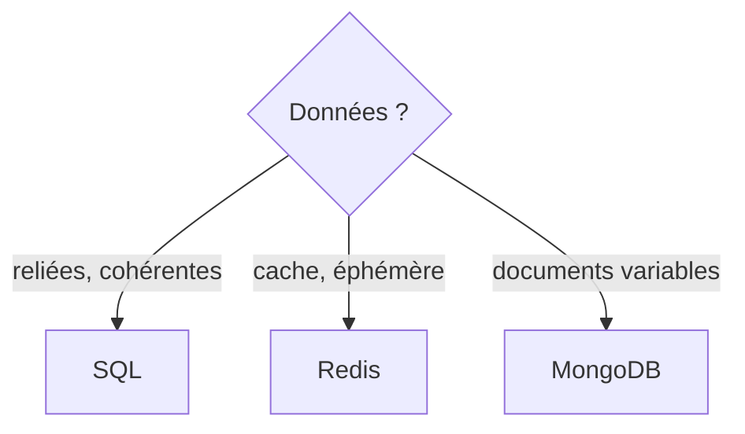

# Base NoSQL

> [!info] En une phrase
> NoSQL désigne les bases qui ne rangent pas les données en tables reliées : documents JSON (MongoDB), clé-valeur (Redis), colonnes ou graphes, chacune adaptée à un usage.

```dataviewjs
await dv.view("10 — Templates/Scripts/learning", { view: "concept" })
```

## 1 · Comprendre
### Définition
| Famille | Exemple | Stocke | Bon pour |
| --- | --- | --- | --- |
| Document | MongoDB | des documents JSON | données de forme variable |
| Clé-valeur | **Redis** | `clé → valeur`, en mémoire | cache, sessions, files d'attente |
| Colonnes | Cassandra | énormes volumes distribués | journaux, capteurs |
| Graphe | Neo4j | nœuds et relations | réseaux, recommandations |
Elles sacrifient souvent les jointures et une partie des garanties [[Transaction|ACID]] pour la souplesse ou la vitesse.

### Pourquoi ça existe
Certains besoins (cache ultra-rapide, documents sans schéma fixe, volumes énormes) collent mal aux tables relationnelles.

### Le problème résolu
Choisir l'outil adapté au lieu de tout forcer dans une base SQL, ou l'inverse.

## 2 · Explorer
### Comment ça fonctionne


### Exemple concret
```bash
docker run -d --name redis -p 6379:6379 redis:7
docker exec -it redis redis-cli
> SET session:abc "oumar" EX 3600
> GET session:abc
"oumar"
> TTL session:abc
(integer) 3598
```
CVAT utilise PostgreSQL pour ses données **et** Redis pour ses files de tâches et son cache.

### Cas d'utilisation
- Cache devant une API lente
- Sessions d'utilisateurs
- File de tâches en arrière-plan

> [!warning] À ne pas confondre
> « NoSQL » ne veut pas dire « plus moderne » ni « sans structure » : pour des données reliées qui doivent rester cohérentes, une base relationnelle reste le choix par défaut.

## 3 · Pratiquer

### Exercice visuel

Sur Excalidraw, **sans regarder la fiche**. Puis je compare avec la fiche, je corrige en rouge ce qui était faux, et j'explique mon dessin avec mes mots (section 4).

> [!example] 🧠 Dessine de mémoire
> Dessine les mêmes dépenses rangées de deux façons : en tables reliées (SQL), puis en documents JSON (MongoDB).

> [!example] 🔄 Change de contexte
> Redessine-les en clé-valeur pour Redis. Quel usage de MesDépenses irait bien dans chaque base ?

### Mon schéma

> [!tip] Mon dessin Excalidraw
> _Je crée le dessin « Schéma - Base NoSQL » et je l'intègre ici avec `![[Schéma - Base NoSQL.excalidraw]]`._

### Appliquer dans le fil rouge
- Pas encore d'étape du fil rouge pour cette notion : je l'applique dans mon travail (CVAT, Nuclio) ou je demande une étape à Claude.

## 4 · Expliquer
> [!quote] Mon résumé, avec mes mots
> _J'explique mon schéma avec mes mots, sans regarder la fiche. Si je bloque, je ne l'ai pas encore compris._

## 5 · Relier
- **Prérequis** : [[Base de données relationnelle]] · [[JSON]]
- **Complémentaires** : [[Docker]]

## 6 · Réviser
> [!question] Me faire interroger
> Je demande à Claude de m'interroger sur cette notion pour vérifier que je l'ai comprise.

### Validation de la maîtrise
La notion est maîtrisée quand je sais :
1. **l'expliquer** de façon fluide, à partir de mon schéma (section 4) ;
2. **l'adapter** à un autre contexte (consigne « Change de contexte », ou Claude m'interroge sur un autre cas) ;
3. **l'appliquer** pour de vrai dans le fil rouge (section 3).

Réussir un exercice ne suffit pas. C'est moi qui passe le statut en `maitrise`.

```dataviewjs
await dv.view("10 — Templates/Scripts/learning", { view: "maitrise" })
```
