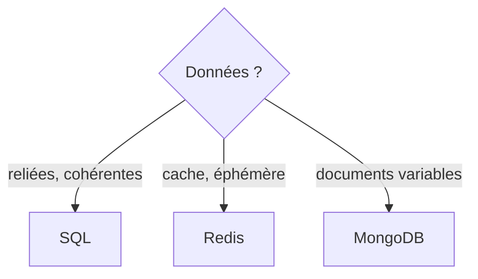

# Base NoSQL

> [!info] En une phrase
> NoSQL désigne les bases qui ne rangent pas les données en tables reliées : documents JSON (MongoDB), clé-valeur (Redis), colonnes ou graphes, chacune adaptée à un usage.

## 1 · Comprendre
### Définition
| Famille | Exemple | Stocke | Bon pour |
| --- | --- | --- | --- |
| Document | MongoDB | des documents JSON | données de forme variable |
| Clé-valeur | **Redis** | `clé → valeur`, en mémoire | cache, sessions, files d'attente |
| Colonnes | Cassandra | énormes volumes distribués | journaux, capteurs |
| Graphe | Neo4j | nœuds et relations | réseaux, recommandations |
Elles sacrifient souvent les jointures et une partie des garanties [[Transaction|ACID]] pour la souplesse ou la vitesse.

### Pourquoi ça existe
Certains besoins (cache ultra-rapide, documents sans schéma fixe, volumes énormes) collent mal aux tables relationnelles.

### Le problème résolu
Choisir l'outil adapté au lieu de tout forcer dans une base SQL, ou l'inverse.

## 2 · Explorer
### Comment ça fonctionne


### Exemple concret
```bash
docker run -d --name redis -p 6379:6379 redis:7
docker exec -it redis redis-cli
> SET session:abc "oumar" EX 3600
> GET session:abc
"oumar"
> TTL session:abc
(integer) 3598
```
Beaucoup d'applications utilisent PostgreSQL pour leurs données **et** Redis pour leurs files de tâches et leur cache.

### Cas d'utilisation
- Cache devant une API lente
- Sessions d'utilisateurs
- File de tâches en arrière-plan

> [!warning] À ne pas confondre
> « NoSQL » ne veut pas dire « plus moderne » ni « sans structure » : pour des données reliées qui doivent rester cohérentes, une base relationnelle reste le choix par défaut.

## 3 · Relier
- **Prérequis** : [[Base de données relationnelle]] · [[JSON]]
- **Complémentaires** : [[Docker]]
