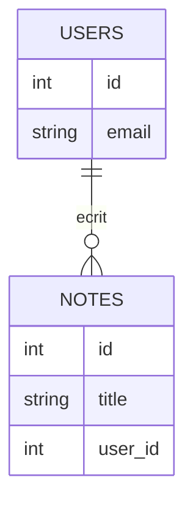

# Base de données relationnelle

> [!info] En une phrase
> Un système qui stocke les données dans des tables liées entre elles (utilisateurs, notes…).

```dataviewjs
await dv.view("10 — Templates/Scripts/learning", { view: "concept" })
```

## 1 · Comprendre
### Définition
Les données sont rangées en **tables** (colonnes typées, une ligne par enregistrement). Chaque ligne a une **clé primaire** ; une **clé étrangère** relie une table à une autre (`notes.user_id → users.id`). Exemples : PostgreSQL, MySQL, SQLite.

## 2 · Explorer
### Comment ça fonctionne


> [!warning] À ne pas confondre
> **Relationnelle** (tables + SQL) et **NoSQL** (documents, clé-valeur… comme MongoDB).

## 3 · Pratiquer

### Exercice visuel

Sur Excalidraw, **sans regarder la fiche**. Puis je compare avec la fiche, je corrige en rouge ce qui était faux, et j'explique mon dessin à voix haute ou à Claude dans le chat.

> [!example] 🧠 Dessine de mémoire
> Dessine les tables de ton application (depenses, et une table categories si tu la séparais) avec leurs colonnes et le lien entre elles.

> [!example] ⚖️ Avant / après
> Avant / après : les dépenses dans un fichier JSON, puis dans SQLite. Dessine ce que la base apporte quand deux requêtes écrivent en même temps.

### Mon schéma

> [!tip] Mon dessin Excalidraw
> _Je crée le dessin « Schéma - Base de données relationnelle » et je l'intègre ici avec `![[Schéma - Base de données relationnelle.excalidraw]]`, puis je coche `schema`._

### Appliquer dans le fil rouge
- Pas encore d'étape du fil rouge pour cette notion : elle sera pratiquée dans le fil rouge de son niveau (voir [[Niveaux]]).

## 4 · Relier
- **Mène à** : [[SQL]]
- **Fiche** : [[Fiche - Lancer PostgreSQL avec Docker]]

## 5 · Réviser
> [!question] Me faire interroger
> Je demande à Claude de m'interroger sur cette notion pour vérifier que je l'ai comprise.

### Validation de la maîtrise
Trois cases à cocher dans les propriétés de la fiche :
- `schema` : mon dessin du concept est dans « Mon schéma » ;
- `exercice_visuel` : j'ai fait et corrigé les exercices visuels de la section 3 ;
- `fil_rouge` : je l'ai appliqué dans le fil rouge (coché tout seul quand une étape qui l'utilise est réussie).

Les trois cochées : la notion compte comme **comprise**. **Maîtrisé** : c'est moi qui le mets dans `status`, quand je le sens.

```dataviewjs
await dv.view("10 — Templates/Scripts/learning", { view: "maitrise" })
```
