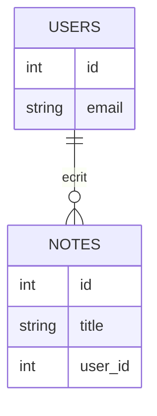

# Base de données relationnelle

> [!info] En une phrase
> Un système qui stocke les données dans des tables liées entre elles (utilisateurs, notes…).

```dataviewjs
await dv.view("10 — Templates/Scripts/learning", { view: "concept" })
```

## 1 · Comprendre
### Définition
Les données sont rangées en **tables** (colonnes typées, une ligne par enregistrement). Chaque ligne a une **clé primaire** ; une **clé étrangère** relie une table à une autre (`notes.user_id → users.id`). Exemples : PostgreSQL, MySQL, SQLite.

## 2 · Explorer
### Comment ça fonctionne


> [!warning] À ne pas confondre
> **Relationnelle** (tables + SQL) et **NoSQL** (documents, clé-valeur… comme MongoDB).

## 3 · Pratiquer
- Les exercices de cette notion sont listés en haut de la fiche et dans *Validation de la maîtrise*.

## 4 · Expliquer
> [!quote] Mon résumé, avec mes mots
> _À écrire sans regarder la fiche. Si je bloque, je ne l'ai pas encore compris._

## 5 · Relier
- **Mène à** : [[SQL]]
- **Fiche** : [[Fiche - Lancer PostgreSQL avec Docker]]

## 6 · Réviser
> [!question] Me faire interroger
> Je demande à Claude de m'interroger sur cette notion pour vérifier que je l'ai comprise.

### Validation de la maîtrise
La notion est maîtrisée quand j'ai réussi **tous les exercices** qui l'utilisent (statut `reussi` dans l'exercice).

```dataviewjs
await dv.view("10 — Templates/Scripts/learning", { view: "maitrise" })
```
