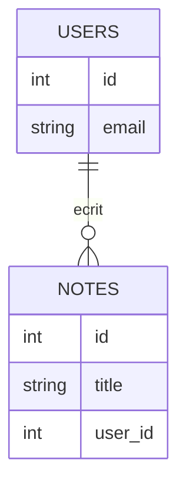

# Base de données relationnelle

> [!info] En une phrase
> Un système qui stocke les données dans des tables liées entre elles (utilisateurs, notes…).

```dataviewjs
await dv.view("10 — Templates/Scripts/learning", { view: "concept" })
```

## 1 · Comprendre
### Définition
Les données sont rangées en **tables** (colonnes typées, une ligne par enregistrement). Chaque ligne a une **clé primaire** ; une **clé étrangère** relie une table à une autre (`notes.user_id → users.id`). Exemples : PostgreSQL, MySQL, SQLite.

## 2 · Explorer
### Comment ça fonctionne


> [!warning] À ne pas confondre
> **Relationnelle** (tables + SQL) et **NoSQL** (documents, clé-valeur… comme MongoDB).

## 3 · Pratiquer

### Exercice visuel

Sur Excalidraw, **sans regarder la fiche**. Puis je compare avec la fiche, je corrige en rouge ce qui était faux, et j'explique mon dessin avec mes mots (section 4).

> [!example] 🧠 Dessine de mémoire
> Dessine les tables de MesDépenses (depenses, et une table categories si tu la séparais) avec leurs colonnes et le lien entre elles.

> [!example] ⚖️ Avant / après
> Avant / après : les dépenses dans un fichier JSON, puis dans SQLite. Dessine ce que la base apporte quand deux requêtes écrivent en même temps.

### Mon schéma

> [!tip] Mon dessin Excalidraw
> _Je crée le dessin « Schéma - Base de données relationnelle » et je l'intègre ici avec `![[Schéma - Base de données relationnelle.excalidraw]]`._

### Appliquer dans le fil rouge
- Pas encore d'étape du fil rouge pour cette notion : je l'applique dans mon travail (CVAT, Nuclio) ou je demande une étape à Claude.

## 4 · Expliquer
> [!quote] Mon résumé, avec mes mots
> _J'explique mon schéma avec mes mots, sans regarder la fiche. Si je bloque, je ne l'ai pas encore compris._

## 5 · Relier
- **Mène à** : [[SQL]]
- **Fiche** : [[Fiche - Lancer PostgreSQL avec Docker]]

## 6 · Réviser
> [!question] Me faire interroger
> Je demande à Claude de m'interroger sur cette notion pour vérifier que je l'ai comprise.

### Validation de la maîtrise
La notion est maîtrisée quand je sais :
1. **l'expliquer** de façon fluide, à partir de mon schéma (section 4) ;
2. **l'adapter** à un autre contexte (consigne « Change de contexte », ou Claude m'interroge sur un autre cas) ;
3. **l'appliquer** pour de vrai dans le fil rouge (section 3).

Réussir un exercice ne suffit pas. C'est moi qui passe le statut en `maitrise`.

```dataviewjs
await dv.view("10 — Templates/Scripts/learning", { view: "maitrise" })
```
