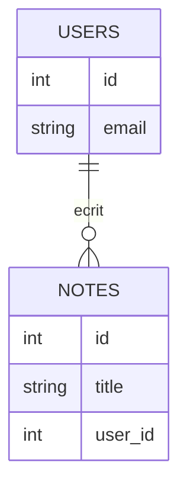

# Base de données relationnelle

> [!info] En une phrase
> Un système qui stocke les données dans des tables liées entre elles (utilisateurs, notes…).

## 1 · Comprendre
### Définition
Les données sont rangées en **tables** (colonnes typées, une ligne par enregistrement). Chaque ligne a une **clé primaire** ; une **clé étrangère** relie une table à une autre (`notes.user_id → users.id`). Exemples : PostgreSQL, MySQL, SQLite.

## 2 · Explorer
### Comment ça fonctionne

> [!warning] À ne pas confondre
> **Relationnelle** (tables + SQL) et **NoSQL** (documents, clé-valeur… comme MongoDB).

## 3 · Relier
- **Mène à** : [[SQL]]
- **Fiche** : [[Fiche - Lancer PostgreSQL avec Docker]]
