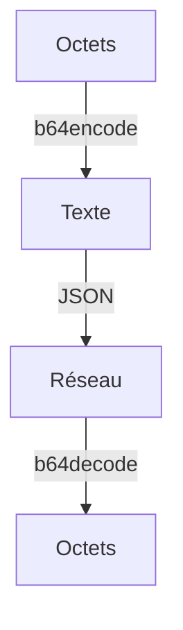

# Base64

> [!info] En une phrase
> Base64 transforme n'importe quels octets (une image, un zip) en texte simple, pour pouvoir les mettre là où seul du texte est accepté, comme dans du JSON.

```dataviewjs
await dv.view("10 — Templates/Scripts/learning", { view: "concept" })
```

## 1 · Comprendre
### Définition
Base64 réécrit les octets avec seulement 64 caractères sans danger : `A-Z`, `a-z`, `0-9`, `+` et `/` (plus `=` pour compléter la fin). Ce n'est **ni** une compression **ni** un chiffrement : n'importe qui peut décoder, et le résultat est environ **un tiers plus gros**.

### Pourquoi ça existe
JSON, YAML, une URL ou un e-mail ne transportent que du texte. Des octets d'image au milieu casseraient le format.

### Le problème résolu
Envoyer une image **avec** d'autres informations dans un seul JSON : `{"image": "iVBORw0KGgo...", "seuil": 0.5}`. C'est ce que fait CVAT avec ses fonctions Nuclio de détection : il leur envoie l'image en base64 dans le corps JSON.

## 2 · Explorer
### Comment ça fonctionne


### Exemple concret
```python
import base64
import json

with open("plan.png", "rb") as f:
    octets = f.read()

texte = base64.b64encode(octets).decode("ascii")   # bytes → bytes base64 → str
corps = json.dumps({"image": texte})                # maintenant, JSON l'accepte

# De l'autre côté
recu = json.loads(corps)
octets_retrouves = base64.b64decode(recu["image"])
print(octets_retrouves == octets)                   # True
```

### Cas d'utilisation
- Envoyer une image dans un corps JSON (fonctions Nuclio de CVAT)
- Afficher une image directement dans une page : ``
- Écrire un fichier dans une variable de CI ou un secret Kubernetes

> [!warning] À ne pas confondre
> - `base64.b64encode()` renvoie des **bytes** (`b"iVBOR..."`), pas un `str`. `json.dumps` les refuse : `TypeError: Object of type bytes is not JSON serializable`. Il faut `.decode("ascii")`.
> - Base64 ne cache rien : ce n'est pas une protection (une authentification « Basic » ([[Authentification]]) en base64 se lit en une commande).
> - Quand on peut envoyer le fichier tel quel (corps brut ou multipart), c'est plus léger que base64.

## 3 · Pratiquer
- [[Envoi 05 - Une image dans du JSON]]

## 4 · Expliquer
> [!quote] Mon résumé, avec mes mots
> _À écrire sans regarder la fiche. Si je bloque, je ne l'ai pas encore compris._

## 5 · Relier
- **Prérequis** : [[Binaire et octet]] · [[JSON]]
- **Complémentaires** : [[Encodage des caractères]] · [[Envoyer et recevoir un fichier en HTTP]] · [[Fichier en mémoire (io.BytesIO)]]
- **Utilisé par** : [[Cours - Envoyer et recevoir des fichiers par HTTP]] · [[Serverless et FaaS]]

## 6 · Réviser
> [!question] Me faire interroger
> Je demande à Claude de m'interroger sur cette notion pour vérifier que je l'ai comprise.

### Validation de la maîtrise
La notion est maîtrisée quand j'ai réussi **tous les exercices** qui l'utilisent (statut `reussi` dans l'exercice).

```dataviewjs
await dv.view("10 — Templates/Scripts/learning", { view: "maitrise" })
```
